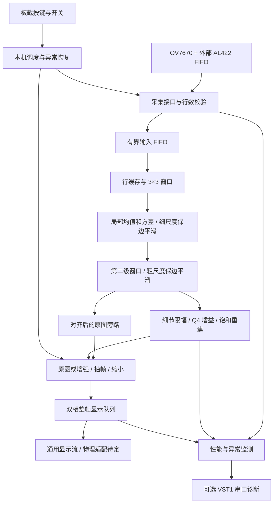

# 独立视觉架构

[返回项目首页](../README.md) · [开发与验证](开发与验证.md) · [验证证据](../evidence/regression_20261023_vision/README.md)

按照提供的系统流程图实现，摄像头沿用 Basys 3 + OV7670/AL422B，显示硬件待定。当前交付是可仿真的 `vision_top` 平台核心与通用显示流接口；完整板级显示、电源分配、Flash 启动和实板验收仍待完成。原 `stream_top` 串口 Demo 保留，两个顶层的开关表和协议分别定义。

## 流程图与实现



| 流程图节点 | 当前实现 | 边界 |
|---|---|---|
| 本机控制与异常恢复 | [vision_top.sv](../rtl/vision_top.sv) | 无需 PC 启动或应答，逐帧锁存参数；采集超时、配置重试和处理看门狗 |
| 摄像头采集、行帧校验 | [camera_frontend.sv](../rtl/camera_frontend.sv)、原 fifo_capture/camera_monitor | 复用 SCCB 配置、读回与外部 FIFO；强制校验 HREF 行数 |
| 跨时钟域、有界输入 FIFO | 外部 AL422 + [pixel_fifo.sv](../rtl/pixel_fifo.sv) | 摄像头时钟域转换由 AL422 完成；片内 FIFO 为 100 MHz 同步 FIFO，默认 16 项 |
| 行缓存与窗口 | [window3x3.sv](../rtl/window3x3.sv) | 三个轮转行 RAM；数据 RAM 不复位，连续输入每拍一像素 |
| 局部统计、保边滤波与尺度分解 | [edge_preserve9.sv](../rtl/edge_preserve9.sv)、[enhance_core.sv](../rtl/enhance_core.sv) | 两级 3×3，均值和方差决定平滑强度，尺度数量固定为两级 |
| 细节提取、增益与限幅 | enhance_core | 有符号定点乘加、细节限幅、输出饱和到 0…255 |
| 原图旁路、抽帧与缩小 | vision_top | 原图与增强共用裁剪坐标；不绕过处理调度 |
| 显示队列与接口控制 | [display_frame_queue.sv](../rtl/display_frame_queue.sv) | 两个完整帧槽，只发布完整帧；物理显示驱动与时钟转换待定 |
| 性能、异常、可选 PC | vision_top、[vision_status_tx.sv](../rtl/vision_status_tx.sv)、[vision_status.py](../pc/vision_status.py) | 计数器、处理帧率与延迟；PC 只读取状态，不参与算法 |
| 独立电源与板载 Flash | 硬件集成阶段 | 尚未设计最终电源网络、生成配置镜像或验证掉电启动 |

这里的行帧校验包括 VSYNC 超时、HREF 行数及固定数量 FIFO 读取。当前接口没有直接引入摄像头 PCLK，无法独立测量每行像素时序；最终上板仍需确认模组时序、信号电平、上拉及图像质量。`camera_monitor` 的模块定义暂与原 `stream_top.sv` 同文件，构建时应收录全部 RTL。

## 双尺度整数算法

输入为 320×240 的 8 bit 灰度像素。每级窗口裁去一圈，最终输出 **316×236**，其原始传感器坐标为 x=2…317、y=2…237。原图显示同样取这些坐标，便于逐像素比较。

对每个 3×3 窗口，设像素和为 S、平方和为 Q、中心为 C：

```text
M = floor(S / 9)
V81 = 9*Q - S*S                 # 等于总体方差的 81 倍
B = M                           当 V81 <= 81*epsilon
    floor((C + M) / 2)          当 V81 <= 324*epsilon
    floor((3*C + M) / 4)        其他情况
```

第一层 epsilon=64，得到细尺度基底 F；对 F 再用 epsilon=256 做第二层，得到粗尺度基底 B。这是方差自适应的量化保边平滑，没有实现完整双边滤波或导向滤波求解器。低方差区域更接近局部均值，高方差区域更多保留中心值。

```text
Df = clamp(raw - F, -limit, limit)
Dc = clamp(F - B, -limit, limit)
output = clamp(B + floor((fine_gain*Df + coarse_gain*Dc)/16), 0, 255)
```

增益为无符号 8 bit Q4（16 表示 1.0），乘积采用 20 bit 有符号数，重建采用 24 bit 有符号数；负值右移按向下取整处理。窗口、统计和重建流水线可接收每拍一像素，图像边界存在裁剪空拍；实际整机帧率仍受摄像头、AL422 读取周期和采集调度限制。

[独立参考模型](../pc/enhancement_reference.py)按完整图像计算结果，与 RTL 流水线分别实现。测试包括常量、棋盘格、斜坡、阶跃、最大增益、限幅、连续像素、输入空拍、帧中改参数和中途重启。

## 显示接口与队列

显示适配器与 `vision_top` 在同一个 `clk100` 域握手：当 `display_valid && display_ready` 时接受一个像素。阻塞期间像素及元数据保持稳定。

| 信号 | 含义 |
|---|---|
| display_pixel | 8 bit 灰度像素 |
| display_sof / display_eol / display_eof | 当前有效像素为帧首、行尾、帧尾 |
| display_frame_id | 采集尝试的序号，允许因异常、抽帧或队列满而跳号 |
| display_processed | 1 为增强图，0 为同坐标原图 |
| display_width / display_height | 当前接口尺寸，帧内不变 |

`DISPLAY_SCALE` 默认 1；仿真覆盖 1、2、4。尺寸为 `ceil((W-4)/scale) × ceil((H-4)/scale)`，从传感器坐标 (2,2) 开始做等间距点采样，不做抗混叠插值。软件控制另可选择每 1/2/4/8 个成功处理帧显示一次；改变倍率时重新开始抽帧相位。

队列预留两个完整帧槽，只有像素数量和 EOF 都正确才提交。显示端断开或阻塞时，队列满后丢弃新帧，采集处理继续；异常帧释放未提交槽，不会显示半帧。缩小时最后一个选中像素会等到整个处理帧 EOF 才提交，以覆盖未被采样的尾部输入。读槽在最后一个像素真正被接受后释放。

最终显示适配器需要完成屏幕协议、引脚、灰度到屏幕色彩格式转换，以及必要的时钟域转换。不能把该握手接口直接当成 VGA、HDMI 或 LCD 电气信号。

## 本机操作

以下仅适用于 **vision_top**，原串口 Demo 的定义见[原使用手册](使用手册.md)。所有参数在下一帧开始前锁存。

| 控制 | 定义 |
|---|---|
| BTNC | 核心、计数器和摄像头重新初始化 |
| SW0 | 0 摄像头，1 内部测试图 |
| SW1 | 0 原图，1 增强图 |
| SW3:2 | 00/01/10/11 → 细尺度增益 16/24/32/48（Q4） |
| SW5:4 | 00/01/10/11 → 粗尺度增益 16/20/24/32（Q4） |
| SW7:6 | 00/01/10/11 → 细节限幅 16/32/64/255 |
| SW9:8 | 00/01/10/11 → 每 1/2/4/8 个成功处理帧显示一次 |
| SW10 | 1 开启每秒一次 VST1 状态发送；0 时 UART 保持空闲 |
| SW13:11 | 保留 |
| SW14 | 1 显示诊断 LED 页，0 正常状态页 |
| SW15 | 1 暂停发起新采集；当前处理和显示排空仍可继续 |

例如初次板级集成可用 SW0=1、SW1=1，其余置 0，从内部图验证屏幕；摄像头配置失败不会阻止内部图运行。摄像头仍需完成现有 SCCB/AL422 接线与初始化。

正常 LED 页：15 为摄像头/处理异常，14:7 为帧号低 8 bit，6 为心跳，5 为增强模式，4 为内部图模式，3 为状态发送忙，2 为采集忙，1 为配置完成，0 为复位已释放。诊断页：15:8 为 HREF 行数低 8 bit，7:6 为显示槽占用，5 为输入溢出脉冲，4 为显示帧错误脉冲，3 为配置故障，2 为采集错误脉冲，1/0 同正常页。

## 监测与可选 PC 诊断

`processed_frames` 在增强流水线 EOF 增加，`displayed_frames` 在显示 EOF 握手完成后增加，两者独立。`display_dropped` 计数因队列满被拒绝的帧，`display_skipped` 计数按显示抽帧策略跳过的成功处理帧。异常分别记录在 `capture_errors`、`line_errors`、`input_overflows`、`processing_errors`、`display_errors`，32 bit 计数器自然回绕。

`processing_fps` 是前一个 100,000,000 拍窗口内的处理完成帧数，不是显示帧率。`last_latency_cycles` 从处理 SOF 到最终输出像素，包含输入像素间隙，不含等待摄像头 VSYNC 与显示队列排空；在 100 MHz 下乘 10 ns 得到时间。默认处理看门狗为 20,000,000 拍，超时中止当前帧并恢复下一次采集。

SW10 开启后，可使用现有 USB UART 读取状态，正常运行无需 PC：

```powershell
python -m pip install -r pc/requirements.txt
python pc/vision_status.py --port COM10 --baud 1000000 --out status_logs --reconnect 2
```

VST1 为固定 58 字节小端包，与原 FPG1 图像协议独立：

| 字节 | 内容 |
|---|---|
| 0…3 | ASCII VST1 |
| 4 | 版本 1 |
| 5 | 标志：bit0 配置完成、bit1 摄像头故障、bit2 暂停请求、bit3 内部图 |
| 6…7 | 总长度 58 |
| 8…55 | 12 个 uint32，顺序见下方 |
| 56…57 | CRC16/CCITT-FALSE，覆盖字节 4…55，低字节在前 |

计数器顺序：`frame_id, processed_frames, displayed_frames, display_dropped, display_skipped, capture_errors, line_errors, input_overflows, processing_errors, display_errors, processing_fps, last_latency_cycles`。发送开始时锁存快照，UART 阻塞或 PC 缺席不反馈到采集/处理。解析器校验版本、保留位、长度和 CRC，文件输出使用新序号，已有日志不覆盖。

## 资源预算与硬件完成条件

选择两级尺度及双槽队列以控制存储用量。默认尺寸下，显示像素 RAM 为 `2×316×236 = 149,152` 字节，窗口 RAM 为 `3×320 + 3×318×2 = 2,868` 字节，合计 **152,020 字节**，另有小 FIFO 和寄存器。这只是逻辑数据量，实际 RAM 块会有端口和深度取整开销，不能代替综合资源报告。

Basys 3 的器件资源与供电、配置 Flash 功能以 [Digilent 官方手册](https://digilent.com/reference/_media/basys3%3Abasys3_rm.pdf)为准。`scripts/synth_vision.tcl` 默认约束为 45 个 BRAM36 等效块、72 个 DSP、18,000 个 LUT，为最终显示适配预留空间；预算检查统计 RAMB36+RAMB18/2，超出后停止，且不允许把限制设置到器件容量以上。

该脚本仅独立综合核心，使用 `constraints/vision_ooc.xdc` 的 100 MHz 时钟；没有指定物理显示引脚。当前只验证了 Tcl 语法和预算分支，**尚未进行真实综合、实现、时序收敛与新 bit 生成**。原 `scripts/build.tcl` 仍构建 `stream_top`，不能用其历史报告证明新架构已通过实现。

硬件完成需依次落实显示模组选型及电源/电平预算，制作最终板级顶层与约束，通过综合和布局布线时序，上板验证摄像头与显示故障恢复，再烧写配置 Flash 并验证脱离 PC 的冷启动。独立电源应按开发板、摄像头与最终显示模组规格设计；本次没有执行供电改线或 Flash 烧写。

## 本轮验证范围

截至 2026-10-23，86 项 Python 测试（PC 70、脚本 16）通过；20 组 RTL 仿真通过。增强核心独立模型比对 **223,828** 个输出像素；顶层摄像头、原图/增强、1/2/4 缩小路径比对 **67** 个像素。8 组实际 UART 字节流经 PC 命令行解码通过，其中 7 组 FPG1 共 39 包，1 组 VST1 共 2 包。

顶层还验证了 PC 缺席、显示端长期阻塞、整帧丢弃、开关帧内变化、SCCB 真正引脚应答和重试、AL422 读引脚模型、HREF 行数拒绝、VSYNC 超时、处理看门狗、抽帧倍率、暂停和复位。测试使用缩小的顶层图像与缩短的等待参数；增强核心另外覆盖完整 QVGA。以上均为仿真和离线测试，未连接真实摄像头、屏幕或串口硬件。
