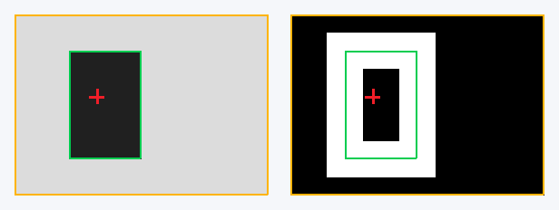

# ROI单目标定位迭代记录

日期：2026-10-19。基于2026-10-17可靠性迭代，继续使用Basys 3 + OV7670_FIFO与320×240输入。

## 本轮结果

新增ROI内暗/亮目标阈值统计，输出目标是否有效、面积、包围框与坐标累加和。PC计算并显示目标中心；灰度/Sobel和旧FPG1 v1流继续可用。定位是可选模式，默认SW2=0保持原模式。

统计模块直接处理原始像素流，与image_core并行运行，不增加行缓存或帧缓存。FPGA传送Sx/Sy，PC用整数除法计算中心，避免增加硬件除法器。模式、极性与亮度阈值在帧间锁存，面积与ROI在模块帧开始时锁存。

该算法面向受控背景中的单目标；ROI内所有符合阈值的区域会合并统计。目标面积不满足范围时，原始面积/累加保留，目标框和中心在PC端隐藏。无效ROI配置产生明确的配置无效状态。

## 操作方式

需要用当前全部RTL重新生成bit；原包的预编译bit仍为历史版本。已有Vivado工程应加入 `rtl/target_stats.sv`，新建工程脚本会自动加入。

| 控制 | 设置 |
|---|---|
| SW0 | 1内部测试图，0摄像头 |
| SW1 | 0灰度，1 Sobel |
| SW2 | 0旧图像模式/v1，1 ROI定位/v2 |
| SW3 | 0暗目标，1亮目标 |
| SW9:8 | 00阈值96，01阈值64，10阈值128，11阈值160 |
| SW7:4 | 原Sobel阈值选择，和目标亮度阈值独立 |

顶层ROI参数默认覆盖原坐标 `(1,1)..(318,238)`；`TARGET_MIN_AREA=16`，`TARGET_MAX_AREA=37842`。ROI端点包含在内；修改这些参数后重新构建。显示图像裁去一圈边界，PC叠加坐标统一减1，JSON记录原图坐标。

新版PC接收器支持 `--display`：黄色ROI、绿色目标框、红色中心，缺少目标时显示“No target”。显示依赖可选的opencv-python，离线文件回放与测试只需标准库。原始PGM不叠加标记；JSON包含完整target对象，CSV平铺目标字段。已有旧CSV保持原样，新schema写到独立的 `metadata_v2.csv`。

## 仿真预览



左为暗目标灰度，右为亮目标Sobel。此图根据14×10顶层UART仿真输出的PGM/JSON绘制并放大，供观察坐标关系；它不是实拍或实板精度证据。

两帧均得到面积24、原图包围框 `(4,3)..(7,8)`、原图整数中心 `(5,5)`，显示中心为 `(4,4)`。暗目标帧的旧亮像素质心为 `(7,5)`，与目标中心分开记录，说明定位不再把亮背景当作目标。

## 协议与兼容性

FPG1 v1保持32字节头；启用定位后发送v2，头部72字节，多出的40字节包含ROI、目标框、面积、坐标和及有效性。CRC仍覆盖magic之后的头和图像。新增40字节在1 Mbps、8N1下只增加约0.4 ms线路时间。

接收器兼容v1、v2及混合流，检查配置、面积、框、累加与有效标志是否自洽。旧接收器只支持v1，启用新定位功能时要同时使用新版PC程序。完整字节布局和RTL接口见 `定位协议_FPG1v2.md`。

目标结果当前仍随整帧图像发送。原有1 Mbps UART、输出整帧缓存及500 ms帧间等待继续决定刷新速度；本轮增加定位能力，尚没有将目标结果与图像预览独立调度。

## 验证结果

| 范围 | 本轮结果 |
|---|---|
| Python | 最终PC21项、测试入口12项，共33项通过 |
| 完整RTL回归 | 10组通过，包含原7组及target_stats、target_transport、top_target |
| 图像算法回归 | 320×240、12帧灰度/Sobel逐像素及统计参考对比通过 |
| 目标统计 | 小图23帧通过：暗/亮、ROI干扰排除、阈值边界、面积过滤、无效配置、帧中配置变动、复位、中止、额外输入与done时序 |
| 默认尺寸统计 | 320×240专项2帧通过，覆盖最后有效点及全ROI匹配；全ROI面积75684、Sx=12071598、Sy=9044238 |
| UART到PC | 旧发送器2帧、新发送器6帧、顶层4帧均正确解码保存，拒绝候选数为0 |
| 顶层切换 | 旧模式→暗目标→亮目标/Sobel→旧模式；采集中改变开关，头与整帧像素保持当前帧配置 |
| PC几何检查 | 穷举3×3 ROI的511种非空真实像素集合，合法统计全部接受；坏包、截断、混合流和CSV兼容通过 |

日志、UART原始字节流、解码PGM/JSON/CSV和预览放在 `evidence/regression_20261019/`。工具沿用上一轮已校验的便携Icarus Verilog 13.0，不修改系统PATH。

本轮没有执行Vivado综合、布局布线、新bit生成或上板。预编译bit及其历史资源/时序报告保持原样；新模块的资源占用、时序、真实镜头场景精度及长期稳定性，需在后续综合和实板验收中测量。

## 文件入口与复现

主要代码：`rtl/target_stats.sv`、`rtl/stream_top.sv`、`rtl/frame_sender.sv`、`pc/receiver.py`。新测试：`sim/tb_target_stats.sv`、`sim/tb_target_transport.sv`、`sim/tb_top_target.sv`。测试入口会自动交叉校验三个RTL字节流。

```text
python scripts/run_tests.py --python-only
python scripts/run_tests.py --simulator iverilog --iverilog-bin "你的Icarus安装目录/bin"
python scripts/run_tests.py --vivado-bin "你的Vivado安装目录/bin"
python pc/receiver.py --input evidence/regression_20261019/full/verify_top_target/top_target_wire.bin --count 4 --out replay_frames
python scripts/check_delivery.py
```

下一阶段先做上板定位验收：固定与移动目标、无目标、背景干扰、ROI边缘及阈值扫描，记录定位偏差与误检。随后将目标结果和图像预览分流、增加1 bit边缘打包及可配置帧间等待，以减少结果回传延迟。
