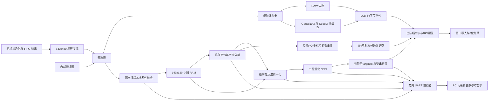

# 当前工程架构与数据所有权

本页描述发布版40个RTL模块的连接、数据所有权与调度机制。系统以行缓存处理视频，以单份灰度小图完成板端识别；显示和旁路观察通过事件接口取得结果。算法细节见[算法原理](algorithm_principles.md)，当前实现与实机结果见[当前验证](current_validation.md)。

## 系统分层与主数据流

图中分支表示连接关系，不表示所有阶段同时运行。定位与分割串行读小图，分割后逐字符执行归一化和 CNN；视频显示可独立继续。自主识别全过程不需要 PC 下发每帧 ROI/字符任务，PC 观察端只记录和复核；人工回放模式则由 PC 上传小图和请求，不能混为同一种自主证据。关键连接见 [lcd_top.sv](../../project/rtl/top/lcd_top.sv)。

| 目录 | 职责 | 主要源码 |
|---|---|---|
| rtl/top | 开关译码、顶层连接、源帧接纳、状态汇总 | [lcd_top.sv](../../project/rtl/top/lcd_top.sv)、[display_mode_control.sv](../../project/rtl/top/display_mode_control.sv) |
| rtl/drivers/camera | 相机启动、寄存器初始化、外部 FIFO 读写控制和同步过滤 | [camera_startup.sv](../../project/rtl/drivers/camera/camera_startup.sv)、[camera_fifo_video.sv](../../project/rtl/drivers/camera/camera_fifo_video.sv) |
| rtl/drivers/display | LCD 初始化、窗口命令、RGB565字传输、8位总线波形 | [nt35510_init.sv](../../project/rtl/drivers/display/nt35510_init.sv)、[nt35510_window_writer.sv](../../project/rtl/drivers/display/nt35510_window_writer.sv)、[nt35510_bus8.sv](../../project/rtl/drivers/display/nt35510_bus8.sv) |
| rtl/drivers/uart | 纯字节收发 | [uart_fast_rx.sv](../../project/rtl/drivers/uart/uart_fast_rx.sv)、[uart_fast_tx.sv](../../project/rtl/drivers/uart/uart_fast_tx.sv) |
| rtl/video | 行缓存图像计算、显示接收、叠字与故障锁存 | [edge_core.sv](../../project/rtl/video/edge_core.sv)、[video_lcd_sink.sv](../../project/rtl/video/video_lcd_sink.sv) |
| rtl/recognition | 小图采集控制、定位/分割、归一化、CNN和所有权 | [plate_recognition_subsystem.sv](../../project/rtl/recognition/plate_recognition_subsystem.sv) |
| rtl/debug | 测试图、旁路抓取、协议桥、手动回放入口 | [test_pattern_source.sv](../../project/rtl/debug/test_pattern_source.sv)、[plate_auto_uart.sv](../../project/rtl/debug/plate_auto_uart.sv)、[norm_uart_bridge.sv](../../project/rtl/debug/norm_uart_bridge.sv) |
| rtl/common | 无业务语义的整数除法等公共单元 | [u32_div.sv](../../project/rtl/common/u32_div.sv) |
| pc | 协议解码、采集、组帧、参考比较、命令入口 | 下文分别列出 |

驱动模块处理引脚、字节或像素，不应把 ROI、字符或 CNN 类别作为时序条件。紧密耦合的分割状态机仍作为一个算法工作单元，目录整理没有把其每个状态拆成独立模块。

## 模式与控制优先级

实体开关与 VIO 虚拟开关先按 debug_control[0] 选择，再经 sm/ss 同步。以下 SW 指同步后的 ss；按钮与虚拟复位经同步和 reset_hold 延展。见 [lcd_top.sv](../../project/rtl/top/lcd_top.sv)。

| SW4 | SW3 | display_mode | 视频背景 | 自主识别请求 |
|---:|---:|---:|---|---|
| 0 | 0 | 0 | RAW 640×480 | 关 |
| 0 | 1 | 1 | EDGE 630×470 | 关 |
| 1 | 0 | 2 | RAW 640×480 | 开 |
| 1 | 1 | 2 | RAW 640×480 | 开，优先于 EDGE |

译码公式 `recognition_enabled=SW4`、`edge_requested=SW3&&!SW4`，见 [display_mode_control.sv](../../project/rtl/top/display_mode_control.sv)。SW13 是人工回放，优先于 SW12；`pair_mode=!SW13&&SW12`。自主实际使能为 `recognition_enable&&!manual_mode&&!diagnostic_mode`，所以 SW4 并不覆盖人工/字节诊断的所有权。人工回放可以在任意显示模式独立使用。见 [lcd_top.sv](../../project/rtl/top/lcd_top.sv)、[plate_recognition_subsystem.sv](../../project/rtl/recognition/plate_recognition_subsystem.sv)。

SW5 经顶层传入 `white_characters`，只为自主OCR选择字符极性。子系统在接纳源帧时锁存该值，生成 `a_flags={active_white_characters,1'b0}`，供分割、归一化与遥测使用；定位器仍读取原灰度。人工模式继续使用上传的 `m_flags`。详见[白字支持](white_character_support.md)。

SW0 选择内部测试图；SW15 暂停接纳新视频帧。已经接纳的源帧仍应排空到显示端，而不是在像素中途撤销 start。SW1 参与相机配置场景，SW14 选择 LED 错误显示；这些保留功能应按运行说明操作，不能把图像内容用于自动猜测相机Y/UV字节交换。源选择与 frame admission 见 [lcd_top.sv](../../project/rtl/top/lcd_top.sv)。

## 视频时序：帧级接纳，像素级不反压

顶层只在初始化与显示 ready、无在途帧、相机/测试图不 busy、未暂停及错误条件允许时生成 start。active_internal、active_edge 随该帧锁存，避免帧中切换尺寸。识别使能变化另由识别子系统处理，不把旧任务所有权带进下一模式。

显示 sink 的 ready 是“能否接纳下一整帧”的握手；没有逐像素 ready 从 sink 回到 Gaussian/Sobel 数学核心。中间 64 字节队列用于吸收短暂的总线忙，不能无限吸收吞吐差。一旦源有效数据到来时队列满且本拍不出队，sink 置 error=0x10 进入 FAULT，而不是暂停上游或静默丢像素。坐标错误、过量像素、错误结束计数、写入端故障和输入源错误均分别报告。见 [video_lcd_sink.sv](../../project/rtl/video/video_lcd_sink.sv)。

RAW 直接输出 307200 像素；EDGE 保留既有每边5像素裁边，输出296100像素。显示模式改变时 sink 先撤销 ready、切换窗口并清背景，再接纳下一帧；不能把630×470数据装进640×480旧窗口。数学裁边原因见 [algorithm_principles.md](algorithm_principles.md)。LCD 面板参数800×480，RAW窗口水平居中，EDGE在此基础上各内缩5像素；这是写入窗口，不是图像插值放大。见 [video_lcd_sink.sv](../../project/rtl/video/video_lcd_sink.sv)。

LCD 路径将8位灰度复制截位到RGB565，经过窗口写入器和8位总线发送。当前顶层 BUS_SETUP/LOW/HOLD/GAP=2/2/2/0，这是当前参数，不是新测得LCD刷新率。队列入/出 CRC 比较的是叠字之前的像素；CRC相等不能证明屏幕实际发光内容正确。见 [lcd_top.sv](../../project/rtl/top/lcd_top.sv)、[video_lcd_sink.sv](../../project/rtl/video/video_lcd_sink.sv)。

## OCR 调度与单份小图所有权

[plate_auto_controller.sv](../../project/rtl/recognition/plate_auto_controller.sv) 的主序列为：

`IDLE → CAPTURE → CAP_DRAIN → SEG_LAUNCH/SEG_WAIT → [CHAR_PREP → NORM_LAUNCH/NORM_WAIT → CORE_LAUNCH/CORE_WAIT → CHAR_REPORT/CHAR_NEXT] → REPORT → RELEASE → IDLE`。

IDLE 接受 source_start 时记录 frame_id/capture_tick，校验完整 VGA 像素流并隔点写19200字节小图。采集完成后才运行定位/分割；从第一框开始逐个归一化，768个像素顺序写入CNN输入，归一化完整后启动CNN；36个分数完整后决定字符，最后发布整串。无框时直接发布零字符结果，不是源采集故障。

source_seq 对观察到的 source_start 递增；识别 busy 时的新 source_start 增加 skipped_frames，不覆盖当前帧，不建立待识别帧队列，也不要求视频等待。frame_id 指被本次OCR接纳的源帧，不是“每次识别都加1”的连续结果编号。见 [plate_auto_controller.sv](../../project/rtl/recognition/plate_auto_controller.sv)。

归一化模块内保存唯一的OCR原始小图。定位/分割期间 scan_active 持有同步读口，同时禁止上传写入与启动归一化；分割结束后归一化接管读口。人工模式与自主模式通过顶层mux独占 frame写口、ROI、normalize/segment/CNN启动及输入端。见 [char_normalizer.sv](../../project/rtl/recognition/char_normalizer.sv)、[plate_recognition_subsystem.sv](../../project/rtl/recognition/plate_recognition_subsystem.sv)。

模式向量为 `{auto_mode&&white_characters,recognition_enable,manual_mode,diagnostic_mode}`，变化触发 mode_changed、worker reset 与相应transport reset。退出识别、进入诊断或自主OCR中改变SW5均撤销旧任务并清除旧文字与ROI；不会把半幅人工上传或旧自主任务继续当作新任务。这里是中止识别任务；与视频侧“已经接纳帧排空”的规则不同，两个控制域不能用同一个“暂停”描述。

看门狗默认 capture/norm/core 各10000000周期，segment=100000000周期，在100MHz对应100ms/1s配置上限。这些是超时门限，**不是实测平均延迟**。故障结束当前识别任务、复位工作单元并发布状态，后续源帧可重新接纳。控制器还检查框地址/尺寸/数量、768像素地址顺序、36个类别索引集合。completed_frames 只统计 result_status=0，其中包括零字符结果，不等于真值识别成功帧。见 [plate_auto_controller.sv](../../project/rtl/recognition/plate_auto_controller.sv)。

## 存储：声明容量、有效负载与综合资源分开

以下按源码数组声明计算，不能相加后直接当作BRAM tile用量；工具映射、字宽、bank和调试开关影响物理资源。整机实测资源需查相应构建报告。

| 单元 | 源码数组/有效数据 | 声明容量或逻辑负载 | 生命周期 |
|---|---|---:|---|
| Gaussian 行RAM | 3×640×8bit | 1920字节 | 邻域滑动，不存整帧 |
| Sobel 行RAM | 3×632×16bit，灰度原值+平滑值 | 3792字节 | 邻域滑动 |
| LCD 队列 | 64×8bit | 64字节 | 短时弹性缓冲 |
| OCR 原小图 | 5×4096×8bit，使用地址0..19199 | 声明20480字节，有效19200字节 | 从采集到整帧识别释放 |
| 分割mask | 19200×1bit | 2400字节逻辑容量 | 当前ROI覆盖，洪泛消费 |
| 洪泛队列 | 10×2048×16bit | 声明40960字节，有效最多19200点/38400字节 | 每个连通域复用 |
| CNN激活RAM A/B | 各2048×8bit | 共4096字节 | 输入/池化层工作区复用 |
| CNN权重ROM | 32768×8bit，前28872字节权重 | 声明32768字节 | 冻结初始化 |
| CNN偏置 | 60×32bit | 240字节 | 冻结初始化 |
| UART观察FIFO | 2048×8bit，另有raw_pending[8] | 2048字节+8字节待发队列 | 尽力发布 |
| LCD_SNAPSHOT诊断概览 | 默认OVERVIEW为1，19200×16bit | 38400字节 | 调试抓图，独立于OCR小图 |

行RAM见 [row_window3.sv](../../project/rtl/video/row_window3.sv)；OCR RAM见 [char_normalizer.sv](../../project/rtl/recognition/char_normalizer.sv)；mask/队列见 [char_segmenter.sv](../../project/rtl/recognition/char_segmenter.sv)；CNN见 [cnn_core.sv](../../project/rtl/recognition/cnn_core.sv)、[cnn_weight_rom.sv](../../project/rtl/recognition/cnn_weight_rom.sv)；UART见 [plate_auto_uart.sv](../../project/rtl/debug/plate_auto_uart.sv)；snapshot见 [video_snapshot.sv](../../project/rtl/debug/video_snapshot.sv)。

此外还有候选框/输出框/排序工作区、归一化hist[256]及lut[256]、每字符分数、文本及协议寄存器，不能说上述表是全部存储。CNN即时池化使实际激活数组为4096字节；模型元数据12288字节为软件预算。完整系统还连接相机外部FIFO和LCD内部显示存储，因此“FPGA视频滤波无全VGA帧RAM”不等于“系统不存在帧存储”。调试snapshot也不可从整机资源统计中隐去。

## 结果显示与旁路遥测

结果以单拍event发布，没有屏幕ready回传。OSD保存最新完整结果，到视频帧边界再提交active_text；一帧内不会混用两份字符串。显示最多8字符，超长置more标记；上电/重开识别等待新结果，错误显示ERR，正常零字符显示NONE。关闭识别不会永久保留旧答案。OSD只在LCD队列出队后覆盖左上区域，不改变OCR输入和UART归一化/分数证据。见 [plate_text_overlay.sv](../../project/rtl/video/plate_text_overlay.sv)。

自主UART发送原小图、分割、字符patch/分数和结果事件；AIF1原图及其CRC仍基于原灰度，flags bit1说明分割/归一化采用反相读取，包格式保持兼容。使用内部FIFO与pending状态，任何拥塞只影响观测。无 ready 输出到识别控制器，publisher_dropped用于记录发布丢弃。PC未收全一组既可能是接入流时的残包，也可能是传输/发布丢失；必须保留 parser及组帧计数，不能把观测缺组静默当作算法通过或识别错误。见 [plate_auto_uart.sv](../../project/rtl/debug/plate_auto_uart.sv)、[plate_recognition_subsystem.sv](../../project/rtl/recognition/plate_recognition_subsystem.sv)。

UART引脚多路选择中人工SW13优先，否则SW12选择相机字节对诊断，否则输出自主通道；被诊断模式抑制时没有自主推理。旁路“不会反压”是连接/接口事实，不保证观测包永不丢失，也不保证无穷输入速率下显示正常。

## PC 模块划分与验证闭环

| 文件 | 职责与边界 |
|---|---|
| [auto_protocol.py](../../project/pc/auto_protocol.py) | wire包魔数/版本/长度/CRC及字段解码，不自行将残片认作完整识别结果 |
| [auto_capture.py](../../project/pc/auto_capture.py) | 串口或保存wire来源的数据采集，管理时间/字节流，不决定算法真值 |
| [auto_collect.py](../../project/pc/auto_collect.py) | 按epoch/frame_id组装，保存包记录和拒绝记录；原图raw.npy和arrays.npz由auto_verify.py保存，报告残缺/非法组 |
| [auto_verify.py](../../project/pc/auto_verify.py) | 以对应协议语义重算定位/分割/归一化/整数CNN，比较完整组 |
| [observe_auto.py](../../project/pc/observe_auto.py) | 命令参数、模型加载、调度采集与验证、输出summary |
| [plate_locator.py](../../project/pc/plate_locator.py)、[segment_ref.py](../../project/pc/segment_ref.py)、[norm_ref.py](../../project/pc/norm_ref.py)、[integer_cnn.py](../../project/pc/integer_cnn.py) | 可审查的PC数学参考；正确率评分与数值等价判断分离 |

保存wire回放可验证协议/组帧/整数参考，不等于重新验证当前相机引脚、LCD或新BIT。板端与PC相同输出可证实现一致，却可能同时认错真实文字。历史连续结果、非连续传输、空结果及离线新旧前端比较见 [validation_data.md](validation_data.md)。

## 性能和完成状态的陈述约束

视频帧起始率、LCD写入完成率、光学刷新率、OCR结果率、单字符CNN周期和串口有效字节率都不是同一个指标。单小图所有权和逐字符串行调度意味着OCR通常跳过源帧；保持视频不等识别是有意行为，不是丢失已承诺识别任务。v1.0基线按FPGA时间戳得到约22.51 fps源帧起始节拍及4.50–5.63 fps场景相关OCR结果节拍，具体版本与数据见[资源与时序](resource_and_timing.md)。

## 显示增量：实际定位框

当前`plate_roi_overlay`，由识别子系统旁路输出分割实际ROI，在LCD出队端绘制绿色2px框；不变更定位/CNN或读取时序。该框是最近结果而非同帧跟踪，规则和本轮验证见[区域框说明](roi_overlay_and_options.md)。该模块与文本覆盖共同构成当前显示反馈层。
