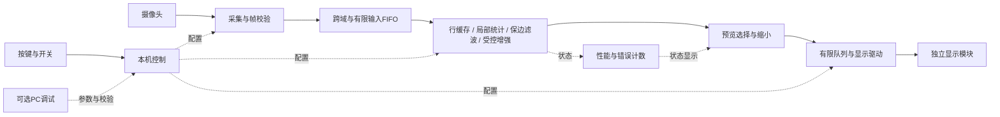

# 资源协同流式视频处理：开发交接说明

日期：2026-10-22。用途：交给团队与新对话，建立基础版本并持续迭代。

**状态：方向已确认，算法与硬件规模尚未冻结，新版RTL尚未实现。本文是最新方向的交接入口，不是已经验证的最终规格。**

## 1. 项目要做什么

在Basys 3上完成连续视频的保边降噪与细节增强。主要工作是协调片上存储、计算并行度、数据精度、访问带宽和流水时序，让有限资源支撑有实际画质收益的计算。最终设备独立供电、上电运行、按键控制、本机显示；PC仅作为开发、校验与可选调试工具。

算法以成熟方法为基础，当前优先考察引导滤波及多尺度细节处理。先把一个正确、可验证的基础版本做完整，再在同一架构下迭代到预期。用户允许存在技术难度，不要求刻意降低到入门实验水平。

| 原思路 | 已确认的新思路 |
|---|---|
| 保存几行，计算一个3×3算子 | 同时处理多个尺度、多种中间量或大量有效运算 |
| 优化后内存空闲 | 用节省的存储支持更大的有效计算任务 |
| 算法吞吐远大于实际输入需求 | 在真实数据率下，计算与存储调度都需要设计 |
| 输出快慢决定展示效果 | 算法质量、持续吞吐、延迟共同决定价值 |

必须避免把项目做成“高速生成边缘图的接口实验”。也不靠附加工件检测、分拣等应用，掩盖计算核心过轻的问题。Sobel可以保留为基线或诊断模式，不能继续承担核心亮点。

## 2. 用户要求与设计原则

- 资源平衡不是把所有资源用满。富余DSP可以换取较少复用和稳定吞吐；富余BRAM可以换取独立访问端口与简单控制；富余寄存器可以用于流水分级。每项资源开销要说明收益。
- 用户没有时间反复上板比较多个主方案。允许修代码、接线与调试，但应在上板前完成算法、数值、缓存、调度和时序论证，尽量避免中途架构重做。
- 不能承诺第一次上板成功，也不能未经综合就承诺全部功能、频率或帧率。应交付经过离线验证、内部一致的方案，而不是仅有框图。
- 优先模块化功能、统一核心时钟与接口约定；不为每个模块单独建立时钟域。
- 不用低效算法制造运算压力，不用“节约内存百分比”替代实际质量或能力提升。
- 比较必须公平：同算法、同输入、同位宽/误差要求、同显示条件；必要时分别报告算法改动和架构改动的贡献。
- 不以“全系统绝无帧存储”为口号。首版空域处理不依赖整帧中间图；若未来算法确需历史状态，必须明确讨论。屏内显示RAM不能参与算法计算。

## 3. 当前可复用基线：不要混同新方案

已验证旧工程：`E:/UESTC/FPGA/stream_image_demo`。`E:/UESTC/FPGA/FPGA_demo`不是本次确认的源码基线。

2026-10-22读取了旧工程README、RTL、XDC及既有资源报告；本次没有重新跑综合或上板。

| 项目 | 旧Demo实际状态 |
|---|---|
| 板卡 | Basys 3，XC7A35T CPG236，100 MHz板载时钟 |
| 摄像头 | GYF-198 OV7670_FIFO，AL422B，22针；已跑通旧采集方式 |
| 输入/输出尺寸 | 320×240输入；318×238灰度或Sobel输出 |
| 调度 | 按帧采集、读出处理、发送，再等待约500 ms |
| 处理核心 | 三行缓存；输入像素至少间隔4个系统时钟 |
| 其他限制 | `image_core.sv`声明W×H≤131072，输出地址17位；不能只改W/H升级VGA |
| 缓存 | 摄像头模块保存原始帧；FPGA保存75,684 B处理结果帧 |
| 传输 | UART默认1 Mbps，PC接收PGM；12 Mbaud未在此基线实现 |
| 既有实现报告 | LUT 863/20800；FF 1298/41600；BRAM 25.5/50；DSP 0/90 |

入口文件：

- `stream_image_demo/README_先读我.md`：复现、接线、开关与已知限制。
- `stream_image_demo/docs/开发与联调日志.txt`及同名PDF：历史事实与调试证据。
- `stream_image_demo/rtl/stream_top.sv`：整帧结果缓存、调度和顶层接口。
- `stream_image_demo/rtl/image_core.sv`：旧三行窗口与Sobel。
- `stream_image_demo/rtl/fifo_capture.sv`：当前FIFO采集方式。
- `stream_image_demo/constraints/basys3.xdc`：旧接线和旧时序约束。
- `stream_image_demo/scripts/`：工程创建、构建及回归脚本。
- `stream_image_demo/evidence/`：既有成像证据，可供回归；不能代替新算法数据集。

**保护旧Demo及其demo.zip。建议新版在 `E:/UESTC/FPGA/stream_video_enhance` 独立目录开发；该目录只是建议，本文未创建或实施新版。不要直接覆盖旧bit、日志和交付包。**

历史计划中工件缺损、一键学习、轮廓签名、ROI检测等，不再是当前默认主线。`output/pdf/streaming_proposal_2026-10-21/`中的工件检测评估PDF属于先前候选，不是新版开发规格。旧日志的硬件事实可参考，未来规划部分以本说明和后续冻结规格为准。

## 4. 总体结构与职责



FPGA完成像素到增强结果的全部计算。显示模块只负责呈现；显示缓存不向算法提供历史图像，显示忙不应使主计算链停顿。核心输出没有被预览选中时仍应被正常消耗，不可在显示支路入口反压核心。

还需保留内部测试源、原图旁路、阶段输出选择与帧号，方便定位错误。原图与结果若做同帧比较，必须计算并实现对齐所需存储，不能将延迟视为免费。

## 5. 算法范围与基础版本

### 已选方向

- 连续灰度视频、当前帧内的空域处理；不是只处理单张图片。
- 成熟保边滤波＋受控细节增强作为候选；先单尺度，预算允许后扩展双尺度。
- 不同时加入运动补偿、多帧融合、自动调焦、双目、神经网络和全彩复杂处理。
- 增强不能恢复镜头失焦已丢失的真实细节；噪声和真实细节都可能进入高频分量，禁止无条件锐化。

### 候选算法参考，不是已冻结公式

可从灰度自引导滤波建立软件模型，令输入为I：

```text
mu    = mean_window(I)
var   = mean_window(I * I) - mu * mu
a     = var / (var + epsilon)
b     = (1 - a) * mu
B     = mean_window(a) * I + mean_window(b)
D     = I - B
O     = saturate(B + gain * D)
```

epsilon必须为正，数值尺度取决于I使用0～1还是0～255；不能照抄不同归一化下的参数。定点舍入可能产生微小负方差，应按数值方案处理。上式最后的gain只是说明基础层与细节层关系，实际如何限制噪声放大需通过软件验证确定。

**引导滤波有两轮局部均值运算，不是一次3×3窗口。** 原始I必须延迟至系数对应位置，边界、流水排空、系数缓存和对齐数据都需要计入预算。不能看到“行缓存”就直接写“三行内存足够”。

局部均值应采用合理的滑动和/可分离结构，避免逐窗口重复累加。双尺度要先比较独立支路与数据复用，不提前承诺所有缓存均可共享。

### 建议的V0验收范围

1. 一套固定的单尺度灰度保边处理与可控增强，旁路可用；软件、定点模型、RTL一致。
2. 核心使用统一时钟，目标先按100 MHz预算。II=1是优先设计目标，不是现成性能；若资源或数据依赖不支持，必须在冻结前说明。
3. 先用320×240完成旧摄像头兼容联调，同时让接口、计数器与仿真覆盖640×480，避免重写整个核心。
4. 首次硬件成像可暂用旧摄像头与PC慢速诊断输出，但必须标注为开发过渡模式。不能把它当作已实现连续高速采集或最终独立设备。
5. 最终独立显示、Flash启动、实际高速输入及双尺度作为明确的后续里程碑，不能因未购外设而阻塞核心仿真与实现工作。

基础版本不是最终竞赛交付，也不能停在单尺度滤波就宣称全部目标完成。

## 6. 资源、接口和时序必须如何设计

### 主时钟与跨域

- 功能拆成模块，核心采用统一时钟；子模块慢操作优先用时钟使能，不用逻辑门产生新时钟。
- 原始摄像头若输出PCLK，应在该域可靠采样，再用异步FIFO进入核心；当前模块为外部FIFO读出，是另一种适配器，不能混为同一接口。
- 输入、显示跨域时定义复位释放、FIFO清空、帧重新同步规则。并行数据不能靠每一位分别打两级同步器传递。
- 主链优先固定吞吐与确定延迟；若使用ready/valid，必须明确所有数据、坐标及状态如何一起停顿。相机通常不能因显示堵塞而暂停。

### 像素流契约

冻结前写清：pixel位宽、valid、SOF、EOL/EOF、坐标或计数规则；空拍、行帧消隐、边界填充/裁剪、复位中断、帧错误后的恢复行为。若裁剪，明确输出尺寸与原图对齐。

参数在帧边界统一生效，避免一帧内新旧参数混用。每个模块标明吞吐、延迟、缓存深度和边界策略。缺失行/帧应被标记或丢弃，不能悄悄拼接到下一帧。

### 资源账本

逐模块列出：数据位宽、有效范围、RAM深度/宽度/读写端口、逻辑字节数、预计物理BRAM块、DSP并行度、LUT/寄存器、II、延迟和时钟域。综合后替换估算值；物理BRAM碎片不能忽略。

为CDC、显示队列、对齐、状态和必要调试资源留余量，不把全部预算分给滤波核。片上内存空闲时可换取更简单的端口组织，不强制追求占用率。

必须处理滑动和的反馈依赖；不能只给组合运算加寄存器却破坏递推。除法/倒数选择精确流水、查表近似还是迭代结构，要同时核算误差、吞吐、延迟与资源。

### 时序约束

100 MHz只是预算起点，最终由布局布线报告验证。新的输入/输出时钟、setup/hold、引脚及CDC约束需重新建立。旧XDC中针对2 MHz FIFO读出的multicycle/false_path不能复制到新摄像头接口来掩盖违例。检查未约束路径，不能只看WNS为正。

## 7. 摄像头、屏幕、供电的当前决定

**摄像头尚未选新型号。** 现有OV7670可用于早期画质与接口联调；模块完整板级原理图、独立读使能及原始PCLK可访问性仍未确认。芯片手册不等于模块接线资料，不能承诺现模块支持持续并发读写。旧外部FIFO可作为适配器过渡，不能计作新架构端到端无帧缓存成果。

固定物距场景先手动对焦并锁定，不因“高级”而加入自动调焦。升级设备优先资料完整、接口/电平匹配、曝光增益可控与稳定成像，然后考虑帧率、分辨率。没有任何新摄像头采购或接线已获确认。

**屏幕也未选型。** 用户发过ST7701S MIPI屏图片，仅代表模块形态，不表示选定该屏。带GRAM的8080并口屏是候选；RGB/VGA也是候选，但连续扫描与摄像头时序不匹配时，几行FIFO无法任意重复整帧。MIPI裸屏不直接按3.3 V GPIO连接。

屏内GRAM仅显示，不回读用于算法，不能据此宣称全系统无帧存储。单缓冲GRAM还存在撕裂问题；TE与写入窗口是否足够要按具体模块验证。处理帧率、预览更新率、屏幕扫描刷新率分开报告。

显示帧应在SOF处决定是否接收；有限队列只能吸收有限突发，不能保证任意停顿无损。溢出要标记、重新同步并恢复完整更新。高分辨率主链可配低分辨率/低更新率预览，局部细节可用ROI显示；预览原图和处理图是否同帧必须说明。

最终独立供电，FPGA配置写入板载Flash，自动初始化摄像头和屏幕，板载按钮操作。电源容量、背光驱动与电平按最终外设核算；不把普通FPGA IO当电源。PC保留为开发工具，不是启动或计算依赖。

旧摄像头接线只以旧README/XDC为基线。尤其SIOC/SIOD/RST的外部电阻网络是旧样机方案，不能原样套用于新设备。

## 8. 性能预算：只保留已算清的边界

| 项目 | 数值及含义 |
|---|---|
| VGA 30 fps有效像素 | 9.216 MPixel/s |
| VGA 60 fps有效像素 | 18.432 MPixel/s |
| 720p 30 fps有效像素 | 27.648 MPixel/s |
| 100 MHz、II=1 | 核心理论100 MPixel/s；不是相机/整机实测 |
| 当前II≥4、100 MHz | 旧核心理论接受上界25 MPixel/s；另有尺寸限制 |
| 12 Mbaud、8N1 | 理想载荷1.2 MB/s；旧Demo只实现1 Mbps |
| VGA 60 fps，8位灰度原图 | 平均18.432 MB/s，UART无法完整回传 |
| 320×240、30次/秒、RGB565显示 | 平均4.608 MB/s，另计命令/空隙 |

所有平均带宽都要另查有效行期间的瞬时速率、消隐占比和最大停顿。输入Pmod最高可靠频率没有可直接套用的统一保证，不能由内部时钟反推外部接线速度。不要将USB芯片标称能力当成本板稳定速度。

单帧VGA8位灰度约300 KiB，超过板卡标称约225 KiB BRAM总量；VGA二值帧约37.5 KiB。比较时选同等信息表示，不能只拿灰度帧与二值/特征缓存作不公平对比。三行8位VGA数据1920 B只是一个窗口的逻辑存储，不是新算法总预算。

## 9. 上板前需要完成的冻结清单

| 冻结项 | 必须形成的证据 |
|---|---|
| 算法 | 公式、边界、窗口、尺度、参数范围、代表性图像的效果 |
| 定点 | 每个变量位宽、量程、误差、舍入、饱和和异常值处理 |
| 吞吐与存储 | 每周期运算/读写计划、依赖、II、FIFO最坏积压与对齐缓存 |
| 外设 | 资料、完整引脚表、电平、供电、初始化、吞吐预算 |
| RTL正确性 | 对照位精确模型；空拍、连续流、边界、复位及错误恢复测试 |
| 实现可行性 | 综合资源、布局布线setup/hold、CDC与未约束路径检查 |
| 验收目标 | 处理规格、画质门槛、延迟定义、持续运行条件及允许丢弃策略 |

允许软件和仿真阶段的小范围迭代，以减少上板返工；用户缺少反复硬件试错时间，不代表可以省略上述验证。

不预设“DSP用到80%”“一定VGA120 fps”“精度损失可忽略”等未经验证的目标。冻结前若发现不匹配，应收敛窗口/尺度/位宽或明确硬件限制；不要在不告知的情况下改成另一套主方案。

## 10. 验收方式与迭代顺序

### 画质与数值

用平坦区、阶跃边、斜线、细文字、纹理、不同噪声强度和曝光条件建立固定测试集。合成加噪数据保留干净参考，可报告PSNR/SSIM等；真实增强画面同时检查噪声放大、光晕、截断和视频闪烁。不能以某一指标或几张好看截图代替全面验证。

浮点算法→定点模型→RTL分别验证。RTL应与位精确模型一致；定点相对浮点的允许误差另行冻结。增强本身会改变原图，不能简单要求增强图相对原图PSNR越高越好。

### 处理性能

记录接受帧、完成帧、无效帧、预览帧、输入/输出溢出、FIFO高水位和帧号。明确延迟测量起止点：像素输入到对应像素输出、SOF到EOF、处理完成到可见画面不是同一个量。

理论吞吐、仿真吞吐、实现频率、真实采集帧率和显示帧率必须分开。板载测试图可验证处理能力，但不能冒充摄像头实测。

### 实施次序

1. 读取本说明和旧基线，创建独立新版目录，确认工具路径。
2. 建立算法参考与固定测试集，给出单尺度和扩展尺度的资源/调度预算。
3. 冻结V0规格；编写定点模型、像素流契约、基础窗口/统计模块和处理核。
4. 仿真对照、综合、布局布线；核对物理资源和时序，不等待屏幕到货才开始。
5. 用内部测试源及已有摄像头适配器分段上板，临时诊断输出与最终通路明确分开。
6. 接入最终显示、Flash启动与本机控制；验证显示限速/断开不改变主处理结果。
7. 在固定架构上按预算增加第二尺度或提高处理规格，完成持续运行和量化报告。

每个里程碑留存源码、参数、工具版本、报告与可用bit。冻结模块接口后尽量保持兼容。测试旁路、错误计数和检查点属于交付设计，不是临时补丁。

## 11. 新版目录建议与每次交接

```text
stream_video_enhance/               # 尚未创建，建议布局
  README.md                        # 当前可运行方式与真实完成状态
  docs/spec.md                     # 已冻结规格与变更原因
  docs/resource_budget.md          # 存储/计算/带宽/时序账本
  docs/status.md                   # 最新完成项、问题、下一步
  model/                           # 浮点与位精确参考模型
  rtl/                             # 适配器、核心、控制、显示
  constraints/                     # 新版独立约束
  sim/                             # 自检仿真与比较器
  scripts/                         # 一键测试、创建、构建脚本
  tests/                           # 固定测试输入与可复现生成方式
  reports/                         # 资源、时序、误差与画质结果
```

新对话的首轮工作应完成：现状检查、V0算法/接口/预算草案、关键未决项清单，并开始不依赖新外设的模型与验证准备。冻结后再进入实现，不反复询问已明确的项目方向。外设未知时继续独立工作；电平、引脚或购买决策所需信息不能猜测。

每次迭代必须更新状态：做了什么、验证到哪层、尚未测什么、下次从哪里继续。旧版实际接线和已验证bit不能被新版本试验悄悄替换。

## 12. 给新对话的启动提示词

> 请先读取 `E:/UESTC/FPGA/docs/资源协同流式视频处理_开发交接说明_2026-10-22.md`，以其中的最新方向继续工作。我要开发Basys 3上的资源协同流式视频降噪与增强系统，重点是存储、计算、精度和时序的平衡，不是Sobel接口演示，也不通过附加工件检测应用补足技术价值。保护 `stream_image_demo` 已验证基线，在独立目录迭代基础版。先核对实际工程与工具，建立可验证的单尺度算法参考、定点方案和资源/时序预算，冻结基础版规格后实现；最终按预算扩展。核心可先用内部测试源和现有摄像头适配器，不要因屏幕未选型停止独立工作。摄像头、显示模块和最终帧率尚未冻结，不要把候选指标当成已确认承诺。最终设备独立供电、自启动、本机控制和显示，PC仅用于开发调试。我允许代码与接线调试，但缺少反复上板更换主方案的时间，请把架构风险尽可能在模型、仿真和布局布线阶段排除，并持续记录真实验证状态。

## 13. 参考入口

以下用于查阅成熟算法与硬件约束，不表示已有工程可直接移植或性能可照搬。

- 引导滤波原作者资料、论文和参考代码：https://people.csail.mit.edu/kaiming/eccv10/index.html
- Basys 3官方参考手册：https://reference.digilentinc.com/_media/reference/programmable-logic/basys-3/basys3_rm.pdf
- 官方板卡约束：https://github.com/Digilent/digilent-xdc/blob/master/Basys-3-Master.xdc
- Pmod速率边界说明：https://forum.digilent.com/topic/27851-pmod-max-data-rate-in-basys3-board/

本说明仅整理开发交接，没有创建新版RTL、改变接线、选择外设或重新生成旧Demo。算法质量、最终资源和实机性能都仍需按上述流程验证。
