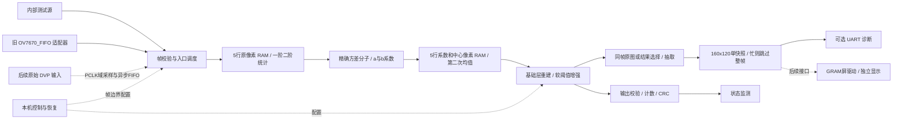

# Basys 3 资源协同流式视频处理：V0 设计规格

版本：1.0-review，2026-10-22。状态：**设计完成供审阅，尚未经用户确认进入实现。**

本文件是下一轮编码的规范性输入。文中“必须”是实现要求，“预算/目标”是待验证指标，不代表已有实现结果。仅用户明确说 **“确认当前设计，开始实现”** 后允许编写参考模型、RTL、测试程序和构建脚本。

## 1. 目标、优先级与设计边界

在已购 Basys 3 上实现灰度视频保边降噪和受控细节增强，FPGA 完成全部正常运行算法。用户本轮补充要求：**“设计要求简单，按照逻辑和实现简单的方案设计。”** 因此优先固定参数结构、独立 RAM 端口、单核心时钟和容易验证的帧级控制；资源节约服从正确性和控制清晰度。

V0 的交付范围：单尺度计算核心、内部测试源、旧摄像头适配、缩小预览快照、可选 UART 诊断、本机控制及错误计数。新摄像头的物理接口、屏幕驱动、Flash 独立启动和双尺度是后续里程碑，不能混入 V0 完成声明。

| 项目 | V0 设计要求 |
|---|---|
| FPGA | XC7A35T-1CPG236，Vivado part `xc7a35tcpg236-1` |
| 核心时钟 | 板载 100 MHz；不建立算法子时钟域 |
| 输入 | 无符号 8 位灰度，保留摄像头 Y 的原始 0～255 编码；不自动拉伸 16～235 |
| 编译配置 | QVGA 320×240；VGA 640×480；W/H 为编译常量，运行时不换分辨率 |
| 算法 | 单尺度自引导滤波 r=2，5×5；两次均值；受控细节重建 |
| 边界 | 有效区域裁剪，每边 4 像素；不做复制/镜像填充，不补算法边界 |
| 输出 | QVGA 312×232=72,384 像素；VGA 632×472=298,304 像素 |
| 吞吐 | 有效帧内 II=1；每帧尾部 64 个核心空拍用于排空 |
| 流控 | 核心无 ready；显示和 UART 永远不能反压核心 |
| 预览 | 单块最多 160×120、8 位灰度快照，容量 19,200 B；属于显示缓存 |
| 外设现状 | 现有 GYF-198 OV7670_FIFO 仅作为帧串行过渡适配器；新屏幕未购 |
| 默认后续顺序 | 位精确模型验收 → 核心仿真 → 综合布局布线 → 用户上板验证 |

不包含 ROI 定位、Sobel 主算法、自动调焦、彩色复杂处理、时间域降噪、神经网络、外部 DDR 或更换 FPGA 板卡。最小窗口测试允许 W/H≥16，其余配置不得超过 640×480；顶层综合只维护 QVGA/VGA 两种配置。

## 2. 实际基线与证据边界

工作仓库：`E:/Vivado_FPGA_Programs/fpga2026`。

上游：[infr025t/fpga2026](https://github.com/infr025t/fpga2026)，本轮 clone 后通过 `git ls-remote origin HEAD` 核对，基线为 `b262f8d730a1e9e831d2ba23c67438d6c960a931`。本轮文档位于独立子目录；`demo/stream_image_demo` 不修改。

| 证据 | 本轮实际观察 | 对新设计的影响 |
|---|---|---|
| 仓库 README、交付核验.json | 当前源码有 ROI、打包、异常恢复及周期预览；仓库记录 63 项 Python、16 组 RTL、7 组交叉校验 | 属于仓库历史验证记录，本轮未重跑；不等于当前 bit 已验证 |
| image_core.sv | 注释明确输入间隔≥4周期、W×H≤131072、17位输出地址 | 不能仅改 W/H 扩到 VGA；新核独立设计 |
| stream_top.sv | 输出整帧 framebuffer；采集/处理/发送按帧串行 | 新版删除主链对整帧结果缓存和串口完成的依赖 |
| fifo_capture.sv | READ_PERIOD=50，100 MHz 下 RCLK=2 MHz；每两个字节输出一个 Y | 读出上界约 1 MPixel/s；仅 QVGA 双字节读出就需 76.8 ms，不承诺30 fps |
| 历史 utilization.rpt | 2026-10-05 的 routed 结果：863 LUT、1298 FF、25.5 BRAM36、0 DSP | 不是新 RTL 资源，不与新预算混写 |
| 使用手册 | JA 接8位数据、JC接8个控制/诊断信号；旧样机有开漏电阻网络 | 复用旧接线事实；不把电阻分压当通用供电方案 |
| 本机工具 | `E:/Vivado/2025.1/Vivado/bin/vivado.bat -version` 成功，v2025.1、build 6140274 | 路径已核实；本轮未创建 Vivado 工程、综合或生成 bit |
| 板卡资料目录 | 用户给出的目录是 PNG 扫描/截图；抽查封面、资源页和末页 | 与官方 Basys 3 Rev.C 手册核对，不将宣传最高频率用作本设计频率 |

基线保护：不覆盖历史 bit、报告、接线说明和 ZIP；新构建必须输出在新版目录内。GitHub 当前源码优先用于接口事实，项目方向以用户本轮要求和交接说明为准。旧版 ROI 功能不自动继承为新版任务。

## 3. 方案选择与整体结构

| 方案 | 收益 | 主要代价 | 决定 |
|---|---|---|---|
| 固定单尺度、独立行 RAM、固定流水 | 控制清晰，位精确验证直接，帧内 II=1 | 多用若干 RAM 和 DSP | **采用** |
| 均值/系数运算时分复用、多尺度共享 RAM | 节省部分算术或存储 | 端口仲裁、反馈调度、停顿传播复杂 | V0 不采用 |
| 保留完整输出尺寸，边界复制/镜像 | 输出尺寸直观 | 边界生成、行末额外处理、排空及吞吐说明复杂 | V0 采用裁边，显示可补边 |

两轮窗口中的中心原像素同时传递，作为最终 I_align。因此比较原图和处理图具有相同坐标、帧号、裁边和延迟，不依赖 PC 对齐。输出链一直计算全部有效像素；抽取只是显示支路行为。

## 4. 算法定义

### 4.1 浮点参考的唯一数学定义

令输入 I(x,y)∈[0,255]，窗口半径 r=2、N=25。第一轮仅在中心 x=2…W−3、y=2…H−3 计算：

$$S_1=\sum_{5\times5}I,\quad S_2=\sum_{5\times5}I^2,$$
$$\mu=S_1/25,\quad V=25S_2-S_1^2,\quad \sigma^2=V/625,$$
$$a=V/(V+625\epsilon),\quad b=(1-a)\mu.$$

第二轮对系数 a、b 各做一次 5×5 均值，得到 ā、b̄，并与同坐标原图重建：

$$B=\bar a I+\bar b,\quad D=I-B,$$
$$R=\operatorname{sign}(D)\min(\max(|D|-T,0),L),$$
$$O=\operatorname{clip}_{[0,255]}(B+gR).$$

这是普通自引导滤波（I=p），不是下采样版 Fast Guided Filter。两轮窗口后的总支持范围为9×9，输出中心 x=4…W−5、y=4…H−5。除法用上述等价方差分子形式避免先算两个近似均值再相减；整数 V 理论非负。

保边基础层来自成熟引导滤波；本项目的细节软阈值和限幅是受控增强规则，需要单独验证画质，不冒称论文原算法已证明适合本摄像头。

### 4.2 参数、模式与默认值

| 参数 | 可编码值 | 默认值 | 含义 |
|---|---|---|---|
| ε | 16、64、256、1024 | 64 | 单位是灰度值平方；不是0～1归一化后的数值 |
| T | 整数0～16 | 4 | 细节死区阈值，低于阈值的细节不回加 |
| L | 固定16 | 16 | 单个像素可回加细节幅度上限，单位灰度 |
| g | G/256，G整数0～512 | 320，即1.25 | 最大2；仅规定可编码范围，不认为所有组合画质都合格 |
| view_mode | RAW、BASE、DENOISE、ENHANCE | DENOISE（模型及推荐操作） | 实板由SW2:1选择；全零开关实际为RAW |

RAW 输出 I_align；BASE 输出 B；DENOISE 固定 G=256，输出 B+R；ENHANCE 使用 G，默认320。所有模式保持相同输出尺寸与延迟，计算核不停算。T=0、G=256 因 L 限幅并不普遍等于原图；RAW 才是严格旁路。

SOF 时将开关等请求锁存为帧参数；同一帧绝不混用参数。非法参数请求不生效，保持上次合法参数并增加 cfg_error；不静默截断成另一个值。显示模式也在帧边界锁存。

### 4.3 本轮能确定与不能确定的结论

可以由公式确定：常量场保持不变；除数严格为正；原图/结果同坐标；回加细节绝对值≤32；无整帧算法中间图。

尚不能确定：默认参数对实际镜头噪声、文字和纹理的最优效果，以及实际资源和频率。本轮不编写模型或 RTL，因此第15节将这些列为下一阶段必须实际执行的验收门槛。若画质门槛不满足，必须记录原因并请求修改参数/规格，不允许暗中改成 Sobel 或另一套主算法。

## 5. 位精确数值契约

所有未特别注明的量均为无符号整数；Q 标记表示整数值除以相应2次幂。所有加减先扩展到完整精度，乘法保留全积，最后才舍入；禁止靠截断溢出形成饱和。

定义：非负整数除法 RN(n,d)=floor((n+floor(d/2))/d)；对2的幂的有符号舍入使用“绝对值加半后右移、恢复符号”，恰好半格时远离0。最终像素先夹紧到 Q8 的[0,65280]，再加128右移8。

### 5.1 运算顺序

1. S1、S2 精确累加；V=25S2−S1² 精确计算。若出现 V<0，应触发算术错误并作废该帧；防护输出可置0，但不能静默掩盖实现错误。
2. DEN=V+625ε；A=RN(4096V,DEN)，存为 Q12。固定允许的 ε 保证 A≤4092，可用12位保存；中间舍入保留13位，若超范围同样报错。
3. M=RN(256S1,25)，Q8；b8=RN((4096−A)M,4096)，Q8。
4. 第二轮精确求 SA=ΣA、SB=Σb8；Abar=RN(SA,25)，bbar8=RN(SB,25)。
5. B8=clip(RN(Abar·I_align,16)+bbar8,0,65280)。除以16是将 Q12 乘积转为 Q8。
6. D8=(I_align×256)−B8；R8=sign(D8)·min(max(abs(D8)−256T,0),4096)。
7. E8=有符号RN(G·R8,256)；O8pre=B8+E8，夹紧并转8位。RAW/BASE 按各自定义选择，但共用最终输出寄存器。

### 5.2 位宽与范围账本

| 信号 | 宽度/格式 | 有效范围或说明 |
|---|---|---|
| I、I_align | U8 | 0…255 |
| I² | U16 | 0…65025 |
| 5行竖向和 V1 / V2 | U11 / U19 | 0…1275 / 0…325125 |
| S1 / S2 | U13 / U21 | 0…6375 / 0…1625625 |
| S1²、25S2 | U26 | 各不超过40640625 |
| V | U24；减法用27位有符号临时量 | 最大10143900，即12×13×255² |
| 625ε / DEN | U20 / U24 | 最大640000 / 10783900 |
| 除法器余数的2倍 | U25 | 比较/减法不能只保留24位 |
| A / 4096−A | U12 Q12 / U13 Q12 | A=0…4092；补系数可为4096 |
| M / b8 | U16 Q8 | 0…65280 |
| (4096−A)M | U29完整乘积容器 | 实际最大267386880，先完整保存再舍入 |
| 系数行RAM条目 | U36 | `{A[11:0], b8[15:0], I_center[7:0]}` |
| 系数竖向和 | U15 / U19 | 5A≤20460；5b8≤326400 |
| SA / SB | U17 / U21 | ≤102300 / ≤1632000 |
| Abar / bbar8 | U12 Q12 / U16 Q8 | 同 A/b8 范围 |
| Abar·I | U20 | 最大1043460 |
| 基础层相加临时量 | U17 Q8 | 相加后夹紧；不能先丢最高位 |
| D8 | S17 Q8 | −65280…65280 |
| R8 | S14 Q8 | −4096…4096 |
| G | U10 Q8 | 0…512 |
| G·R8 | S25容器 | G补0转有符号后乘法；禁止误作负数 |
| E8 / O8pre | S18 Q8 | E8在±8192，O8pre在−8192…73472 |
| 输出坐标 | x U10，y U9 | 统一保留原传感器坐标 |
| 帧像素计数 | U19 | 足以表示307200；不沿用17位帧地址 |

水平滑动差分用带符号临时量：V1差用S12、V2差用S20；总和更新使用S23统一容器；系数均值同样先符号扩展，累加后检查范围。所有有效总和仍为非负。

### 5.3 除法器的唯一选择

变量除法采用**12级展开的二进制小数长除法 + 1级舍入**，每级只做余数倍增、比较、条件减法并向后传 DEN。初始余数是 V，逐级生成 a 的12个小数位；末级若2×余数≥DEN则加1。各级接收独立像素，II=1，固定13周期。它不是单个迭代除法器，不复用13周期来处理一个像素；也不使用近似倒数表。

三个除25的归一化器采用精确常数除法：将舍入偏置12计入 n 后，令 q0=floor(n×671089/2²⁴)，若25q0>n则 q=q0−1，否则q=q0。有效 n≤1,632,012；因671089=ceil(2²⁴/25)，候选商最多高1，修正后精确。乘积用U41；25q0用移位加法并保留完整位宽。统一4周期：乘法2、合并/取商1、比较修正1；较窄通路补寄存器保持一致。

两个21位 n 的归一化器各预算2个DSP；17位 n 的 A 均值归一化器预算1个DSP。将长除法与常数归一化分别封装，测试边界和全域，不交给综合器推断不明确的组合 `/`。

### 5.4 数值误差门槛和解析检查

由于 V/DEN 精确，a 的量化误差≤1/8192；μ量化误差≤1/512灰度。将 b 舍入、第二轮均值舍入和 B 乘积舍入一并计入，基础层 Q8 值对同公式浮点值的保守误差上界为：

255/8192 + 255/4096 + 4/512 = 0.1011962891 灰度。

软阈值是连续分段线性函数；固定 I、0≤g≤2 时，B→B+g·soft(I−B) 的斜率绝对值≤1，限幅仍不扩大误差。再计增强乘积 Q8 舍入，最终量化前误差应小于0.104灰度。因此冻结验收：最终8位输出对浮点相同公式取整结果，**最大绝对误差≤1 LSB**；RTL 对位精确模型必须逐像素完全一致。

此处是解析预算，不是本轮跑出的测试数据。下一阶段须用高精度参考检查边界和舍入定义；一旦超过界限，按实现/模型缺陷定位，不能简单放宽门槛。

## 6. 两轮窗口与 RAM 调度

### 6.1 第一轮：5个轮转行bank

5个bank，每个深度W、宽8；当前行bank=y mod 5。每个有效输入周期在当前bank写 I(x,y)，从其余4个bank各同步读同列x，得到前4行像素。当前输入延迟到读数据同拍，组合成5个竖向像素。当前bank不读，所以不依赖同地址读写的器件模式。

第一轮不储存 I² 图像：对5个竖向像素并行平方，花5个DSP换取较窄的行RAM和独立访问。竖向5项求和用3级加法树；平方和也用同样树。随后沿水平方向分别做滑动和，不重新累加整个25点窗口。

水平递推：H(x)=H(x−1)+Vcol(x)−Vcol(x−5)。每行前5列把越界旧值视为0；x=0清空历史和水平累加器。差值先寄存1级，下一周期在单级反馈加法器中更新累加器；**反馈加法器内不得再插流水级**。x/valid也延迟1级，确保行首清零作用于该行第一个差值。输入空拍不更新行地址、历史或累加器，已进入算术流水的旧token仍正常前进。

中心原像素取竖向中间行 I(x,y−2)，再延迟2个有效列，得到 I(x−2,y−2)，与统计结果走等长算术流水。第一轮每行只输出x≥4且y≥4的统计，因此系数图尺寸 W1=W−4、H1=H−4。

### 6.2 第二轮：5个独立系数bank

每bank深度W1、宽36，保存同位置的 A、b8、I_center。bank轮转依据系数图行号；每拍仍是一写四读，读写bank分开。对A、b8做竖向加法树和水平滑动和，除25得到Abar、bbar8。该轮无需平方器。

从第二轮竖向中间条目取 I_center，再延迟2个有效列，得到最终对应原图 I(x−4,y−4)。原像素并非再求均值。这样9×9总支持范围和两轮中心对齐自然一致，不需要另建按整帧时钟数延迟的原图 FIFO。

在原图底右支持点(u,v)到达后，输出中心是(u−4,v−4)，要求u≥8且v≥8。W1/H1 坐标从0重新计数，外部输出坐标仍用原图坐标。两个中心tap的水平移位只按所在级valid推进，不能随每个100 MHz时钟无条件移位。

### 6.3 初始化与复位

不复位 RAM 内容。复位清 valid、行列计数、bank索引、水平历史和流水有效位。帧前4行/列未形成窗口时屏蔽输出，旧RAM内容永远不能进入有效窗口。帧间先排空64周期再接受下一帧SOF；新SOF只清该帧的窗口状态，不作为运行中随机清空RAM的信号。

## 7. 时钟、逐级延迟与吞吐

下表的周期数定义为输入token在上升沿t被接收，对应结果在上升沿t+L出现；代码和测试采用同一个定义，避免将非阻塞赋值的观察时刻误算为额外1拍。

| 模块 | 固定算术延迟L | II | 说明 |
|---|---:|---:|---|
| moments5 | 9 | 1 | RAM读/选行2 + 平方2 + 竖向树3 + 水平差1 + 累加1；S1较短路径补齐 |
| coefficient5 | 20 | 1 | S1²/25S2及方差/分母4 + 比值13 + b乘法/舍入3；M的4拍归一化并行，延迟到对应A |
| coefficient_box5 | 11 | 1 | RAM读/选行2 + 竖向树3 + 水平差1 + 累加1 + 归一化4 |
| reconstruct | 4 | 1 | Abar×I乘法2 + Q8转换/相加/夹紧2 |
| detail_enhance | 7 | 1 | 差分1、软阈值1、乘法2、舍入1、相加/夹紧与8位化2 |
| output_align | 13 | 1 | 将全路径固定到64拍；RAW、BASE、帧标志、坐标同步延迟 |
| 合计 | **64** | **1** | 窗口等待另计，不包含在这64拍中 |

输入完全连续时：首输出出现在首输入后 `8W+8+64` 拍；同一中心像素从输入到输出是 `4W+4+64` 拍。QVGA分别2632拍/26.32 μs和1348拍/13.48 μs；VGA分别5192拍/51.92 μs和2628拍/26.28 μs。最后一个输入像素后的64拍输出EOF。

有空拍时，一般式为：中心(c,d)的输出时间=输入(c+4,d+4)被接收的时刻+64拍。不能声称任意空拍条件下中心到输出仍固定4W+68拍。SOF到EOF以及采集到屏幕可见时间另行计量。

帧尾输入EOF在t：t+1…t+64不得接受新帧像素，最早t+65接受下一帧SOF。稳定帧内峰值100 MPixel/s；算上64空拍的合成帧持续接受能力是100 MHz×WH/(WH+64)，不能写成无条件持续100 MPixel/s。内部测试源严格执行该契约，入口FIFO为外部数据吸收帧尾等待。

100 MHz、II=1和上述64拍都是设计目标，必须由仿真及布局布线兑现。若时序需要超出分配的流水级，修改规格和延迟测试后才能继续，不允许仅改RTL造成接口文档失真。

## 8. 像素流、帧控制与参数接口

### 8.1 核心输入/输出

| 信号 | 宽度 | 规则 |
|---|---:|---|
| clk / rst | 1 / 1 | 100 MHz；核心同步高有效复位 |
| pixel | 8 | 仅valid=1时解释 |
| valid | 1 | 每拍最多1个像素，无ready；valid=0表示空拍 |
| x / y | 10 / 9 | 输入从(0,0)按行优先递增；输出为原图坐标 |
| sof | 1 | 只能伴随valid和首像素；输入(0,0)，输出(4,4) |
| eol | 1 | 伴随每行最后一个valid；输入x=W−1，输出x=W−5 |
| eof | 1 | 伴随帧最后一个valid；可与eol同拍 |
| frame_id | 32 | 源侧每次观察到新物理帧SOF递增，模2³²；丢弃也消耗帧号 |
| abort | 1 | 核心域独立高优先级事件；可在valid=0时发生 |
| cfg_id | 16 | 每次合法配置整体提交时递增，帧描述符锁存 |

输出同时提供选定模式pixel、I_align8和round(B8)三个8位值，坐标及valid共用；内部分支的原图/基础层须延迟到同一输出拍。若实现只导出其中一个图像端口，另外两者仍保留内部仿真检查点，不建立三份图像缓存。

优先级：rst > abort/协议错误 > 正常valid。标志必须与像素作为同一个token推进。valid=0时sof/eol/eof应为0；若出现，入口报协议错误。禁止单独把SOF/EOL经过与像素不同拍数的同步链。

总输入像素数必须为WH；输入帧标签/坐标不连续、行长度不匹配、重复SOF、早/晚EOF均作废当前帧。可观察到错误前已经输出的前缀，但不得把它记为成功帧；没有整帧算法缓存就不能“撤回”已输出前缀。

### 8.2 帧状态机

入口状态为 WAIT_SOF → RUN → DRAIN → WAIT_SOF；异常进入 DISCARD/RECOVER。

- WAIT_SOF：只接受合法首像素；没有屏幕、UART忙不影响状态。
- RUN：每拍接收valid，检查行列与帧号；参数保持锁存；正确EOF后转DRAIN。
- DRAIN：禁止新的核心输入64周期，让最后结果输出；同时等待源侧帧结束状态。源状态已确认OK且输出EOF完成，才产生frame_success。
- DISCARD：使当前frame_id失效，清算术流水valid和窗口状态，继续丢弃残帧；重新同步后才接受下一完整SOF，绝不把残行接到新帧。
- STOP请求：完成当前帧后停止接收后续完整帧；相机仍可运行，源适配器按帧丢弃，恢复时等待下一个SOF。

新配置在WAIT_SOF接受首像素时提交，不在DRAIN期间修改活跃参数。为简化帧间共享控制，V0一次只有一个核心在途帧，不要求多个帧重叠流水。多级算术流水不由普通valid空拍停止；RAM/递推状态只由该级有效token更新。

### 8.3 源侧结束状态

未来DVP适配器必须提供独立的`frame_end_status(frame_id, ok, reason)`：只有物理帧结束、行数和字节数检查完成后才能发OK；不能在“已经收到预计像素数”时提前忽略后续多余行。跨域用保持数据直至确认的toggle握手邮箱，一次最多一个未确认状态，不能对多位总线逐位同步。

核心输出EOF和源OK可先后到达，控制器保存两者，全部满足才提交预览快照并增加completed_frames。旧FIFO适配器的OK仅表示既定采集窗口完成且读出字节数正确，不能证明所有物理行均正确；状态中标记LEGACY_VALIDATION。

若新帧像素已进入入口FIFO，而上帧源状态仍未确认，从新帧首条目入队起至恢复读取的总等待上界为128个核心周期，**已包含可能剩余的64拍DRAIN和CDC时间，不能再叠加128拍**；超时按源协议错误恢复，而非继续无限阻塞。无新帧数据时等待源状态的超时取100 ms；旧摄像头采集超时沿用1 s。FIFO溢出会立即升级为恢复事件。

结束状态reason编码为：0正常、1初始化失败、2入口溢出、3像素顺序/标志错误、4行数/行长/字节相位错误、5超时、6算术范围错误、7复位中断、8其他源错误。首个错误原因锁存到该帧结束，后续异常可更新粘滞标志但不重复增加invalid_frames。

### 8.4 复位及参数跨域

按键经两级同步和10 ms稳定判决后产生一次请求；开关作为完整16位总线同步并连续稳定10 ms后更新shadow配置。初始上电/BTNC复位在核心同步释放；未来PCLK域异步置位、在本域同步释放，等待FIFO reset_busy退出。

未来异步FIFO只使用经过验证的AMD XPM实现；复位请求/确认握手同时停止写入与读取，确认两侧复位完成后等待新SOF。PCLK停止时不得假装写侧已完成复位，保持输入未就绪并记录超时，待时钟恢复再完成握手。参数不需要送入PCLK域，摄像头寄存器重配另走控制器且只在停止采集时执行。

## 9. 入口FIFO、吞吐包络与异常恢复

入口保留1024条、64位/条的同步或异步FIFO。旧FIFO读出和内部源已在核心域，使用同域FIFO/调度；未来DVP才选择异步配置，不能把旧外部FIFO误说成原始PCLK流接口。

64位条目固定布局：bits7:0 pixel，17:8 x，26:18 y，27 SOF，28 EOL，29 EOF，61:30 frame_id，62 source_error，63保留0。有效位由FIFO非空表达。配置不重复存入每个条目。

正常V0外部输入包络为：核心100 MHz，未来外设有效像素入队峰值≤25 MPixel/s，帧间核心暂停/状态交接上界128周期，其他时间入口按1像素/周期出队。该25 MPixel/s是**待外设满足的逻辑设计上界，不是Pmod接线已验证能力**。YUV422的字节PCLK与Y像素率必须分别核算，例如25 MHz字节时钟对应最多12.5 MPixel/s，而不是25 MPixel/s。内部满速源单独按100 MPixel/s工作，但主动执行帧尾64空拍，不适用外部25 MPixel/s的积压估算；必须在其满速仿真中验证FIFO占用稳定。

在FIFO先已排空、上述包络成立时，128周期最多积压32条；另留8条用于CDC可见延迟/读控制，正常估算高水位≤40条。分配1024条用于异常与调试余量；不得由此允许任意长停顿。若输入包络改变，应重算 `Qmax = max_t(A(t)−S(t))` 并检验跨帧不能持续增长。帧平均像素率和瞬时峰值需分别记录。

almost_full阈值896，只用于告警和记录，**不能要求物理摄像头暂停**。full时源域丢弃后续像素，置粘滞overflow并通过独立握手请求核心abort；不能指望往已经满的FIFO再塞一个“错误token”。完成双侧清空后，源域等待新SOF再恢复。

| 异常 | 必须行为 | 恢复点 |
|---|---|---|
| FIFO full | 当前帧无效、overflow计数、丢残帧、协调清空 | 下一完整SOF |
| 行长度/坐标/字节相位错误 | abort并丢残帧；记录原因 | 下一完整SOF |
| 提前或重复SOF | 旧帧无效；当前乱序帧也不拼接使用 | 恢复握手后的新SOF |
| 算术范围违例 | 作废该帧、sticky error；禁止伪装正常饱和 | 下一SOF，重复则停止并报警 |
| 摄像头初始化失败 | 释放SCCB、1 s后重试，计数；内部源仍可运行 | 初始化成功后的新帧 |
| 复位发生在帧中 | 清valid、快照失效、帧号新会话从0开始 | 首个完整新帧 |
| 屏幕/串口停顿或断开 | 只使快照保持忙或导出超时；主链继续 | 丢弃旧预览后接下一帧 |

## 10. 预览、显示占位与UART诊断

### 10.1 一块有限快照，简单的整帧所有权

V0不实现物理LCD驱动。预览模块与消费者之间保留完整快照接口；无消费者时可禁用预览，正常算法仍运行。

快照物理容量19,200×8，单缓冲，状态 EMPTY → CAPTURE → WAIT_COMMIT → READY → READOUT → EMPTY。开始捕获只在核心输出SOF处决定；若不是EMPTY，**整帧跳过预览**，核心仍消费全部结果。CAPTURE结束后同时满足像素数量正确、核心EOF、源帧OK才置READY。失败快照直接丢弃，不对外提供半帧。READOUT期间不允许覆写。

QVGA对裁剪输出按x_out、y_out均为偶数抽取，得到156×116=18,096 B；VGA取坐标为4的倍数，得到158×118=18,644 B。坐标以裁剪图左上为(0,0)，其原图原点为(4,4)。最大尺寸160×120只表示容量，不对实际抽取图像强行补足。抽样使用最近点，可能混叠，仅用于预览；画质指标在未缩小的完整核心输出上评价。

快照是**一整帧缩小预览**，不能称“系统绝无帧缓存”。它永远不回馈滤波核，不保存供算法使用的历史图像。使用一块快照牺牲预览更新率，换取简单所有权和无覆盖撕裂的数据读出；单GRAM屏自身的扫描撕裂仍需具体驱动验证。

消费者接口：`snapshot_valid`保持到`claim`；描述符含frame_id、cfg_id、view_mode、source_kind、legacy_validation、width、height、origin_x/y、sample_step、epsilon、T、L、G及payload_crc32。claim之后，消费者通过`rd_en, rd_addr[14:0]`读RAM，1周期后`rd_valid, rd_data[7:0]`有效；完成发`release`。只有一个消费者，可编译选UART或未来LCD，V0不做多消费者仲裁。

消费者5 s无完成视为预览导出超时，先复位消费者/撤销本次输出，再释放快照并计数；不能让旧消费者继续读已经复用的RAM。没有任何屏幕接线时选择NONE消费者，快照自动释放或编译关闭，不阻塞核心。

### 10.2 UART诊断接口

默认1,000,000 baud、8N1，从100 MHz分频100。仅作为开发工具，PC不计算正常运行算法。不能用1 Mbps回传VGA连续灰度流；即使不计包头，QVGA/VGA快照单次线路时间也约181/186 ms。

为避免沿用旧FPG1隐含尺寸和Sobel语义，新版采用独立的 `VEF0` 帧格式，不修改旧接收器。下一阶段另建接收入口。所有多字节整数字段为little-endian，固定40字节头后接灰度payload，长度严格为width×height：

| 偏移 | 字节数 | 字段 |
|---:|---:|---|
| 0 | 4 | ASCII `VEF0` |
| 4 | 1 | version=1 |
| 5 | 1 | view_mode：0 RAW、1 BASE、2 DENOISE、3 ENHANCE |
| 6 | 1 | flags：bit0 LEGACY_VALIDATION，其余0 |
| 7 | 1 | header_len=40 |
| 8 | 4 | frame_id |
| 12 | 2 | cfg_id |
| 14 / 16 | 各2 | width / height |
| 18 / 20 | 各2 | origin_x / origin_y |
| 22 / 23 | 各1 | sample_step / source_kind（0内部，1旧FIFO，2未来DVP） |
| 24 | 4 | payload_bytes |
| 28 | 4 | payload_crc32 |
| 32 | 2 | epsilon |
| 34 / 35 | 各1 | T / L |
| 36 | 2 | G；DENOISE记录256，BASE记录0 |
| 38 | 2 | 保留0 |

CRC采用CRC-32/ISO-HDLC：反射多项式0xEDB88320，初值和最终异或均0xFFFFFFFF，仅覆盖payload，按线上的字节顺序计算。CRC是诊断完整性校验；头字段还必须检查范围、长度和保留位。串口复位中断包时接收端丢弃不完整包并搜索下一魔数，结合合法头和CRC重新同步。

### 10.3 显示接口的后续适配

未来LCD驱动独占上述快照；逐像素将灰度转RGB565：R=Y[7:3]、G=Y[7:2]、B=Y[7:3]。可以在屏上居中显示或放大2倍，边框由显示驱动生成；它不改变算法裁剪坐标。记录处理帧率、预览完成率、面板刷新率三个独立指标。

对于320×240 RGB565满屏30次/秒，纯载荷是4.608 MB/s。8位8080接口每像素至少2次数据写，还需命令和间隙；SPI至少36.864 Mbit/s纯载荷，不能用标称SPI时钟直接承诺该更新率。V0快照较小且允许降更新率，没有30 fps显示承诺。

## 11. 物理存储、DSP与逻辑预算

统一以一个RAMB36等价块作为BRAM单位，RAMB18=0.5；板卡总量50 RAMB36，90 DSP48E1，20800 LUT，41600 FF。225 KiB是包含BRAM可配置位的标称总容量，实际可用字节受位宽、深度和端口组织约束。

### 11.1 存储账本

| 存储 | VGA逻辑组织 | 逻辑字节 | 端口/访问 | 物理映射预算 |
|---|---|---:|---|---:|
| 原像素5行bank | 5×640×8 | 3200 | 每周期1个bank写、其余4个bank各读1次 | 5 RAMB18=2.5 BRAM36 |
| 系数+中心像素bank | 5×636×36 | 14310 | 每周期1写bank、4读bank | 5 RAMB36（1024×36） |
| 入口FIFO | 1024×64 | 8192 | 写域1写、读域1读，或同域 | 2 RAMB36（各1024×36，8位未用） |
| 预览快照 | 19200×8 | 19200 | 捕获1写；导出1读，阶段互斥 | 5 RAMB36（每块4096×9） |
| 摄像头配置/控制ROM预留 | 最多2048×8 | ≤2048 | 只读 | 1 RAMB18=0.5 BRAM36 |
| 水平历史与中心tap | 原统计5×(11+19)bit；系数5×(15+19)bit，另两个2×8中心tap | 44 B起，不含算术流水 | 寄存器，无RAM端口冲突 | LUT/FF，0 BRAM |
| 控制/流水元数据 | 按固定64拍和局部valid组织 | 随实现细化，计入FF | 不为每个RAM像素重复保存frame_id | 0 BRAM |
| **基础物理合计** | 含预览和入口，不含ILA | **≤46950 B + 寄存器** | — | **15 BRAM36** |

原像素+系数核心逻辑存储：VGA 17,510 B，QVGA 8,710 B。以VGA最大深度统一约束，两个配置均按7.5 BRAM36核心预算，不假设小图自动获得最理想打包。物理映射采用已公开的7系列RAM合法组织，仍需综合报告核验；尤其36位系数条目不能被工具无意拆成多组窄RAM增加碎片。

另预留9 BRAM36用于布局碎片、诊断ILA及可选小队列，V0发布上限24/50。不能直接拿“逻辑字节÷4608”替代上述逐bank统计，也不能把这9块在每个模块重复计作可用余量。普通发布构建应关闭ILA。

### 11.2 运算资源账本

| 模块 | DSP预算 | LUT估算区间 | FF估算区间 | 对资源开销的解释 |
|---|---:|---:|---:|---|
| moments5 | 5 | 400～900 | 500～1200 | 5路平方换取无平方行RAM和直接竖向tap |
| coefficient5 | 4 | 600～1400 | 1100～2300 | S1² 1、M归一化2、b乘法1；13级比值用比较/减法逻辑 |
| coefficient_box5 | 3 | 450～1000 | 400～1000 | A均值1、b均值2；行/列求和用加法器 |
| reconstruct + enhance | 2 | 300～700 | 300～800 | Abar×I和G×R各1 |
| 元数据/对齐 | 0 | 150～400 | 500～1200 | 64拍固定延迟与边界标志 |
| 入口FIFO与校验 | 0 | 300～700 | 500～900 | CDC指针、帧坐标校验 |
| 源、控制、摄像头配置 | 0 | 800～1600 | 700～1500 | 内部源、旧适配器、去抖、配置、超时 |
| 预览控制 | 0 | 400～900 | 300～800 | 单快照地址、状态机、抽取 |
| UART与监测 | 0 | 300～700 | 500～1000 | 串口、CRC、计数器 |
| **合计估算** | **14** | **3700～8300** | **4800～10700** | 不含ILA；LUT/FF是工程估计，不是综合结果 |

V0验收资源上限：BRAM36≤24、DSP≤24、LUT≤12000、FF≤20000。上限保留余量，不代表应把资源填满。超过任一上限时先调查推断方式、位宽和寄存器复制；需要改变算法或接口时修改规格并说明，不能为了数字好看删减错误检查。

## 12. 外设与本机操作

### 12.1 现有摄像头适配

V0仅使用已确认的GYF-198 OV7670_FIFO读取路径；延用源文件中的寄存器表、复位和SCCB策略，并在独立适配模块封装为第8节接口。原始图像的字节顺序按旧配置Y_BYTE=1，不能自行交换；先用已知图案检查。

| 信号 | 板端/FPGA引脚 | 用途 |
|---|---|---|
| D0…D7 | JA1/2/3/4/7/8/9/10；J1,L2,J2,G2,H1,K2,H2,G3 | 外部FIFO数据 |
| SIOC / SIOD | JC1/2；K17/M18 | 开漏SCCB |
| VSYNC / WEN | JC3/4；N17/P18 | 捕获窗口同步/写允许 |
| RRST_N / RCLK | JC7/8；L17/M19 | FIFO读控制，默认2 MHz |
| RST_N / HREF | JC9/10；P17/R18 | 开漏复位/被动诊断 |

该表记录现有接线，不授权修改物理接线。WRST连模块VSYNC，OE/PWDN接地和旧电阻网络以仓库使用手册及实际模块为准；本轮没有测量引脚电压。不能给现模块附会独立读使能、原始PCLK可用或持续读写能力。

若下一阶段仍使用同样外设，旧模块可做画质采样与诊断；连续吞吐验收由内部源完成并明确标注来源。真正连续外部视频另需带完整原理图、可访问PCLK/HREF/VSYNC及电气时序的新摄像头资料，不能靠片上缓存制造并不存在的采集能力。

### 12.2 屏幕候选及选择理由

屏幕物理驱动本轮明确排除，V0不绑定任何LCD引脚。建议优先考虑有GRAM、资料齐全、能以3.3 V逻辑工作的模块，按实际模块版本而非只按控制器型号采购：

| 候选模块 | 接口/规格（已查资料） | 本项目建议 |
|---|---|---|
| LCDWIKI MRB2801，2.8英寸 ILI9341 | 320×240，8/16位8080可切换，默认16位 | 小屏首选候选；选8位减少IO，具体模块要改总线配置焊盘；该版8位模式用DB8…15 |
| LCDWIKI MRB3205，3.2英寸 ILI9341 | 320×240，8/16位并口，默认16位 | 更易看清的同分辨率候选，核实模块引脚与电平后选择 |
| LCDWIKI MRB3951，4.0英寸 ST7796S | 480×320，8/16位并口 | 后续较大预览候选；同系列8位模式使用DB0…7，不能照搬ILI9341接线 |
| Waveshare 2.8inch Resistive Touch LCD | 320×240，SPI；官方文档注明存在HX8347D/ST7789批次 | 若更看重少接线、能接受较低更新率可选；下单前核对控制器批次，不能只写“2.8寸屏” |

现有相机占JA和JC共16根信号，JB与JXADC合计剩16根逻辑信号。8位8080只写数据8根+WR/DC/CS/RESET共12根，另可选TE、背光控制；RD可在满足模块要求时固定为高。16位并口再加控制超出现有余量，所以不推荐直接按16位使用这些模块。JXADC是8根可作数字IO的引脚，不是只有4根；其板上路由/滤波结构可能限制数字速度，后续必须单独核查。

VGA口可用于以后独立显示，但固定扫描时序需要可重复读取的显示存储；本版单快照的互斥写读不能直接提供无间断VGA扫描。要改VGA，需增加双预览缓存或专门冻结/交换策略并单列时钟域。MIPI裸屏不属于GPIO直连方案。

模块选定后才冻结：精确SKU/修订、逻辑电平、供电和背光电流、总线模式焊盘、完整引脚表、初始化序列、WR setup/hold/周期、TE接线及撕裂策略。本轮不猜这些值，也不需要为缺失屏幕阻塞核心编码。

### 12.3 新版开关与状态

新版操作表独立于旧Demo，不沿用旧SW2的ROI含义。建议固定：SW0=0旧摄像头/1内部源；SW2:1=00 RAW、01 BASE、10 DENOISE、11 ENHANCE；SW4:3=00 ε64、01 ε16、10 ε256、11 ε1024；SW5=1启用预览，0仅计算；SW15=1暂停后续帧。SW6…10保留0；SW14:11选择16页LED诊断。BTNC复位。

T=4、L=16、G=320作为编译默认参数，V0无需额外串口写寄存器协议。模式、ε、源和预览开关在帧边界生效；更换源前先完成当前帧、清FIFO，再等待新SOF。上电不依赖PC发命令；源默认按物理SW0决定。

推荐初始内部降噪预览：仅SW0、SW2、SW5置1，其余置0，再按BTNC；这对应内部源、DENOISE、ε64、预览开启。确认后将SW0置0切换旧摄像头。全零开关表示旧摄像头RAW且不导出预览，不称为默认降噪演示。

LED0页：bit0运行、1源初始化成功、2快照忙、3源错误、4输入溢出、5算术/协议错误、6预览超时、7暂停、15:8最近完成frame_id低8位。页1～14依次显示seen、accepted、completed、invalid、dropped_source、preview_captured、preview_skipped各32位计数的低/高16位；页15显示FIFO高水位低10位和粘滞错误标志。计数32位饱和到0xFFFFFFFF，frame_id使用模计数；清除只由复位执行。

其余内部计数包括overflow次数、cfg_error、preview_timeout、每秒核心完成数/预览导出数、最大输入到输出时间。至少通过仿真检查点保留；V0不要求额外复杂的状态串口协议。

seen按当前选中源观察到的SOF计数；accepted在核心首像素被接收时计数；completed仅在frame_success计数；invalid仅对已accepted且失败的帧计一次；dropped_source统计从未accepted的整帧（暂停、丢弃或恢复期间）。无在途帧且无计数饱和时，accepted=completed+invalid，seen=accepted+dropped_source。预览跳过不增加invalid或dropped_source。

### 12.4 供电与Flash里程碑

最终设备独立5 V供电，FPGA配置写入板载Flash，开机自动初始化外设并按开关运行。具体电源容量按实际摄像头、屏幕、背光最大电流和裕量计算；电源引脚与信号引脚分开，共地，不由FPGA普通IO供电。不在本轮烧写Flash或更改板卡跳线。

Flash启动验收留到显示/相机型号稳定后：断开PC，至少10次冷启动、10次复位，记录初始化结果与首个有效帧；确认使用对应器件和Flash型号的配置文件。V0逻辑验证不等于这一里程碑通过。

## 13. 时序和CDC约束要求

新约束文件独立建立，不复制旧文件全部例外。已核实板载时钟W5，100 MHz的create_clock周期10 ns；旧适配器信号引脚以第12节为起点。

- 核心内部所有RAM、DSP、计数器均用clk100，慢操作用时钟使能。外部RCLK是注册输出，不作为算法内部逻辑时钟。
- 旧2 MHz FIFO输入应以真实RCLK边沿、AL422B时序和采样相位重新核算；旧XDC含25 ns最大输入延迟、20/19周期multicycle，只能在相同实际电路和采样结构下审阅使用，不能搬到新DVP上。
- 未来DVP在PCLK域采样数据/HREF/VSYNC，建立PCLK和基于传感器手册的input_delay最小/最大值；原始并行数据经异步FIFO进核心。未选传感器时不编造input_delay。
- 仅对真实异步同步器/FIFO跨域路径施加适当例外，保留Gray指针的CDC和物理约束；不能用全局false_path隐藏FIFO指针问题。
- 按键/开关/SCCB等低速异步端点应有明确同步或稳定采样依据，例外只作用于必要端点。LCD后续驱动必须按模块写周期和板级延迟做output_delay或等效约束。
- RAM采用同步读，无异步读大数组，不复位存储阵列；DSP的输入/乘积/输出寄存器明确设置。检查是否因无意复位导致RAM被综合为FF。

布局布线验收：setup WNS≥0、TNS=0，hold WHS≥0、THS=0；无未解释的未约束时钟/数据端点，无未处理的CDC critical、DRC critical、锁存器或多驱动。I/O例外和开放漏极相关警告逐项写理由。仅“WNS为正”不足以通过；板外Pmod信号完整性仍需用户实测。

## 14. 双尺度扩展的可行性边界

V0完成后，优先采用**两套独立尺度并行**：r1=2、r2=4；不先引入复杂的跨尺度RAM共享。第二尺度同样两轮均值，9×9窗口，总支持17×17，共同输出区域x/y从8开始，VGA共同尺寸624×464。第二尺度需重新核定定点范围和延迟，不能拿V0的25/625常数直接复用。

候选融合定义为B1=GF_r2(I)、B2=GF_r4(I)、Dfine=I−B1、Dcoarse=B1−B2，再分别软阈值/限幅并加到B2上。两个尺度都从同一原图计算，不把串行GF(B1)冒充并行多尺度。两支路与融合参数属于后续修订规格，当前不启用。

| 扩展项 | 保守资源预留 | 说明 |
|---|---:|---|
| r=2现有行缓存 | 7.5 BRAM36 | 保留 |
| r=4原图9行 | 4.5 BRAM36 | 9个独立RAMB18 |
| r=4系数9行 | 9 BRAM36 | 9×(W−8)×36；A范围需重新证明 |
| B1对齐队列 | 4 BRAM36 | 4096×36，含B1和坐标；按共同ROI顺序入队/出队 |
| 公共入口、快照、控制ROM | 7.5 BRAM36 | 与V0相同 |
| 额外调试/碎片余量 | 8 BRAM36 | 全系统统一余量 |
| 合计上界预算 | **40.5/50 BRAM36** | 不是已验证占用 |

对齐队列必须按匹配坐标出队，不能只延迟固定时钟，因为输入可能有空拍。r=2与r=4空间等待差为4行4列，VGA按4×632+4+64=2596个候选token保守计，4096深度覆盖该估算；这里64是允许的额外算术级差预算，不是已经确定的第二尺度延迟。任何新延迟超出这个包络必须重算。

预留双尺度全系统DSP≤48、LUT≤16000、FF≤28000；这是是否继续扩展的门槛，不是当前估算精度足以保证实现。首版释放的存储用于第二尺度和有意义的中间量，而非为了占满资源。若单尺度已经满足质量但双尺度没有可测收益，不应仅为增加运算量而加入。

## 15. 下一阶段验证与完成标准

编码授权到达后，先完成A门槛再编写算法RTL；模型与测试代码也属于下一阶段。实现不得以“先上板看看”代替下列证据。

### A. 浮点与位精确模型

固定测试集包括：全部256种常量场；水平/垂直/斜向阶跃；0/255棋盘格、单点脉冲；1/2/4像素线条；细文字、低对比纹理；亮度渐变；截断高光/暗部；不同曝光真实图。使用仓库真实图前记录路径与SHA256，不把UART合成图当真实摄像头图。

有干净参考的合成图叠加零均值高斯噪声σ=2/4/8/16，每类5个固定种子0…4，明确生成器、版本、量化顺序并保存最终输入与哈希；跨版本复现实验以保存的输入字节为准。真实图至少含平坦区、文字、纹理三类，不虚构干净参考。图像和指标统一裁掉4像素，避免用不同边界骗取指标。

| 检查 | 冻结通过条件 |
|---|---|
| 常量保持 | 所有常量图、所有合法模式/ε组合均保持常量 |
| 数值范围 | 无V负值、除零、未定义溢出；默认及参数边界均检查 |
| 定点误差 | 对同公式浮点模型，最终8位最大误差≤1 LSB；同时记录MAE、RMSE、误差直方图 |
| RTL后续逐像素一致 | 对位精确模型零差异，包含坐标、标志和frame_id |
| σ=8平坦区降噪 | 默认DENOISE，固定5种子平均PSNR比带噪输入至少提高1 dB；均值偏移≤1灰度 |
| 干净阶跃 | 32↔224水平/垂直/斜边，默认模式的远端对比度保持≥95%；边附近超出两端范围的幅值≤2灰度 |
| 细节保留 | 无噪声64↔192的1/2/4像素线图，DENOISE平均线条对比度≥RAW的80%；报告最差图，不只挑最佳 |
| 受控增强 | ENHANCE相对BASE在至少一类细文字/纹理的预先固定ROI中提高对比度；平坦区标准差≤原始带噪输入的1.1倍；报告光晕和截断比例 |

PSNR采用峰值255、MSE按裁剪后的同一区域计算；不能拿“增强结果对带噪原图PSNR更高”当增强质量。线条对比度定义为已知线条掩膜均值与相邻背景掩膜均值之差的绝对值，掩膜随输入固定。阶跃远端区域距边≥8像素；斜边用垂直距离。SSIM可补充，但固定窗口/库版本后才比较，不代替上述门槛。

这些画质阈值是待实测的工程验收要求；本轮没有代表图运行结果。默认参数若未通过，先在允许范围内做离线参数选择并明确记录，以用户确认后的参数版本替换规格；不宣称该门槛已满足。均值/双边滤波可以作软件对照，但不变更硬件主方案。

精确常数除25在n=0…1,632,012全域验证；变量除法检查V=0、最大值、各ε及舍入临界余数，并以随机/结构化窗口覆盖实际V集合。输入位宽边界和符号转换必须专项检查。

### B. 模块与整链仿真

先以最小16×16和非整齐宽度17×19定位窗口/行首问题，再跑320×240、640×480。测试包括连续valid、随机空拍、长行消隐、每帧64拍间隔、连续至少10帧；在首像素/末像素/窗口未填满/除法器中途复位；错误SOF/EOL/EOF、错行长、漏行、帧号跳变、算术异常注入。

每个模块核对像素、原图中心坐标、帧标志、固定算术延迟、像素数量和边界。核心输出EOF必须等于对应输入EOF+64拍；输入支持点到结果64拍，对中心点延迟按第7节一般式计算。第二轮首输出必须对应原图(4,4)，不能错取(2,2)或(8,8)。

单独覆盖每bank读写计划和满速水平递推，断言同bank无读写冲突、RAM不依赖初始值。未来异步FIFO独立做不同比率/相位、复位busy、满空切换和PCLK停走；V0未实现DVP时不能把这部分填为PASS。

显示/串口消费者分别永久忙、随机慢、完全关闭：主链接受数、输出数据CRC、完成帧数保持相同，允许只有preview_skipped变化。快照在READOUT时不得被写；出错帧不得提交。UART检查包长、字节顺序、CRC及中断恢复。

### C. 综合与布局布线

独立生成QVGA和VGA配置报告，记录Git提交、参数、Vivado版本和约束版本。两者均按第11/13节上限和时序条件通过。报告实际RAMB18/36数量、DSP、LUT/FF、setup/hold、CDC、未约束路径和例外；历史报告不计入。

### D. 用户正式上板验证

1. 内部源：先通过UART快照核对图像、CRC、参数和帧号，再在最大内部像素速率下持续运行30 min；无输入溢出、算术错误和无效帧，记录completed与预览计数。
2. 旧摄像头：保留既有接线，检查寄存器、VSYNC/HREF诊断及同帧RAW/处理快照；每种模式采样真实图。记录实际采集/核心/预览速率，明确“帧串行适配”。
3. 相同输入条件下关闭/启用/暂停预览，验证主链行为不受影响；注入摄像头断开、恢复和初始化失败，确认重新同步。
4. 新摄像头、独立屏幕、Flash启动各自完成单独里程碑，不能用1/2代替。

处理帧率定义为每秒frame_success数量；preview fps按消费者成功release数量；core理论带宽、仿真吞吐、实现时钟、实机采集和显示速率分栏报告。相机图像若随时间变化，不能把两次不同采集的RAW/处理CRC直接比较；一致性测试用内部确定性源或同一输入文件。

### E. 公平比较

架构比较固定同一算法、输入、参数、定点位宽、边界与显示条件；至少比较本设计与相同算法的整帧软件/存储基准，分开列出逻辑字节、物理BRAM和外部存储。算法收益比较RAW、BASE、DENOISE、ENHANCE的画质。旧Sobel只作历史基线，不能宣称它和引导滤波同算法。

## 16. 模块边界与下一轮工作顺序

以下是拟建模块职责，不是已经存在的RTL文件。算法模块间采用第8节的统一像素流语义，内部系数流采用相同valid/坐标/帧语义但携带36位系数条目；帧描述符由控制器在整帧内保持。

| 拟建模块 | 输入→输出 | 依赖及责任 |
|---|---|---|
| source_pattern | 本机配置→灰度流/结束状态 | 确定性测试图，能以II=1发完整帧并留64空拍 |
| source_legacy_fifo | 现有相机信号→统一流/结束状态 | 包装旧配置与捕获逻辑，仅证明旧适配能力 |
| ingress_guard | 源流/状态→合法核心输入 | FIFO、坐标校验、DRAIN、abort |
| moments5 | 灰度流→S1/S2/I_center | 第6节第一轮窗口，9拍 |
| coefficient5 | S1/S2/ε→A/b8/I_center | 精确除法、定点系数，20拍 |
| coefficient_box5 | 36位条目→Abar/bbar8/I_align | 第二轮窗口与均值，11拍 |
| reconstruct | 均值/原图→B8/原图 | 4拍 |
| detail_enhance | B8/原图/参数→各模式结果 | 7拍 |
| output_align | 图像/元数据→统一输出 | 13拍；全链64拍 |
| preview_snapshot | 统一输出/成功状态→快照 | 抽取、单缓冲、提交、所有权 |
| uart_snapshot | 快照→UART | 新VEF0协议，无算法回馈 |
| local_ctrl / monitor | 按键/开关/事件→配置/状态 | 稳定采样、参数提交、计数、超时 |

内部源图案由编译参数PATTERN_ID选择：0为`(x+y+frame_id) mod 256`灰度斜坡；1为16×16像素块的32/224棋盘格；2为x<W/2取32、否则224的竖直阶跃；3为常量128。V0默认0，不新增运行时图案菜单。pattern流最后像素同时产生源侧OK。仿真可以外部文件流覆盖这些图案，以完成第15节测试集。

下一阶段依次完成：

1. **模型门槛**：写浮点/位精确参考、固化测试输入、输出数值及画质报告；不满足则先修改设计。
2. **核心单元**：RAM模板与滑动和、精确除法、两个窗口；先验证对齐和空拍再整合。
3. **整链仿真**：按64拍契约构建核心、帧控制、错误处理；运行满速和QVGA/VGA回归。
4. **板端集成**：内部源、旧摄像头适配、快照/UART、本机控制；不得复制旧framebuffer主链。
5. **实现报告**：单独创建新版Vivado工程，综合布局布线，达到资源与时序门槛后才交付bit给用户。
6. **后续规格**：外设选定后补充新DVP/LCD/供电/Flash验收；基础版通过后再修订双尺度设计。

新目录预期后续增加model/、rtl/、sim/、scripts/、constraints/、tests/、reports/；本轮只存在README与docs，未创建代码骨架或实现脚本。

## 17. 未决项、阻塞范围与变更规则

| 项目 | 当前决策/缺少证据 | 阻塞什么 | 不阻塞什么 |
|---|---|---|---|
| 用户设计确认 | 需要指定授权语句 | 所有编码 | 本轮设计审阅与文档修改 |
| 默认参数实际画质 | 解析合理，尚无本轮图像实验 | 算法RTL进入及画质完成声明 | 授权后先写参考模型 |
| 100 MHz/64拍/资源预算 | 尚无新RTL与实现报告 | 交付可上板bit和性能承诺 | 按本规格编码与仿真 |
| 新摄像头具体模块 | 原理图、PCLK、电平/时序未确认 | 新DVP物理接线、外部连续帧率 | 内部源与旧FIFO适配 |
| 最终显示屏 | 本轮仅候选，不采购不绑定引脚 | 屏幕驱动和显示性能 | 核心、快照、UART诊断 |
| 完整供电/Flash启动 | 等实际外设电流和器件确认 | 独立设备最终验收 | 核心阶段全部工作 |

用户已要求实现简单，本版据此选择固定5×5、裁边、独立bank、精确流水除法和单快照。实现者不得擅自改成边界填充、时分复用、多时钟算法核或持续原图回传。若数值、资源或时序不满足，记录具体失败证据和最小修改建议，及时向用户询问；外设未知项不通过猜测填满。

任何修改窗口/尺度/位宽/舍入/接口/流水延迟/资源上限的决定都更新spec版本和status；单纯内部重命名不必改变接口版本。所有性能表按“理论设计 / 模型 / 仿真 / 综合 / 布局布线 / 实板”区分证据等级。

## 18. 资料来源与本轮核验记录

### 用户资料和仓库事实

- 原始任务交接：[保留副本](reference/开发交接说明_2026-10-22.md)，原路径`E:/UESTC/FPGA/docs/资源协同流式视频处理_开发交接说明_2026-10-22.md`；SHA256 `74709B24F2BC780CCEEFBCE725A21531A37C35143A2B8B2E3E91449318F85144`。
- 用户参考框图：[保留原图](reference/system-reference.png)；SHA256 `65F20F9EC0BF28B5069406D2FE90B6A0E631C81ABD63933421F387B02FBFFF0B`。本规格把其中有限显示队列具体化为单个缩小快照；无新增算法帧缓存。
- 用户开发板资料：`C:/Users/mingg/Desktop/竞赛/FPGA/`，抽查`tb_image_share_1789831339997.png`资源页、`1789831345882.png`手册封面、`1789831422032.png`末页；官方手册用于接口事实交叉确认。未声称逐张完成全部扫描页审阅。
- [当前基线源码](../../demo/stream_image_demo/rtl/stream_top.sv)、[旧采集适配器](../../demo/stream_image_demo/rtl/fifo_capture.sv)、[旧核心](../../demo/stream_image_demo/rtl/image_core.sv)、[原接线手册](../../demo/stream_image_demo/docs/使用手册.md)、[历史资源报告](../../demo/stream_image_demo/build/vivado/utilization.rpt)。

### 原始技术资料（2026-10-22查阅）

1. He, Sun, Tang：[Guided Image Filtering 原作者页面](https://people.csail.mit.edu/kaiming/eccv10/index.html)及[TPAMI论文](https://people.csail.mit.edu/kaiming/publications/pami12guidedfilter.pdf)。算法1明确两轮均值，算法2给出滑动和思路；本规格的固定点、bank组织、控制和细节阈值是工程设计。
2. Digilent：[Basys 3官方参考手册](https://reference.digilentinc.com/_media/reference/programmable-logic/basys-3/basys3_rm.pdf)，2019-07-10 Rev.C，资源见第1页、供电见第2～4页、Pmod及JXADC见第17～18页。
3. AMD：[UG473 7 Series Memory Resources](https://docs.amd.com/v/u/en-US/ug473_7Series_Memory_Resources)，第11页的RAMB18/36合法宽深组织用于物理预算。
4. AMD：[UG479 DSP48E1](https://docs.amd.com/v/u/en-US/ug479_7Series_DSP48E1)，25×18乘法及寄存器结构用于DSP拆分预算；无未跑综合的实际资源声明。
5. 屏幕模块原始资料：[MRB2801](https://www.lcdwiki.com/2.8inch_16BIT_Module_ILI9341_SKU:MRB2801)、[MRB3205](https://www.lcdwiki.com/3.2inch_16BIT_Module_ILI9341_SKU:MRB3205)、[MRB3951](https://www.lcdwiki.com/4.0inch_8%2616BIT_Module_ST7796S_SKU:MRB3951)、[Waveshare SPI模块与批次说明](https://www.waveshare.com/wiki/2.8inch_Resistive_Touch_LCD)。控制器支持的接口不等于某块模块已经引出；以具体模块原理图复核商品页面可能含混的引脚描述。

### 第一阶段交付核对

- 已下载并核对上游HEAD；已静态阅读实际源码、旧验证清单和报告。
- 已核对Vivado可执行文件版本；没有调用综合、实现或硬件管理操作。
- 已给出公式、位宽、精确除法、裁边/坐标、存储bank端口、延迟、资源与异常策略。
- 已列出屏幕候选、物理外设未决项和后续验收门槛。
- **未编写或修改RTL、软件模型、测试代码或构建脚本；未跑新算法画质实验；未重新生成bit；未上板。**
- 等待用户审阅设计。仅在收到“确认当前设计，开始实现”后，按第16节开始下一阶段。
