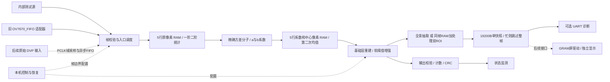

# Basys 3 资源协同流式视频处理：V0 设计规格

版本：1.4-finegain，2026-10-24。状态：**finegain-v3受控模型17项必选检查全部PASS，已发布profile_id=1；可经审阅进入后续RTL实施计划。** 当前没有算法RTL、综合、时序或实板验证结果。修订取舍见[审阅处理记录](review_revision_2026-10-22.md)。

本文件是编码的规范性输入。文中“必须”是实现要求，“预算/目标”是待验证指标，不代表已有实现结果。用户于2026-10-23明确说 **“确认最新设计，开始实现”**，已授权参考模型、RTL、测试程序和构建脚本；算法RTL仍须先通过第15.A节模型门槛。执行记录见[实施计划](plans/2026-10-23-model-gate.md)。

同日用户补充：**“可以不做qvga，只输出vga”**。因此正式硬件仅维护640×480输入、632×472有效核心输出；小尺寸仍用于数值/窗口仿真。这里VGA表示图像分辨率，未新增板载VGA显示口驱动要求。用户确认现有相机本身支持VGA；现有代码的QVGA配置及模块FIFO调度需要分别核实，不以传感器支持分辨率代替采集路径验证。

## 1. 目标、优先级与设计边界

在已购 Basys 3 上实现灰度视频保边降噪和受控细节增强，FPGA 完成全部正常运行算法。用户本轮补充要求：**“设计要求简单，按照逻辑和实现简单的方案设计。”** 因此优先固定参数结构、独立 RAM 端口、单核心时钟和容易验证的帧级控制；资源节约服从正确性和控制清晰度。

项目面向入门组竞赛，不要求算法原创。核心价值是有限片上存储下正确、持续的视觉计算，以及可解释的资源交换和可复现的验证。画质收益需要证据；低资源占用不是缺陷，增加尺度也不是完成竞赛价值的必要条件。

V0 的交付范围：单尺度计算核心、内部测试源、旧摄像头适配、缩小预览快照、可选 UART 诊断、本机控制及错误计数。新摄像头的物理接口、屏幕驱动、Flash 独立启动和双尺度是后续里程碑，不能混入 V0 完成声明。

| 项目 | V0 设计要求 |
|---|---|
| FPGA | XC7A35T-1CPG236，Vivado part `xc7a35tcpg236-1` |
| 核心时钟 | 板载 100 MHz；不建立算法子时钟域 |
| 输入 | 无符号 8 位灰度，保留摄像头 Y 的原始 0～255 编码；不自动拉伸 16～235 |
| 编译配置 | 仅VGA 640×480正式构建；W/H为编译常量，运行时不换分辨率 |
| 算法 | 单尺度自引导滤波 r=2，5×5；两次均值；受控细节重建 |
| 边界 | 有效区域裁剪，每边 4 像素；不做复制/镜像填充，不补算法边界 |
| 输出 | VGA有效区域632×472=298,304像素 |
| 吞吐 | 有效帧内 II=1；帧尾空拍由统一编译参数L_CORE推导，见第7节 |
| 流控 | 核心无 ready；显示和 UART 永远不能反压核心 |
| 预览/诊断 | 单块19,200 B快照，二选一：缩小全景，或同帧同坐标96×96 RAW+处理双ROI；属于显示/诊断缓存 |
| 外设现状 | 现有 GYF-198 OV7670_FIFO 仅作为帧串行过渡适配器；新屏幕未购 |
| 默认后续顺序 | 位精确模型验收 → 核心仿真 → 综合布局布线 → 用户上板验证 |

不包含 ROI 定位、Sobel 主算法、自动调焦、彩色复杂处理、时间域降噪、神经网络、外部 DDR 或更换 FPGA 板卡。最小窗口测试允许 W/H≥16，其余配置不得超过640×480；顶层综合只维护VGA配置。

## 2. 实际基线与证据边界

工作仓库：`E:/Vivado_FPGA_Programs/fpga2026`。

上游：[infr025t/fpga2026](https://github.com/infr025t/fpga2026)，本轮 clone 后通过 `git ls-remote origin HEAD` 核对，基线为 `b262f8d730a1e9e831d2ba23c67438d6c960a931`。本轮文档位于独立子目录；`demo/stream_image_demo` 不修改。

| 证据 | 本轮实际观察 | 对新设计的影响 |
|---|---|---|
| 仓库 README、交付核验.json | 当前源码有 ROI、打包、异常恢复及周期预览；仓库记录 63 项 Python、16 组 RTL、7 组交叉校验 | 属于仓库历史验证记录，本轮未重跑；不等于当前 bit 已验证 |
| image_core.sv | 注释明确输入间隔≥4周期、W×H≤131072、17位输出地址 | 不能仅改 W/H 扩到 VGA；新核独立设计 |
| stream_top.sv | 输出整帧 framebuffer；采集/处理/发送按帧串行 | 新版删除主链对整帧结果缓存和串口完成的依赖 |
| fifo_capture.sv | READ_PERIOD=50，100 MHz 下 RCLK=2 MHz；每两个字节输出一个 Y | 读出上界约 1 MPixel/s；仅 QVGA 双字节读出就需 76.8 ms，不承诺30 fps |
| 历史 utilization.rpt | 2026-10-05 的 routed 结果：863 LUT、1298 FF、25.5 BRAM36、0 DSP | 不是新 RTL 资源，不与新预算混写 |
| 使用手册 | JA 接8位数据、JC接8个控制/诊断信号；旧样机有开漏电阻网络 | 复用旧接线事实；不把电阻分压当通用供电方案 |
| 本机工具 | `E:/Vivado/2025.1/Vivado/bin/vivado.bat -version` 成功，v2025.1、build 6140274 | 路径已核实；本轮未创建 Vivado 工程、综合或生成 bit |
| 板卡资料目录 | 用户给出的目录是 PNG 扫描/截图；抽查封面、资源页和末页 | 与官方 Basys 3 Rev.C 手册核对，不将宣传最高频率用作本设计频率 |

基线保护：不覆盖历史 bit、报告、接线说明和 ZIP；新构建必须输出在新版目录内。GitHub 当前源码优先用于接口事实，项目方向以用户本轮要求和交接说明为准。旧版 ROI 功能不自动继承为新版任务。

## 3. 方案选择与整体结构

| 方案 | 收益 | 主要代价 | 决定 |
|---|---|---|---|
| 固定单尺度、独立行 RAM、固定流水 | 控制清晰，位精确验证直接，帧内 II=1 | 多用若干 RAM 和 DSP | **采用** |
| 均值/系数运算时分复用、多尺度共享 RAM | 节省部分算术或存储 | 端口仲裁、反馈调度、停顿传播复杂 | V0 不采用 |
| 保留完整输出尺寸，边界复制/镜像 | 输出尺寸直观 | 边界生成、行末额外处理、排空及吞吐说明复杂 | V0 采用裁边，显示可补边 |

两轮窗口中的中心原像素同时传递，作为最终 I_align。因此比较原图和处理图具有相同坐标、帧号、裁边和延迟，不依赖 PC 对齐。输出链一直计算全部有效像素；抽取只是显示支路行为。

## 4. 算法定义

### 4.1 浮点参考的唯一数学定义

令输入 I(x,y)∈[0,255]，窗口半径 r=2、N=25。第一轮仅在中心 x=2…W−3、y=2…H−3 计算：

$$S_1=\sum_{5\times5}I,\quad S_2=\sum_{5\times5}I^2,$$
$$\mu=S_1/25,\quad V=25S_2-S_1^2,\quad \sigma^2=V/625,$$
$$a=V/(V+625\epsilon),\quad b=(1-a)\mu.$$

第二轮对系数 a、b 各做一次 5×5 均值，得到 ā、b̄，并与同坐标原图重建：

$$B=\bar a I+\bar b,\quad D=I-B,$$
$$R=\operatorname{sign}(D)\min(\max(|D|-T,0),L),$$
$$O=\operatorname{clip}_{[0,255]}(B+gR).$$

这是普通自引导滤波（I=p），不是下采样版 Fast Guided Filter。两轮窗口后的总支持范围为9×9，输出中心 x=4…W−5、y=4…H−5。除法用上述等价方差分子形式避免先算两个近似均值再相减；整数 V 理论非负。

保边基础层来自成熟引导滤波；本项目的细节软阈值和限幅是受控增强规则，需要单独验证画质，不冒称论文原算法已证明适合本摄像头。

### 4.2 参数范围、模式与参数冻结门槛

| 参数 | 可编码值 | 当前状态 | 含义 |
|---|---|---|---|
| ε | 16、64、256、1024 | profile_id=1使用1024 | 单位是灰度值平方；不是0～1归一化后的数值 |
| T | 整数0～16 | profile_id=1：T_D=2、T_E=4 | 细节死区阈值，低于阈值的细节不回加 |
| L | 固定16 | 16 | 单个像素可回加细节幅度上限，单位灰度 |
| g | G/256，G整数0～512 | DENOISE固定256；profile_id=1的G_E=428 | 最大2；不认为所有组合画质都合格 |
| view_mode | RAW、BASE、DENOISE、ENHANCE | DENOISE（模型及推荐操作） | 实板由SW2:1选择；全零开关实际为RAW |

RAW输出I_align；BASE输出B；DENOISE固定G=256、使用T_D，目标是降噪及细节恢复；ENHANCE使用G_E、T_E，目标是在声明适用的细节上相对RAW产生可测增强。两者共用同一个软阈值硬件，仅锁存的参数不同，不增加第二套增强流水。所有模式保持相同输出尺寸与延迟，计算核不停算。T=0、G=256因L限幅并不普遍等于原图；RAW才是严格旁路。

令d=|I−B|，回加幅度f(d)=g·min(max(d−T,0),L)。对g>1，未夹紧输出时存在f(d)>d的区间，当且仅当`(g−1)L>T`；该区间为`gT/(g−1)<d<gL`，还必须与实际d范围相交。若最终0/255饱和，这个标量条件也不能保证图像对比度增强。

旧候选g=1.25、T=4、L=16满足等号，故所有d上f(d)≤d；d=8/12/16时回加为5/10/15，d=20时才相等。它保留为“部分细节恢复”的模型对照，**撤销其增强默认值地位**。g=1.5、T=4可在12<d<24时放大残差，这仅说明候选具有增强可能，不能据此宣称画质通过。

首轮已使用预登记候选集：共享ε∈{64,256}；T_D∈{2,4,8}、G_D=256；T_E∈{2,4}、G_E∈{384,448}；L=16，共24组，全部未通过受控增强门槛。首轮报告保留在`reports/model_gate/`，不得覆盖或改写为通过。

用户于2026-10-23明确同意扩大软件搜索：共享ε∈{16,64,256,1024}、T_D∈{2,4,8}、T_E∈{2,4}、G_E∈{384,448,512}、L=16，共72组。公式、合法位宽及相对RAW增强≥5%的阈值保持不变。搜索前重新登记独立保留集到`reports/model_gate_round2/`，不得利用原保留集结果选择新发布参数。保留旧参数作为非发布对照；先用调参集选择一个共享ε及两组模式参数，再仅对该参数检查独立保留集。

第三轮`finegain-v3`细化已授权合法增益范围：ε1024、T_D∈{2,4,8}、T_E4、G_E=384…448步长4、L16，恰51组。代码提交`f1adeba`与独立登记提交`747c5da`均先于搜索。只在全部调参检查PASS的候选中，最大化两项主ENHANCE/RAW对比度比值的最小值；并列时先最低T_D再最低G_E，无可行项才用首项诊断。保留集文字`BRAM 2026 / Smooth Gain / Video Core`位于(17,9)，纹理几何`(2*x+y+3)%period < period/2`，噪声entropy2026102303；固定主类、周期4/振幅32与掩膜定义保持。新主输入在登记提交前与前两轮全部数组/帧及本轮调参输入比对，未复用。规范压力图与公开真实区域明确复用。

实测15组调参可行；按预登记规则选中并仅一次评估新保留配置ε1024/T_D2/T_E4/G_E428/L16。17项受控必选检查全部PASS，发布`model/profile.json`的profile_id=1。保留主文字/纹理比1.087972/1.125，ENHANCE阶跃越界2（恰到上限），σ8空间/64帧时间噪声比1.018571/1.012451，新增截断0.018939%（限0.1%）；DENOISE σ8 PSNR提高1.905610 dB。适用结论限登记受控输入：不保证所有细线或噪声强度均增强，已登记最差线条比0.978669、σ16文字比1.036364。第一、二轮FAIL与原输入/报告保持原字节；真实曝光/真实视频及未来RTL逐像素一致保持DEFERRED。完整哈希、来源、四模式与代价见[第三轮报告](../reports/model_gate_round3/report.md)，本结果不代表硬件性能。

只有形成包含数据哈希、各模式指标、适用条件及代价且受控必选检查全部通过的报告后，才能发布参数profile并开始算法RTL。发布记录含profile_id、完整(ε,T_D,T_E,G_E,L)及模型/登记/输入追溯信息；改变数值即换profile_id。用户同日授权：不同真实曝光条件的画质留到相机联调补验，不再阻塞受控模型通过后的RTL；该项保持DEFERRED而非PASS。若扩大后的候选仍无一合格，报告失败并讨论最小调整，不削弱RAW基准或偷偷更换公式。发布参数在实际受控门槛通过前保持未冻结。

SOF 时将开关等请求锁存为帧参数；同一帧绝不混用参数。非法参数请求不生效，保持上次合法参数并增加 cfg_error；不静默截断成另一个值。显示模式也在帧边界锁存。

### 4.3 本轮能确定与不能确定的结论

可以由公式确定：常量场保持不变；除数严格为正；原图/结果同坐标；回加细节绝对值≤32；无整帧算法中间图。

尚不能确定：默认参数对实际镜头噪声、文字和纹理的最优效果，以及实际资源和频率。本轮不编写模型或 RTL，因此第15节将这些列为下一阶段必须实际执行的验收门槛。若画质门槛不满足，必须记录原因并请求修改参数/规格，不允许暗中改成 Sobel 或另一套主算法。

## 5. 位精确数值契约

所有未特别注明的量均为无符号整数；Q 标记表示整数值除以相应2次幂。所有加减先扩展到完整精度，乘法保留全积，最后才舍入；禁止靠截断溢出形成饱和。

定义：非负整数除法 RN(n,d)=floor((n+floor(d/2))/d)；对2的幂的有符号舍入使用“绝对值加半后右移、恢复符号”，恰好半格时远离0。最终像素先夹紧到 Q8 的[0,65280]，再加128右移8。

### 5.1 运算顺序

1. S1、S2 精确累加；V=25S2−S1² 精确计算。若出现 V<0，应触发算术错误并作废该帧；防护输出可置0，但不能静默掩盖实现错误。
2. DEN=V+625ε；A=RN(4096V,DEN)，存为 Q12。固定允许的 ε 保证 A≤4092，可用12位保存；中间舍入保留13位，若超范围同样报错。
3. M=RN(256S1,25)，Q8；b8=RN((4096−A)M,4096)，Q8。
4. 第二轮精确求 SA=ΣA、SB=Σb8；Abar=RN(SA,25)，bbar8=RN(SB,25)。
5. B8=clip(RN(Abar·I_align,16)+bbar8,0,65280)。除以16是将 Q12 乘积转为 Q8。
6. D8=(I_align×256)−B8；R8=sign(D8)·min(max(abs(D8)−256T,0),4096)。
7. E8=有符号RN(G·R8,256)；O8pre=B8+E8，夹紧并转8位。RAW/BASE 按各自定义选择，但共用最终输出寄存器。

### 5.2 位宽与范围账本

| 信号 | 宽度/格式 | 有效范围或说明 |
|---|---|---|
| I、I_align | U8 | 0…255 |
| I² | U16 | 0…65025 |
| 5行竖向和 V1 / V2 | U11 / U19 | 0…1275 / 0…325125 |
| S1 / S2 | U13 / U21 | 0…6375 / 0…1625625 |
| S1²、25S2 | U26 | 各不超过40640625 |
| V | U24；减法用27位有符号临时量 | 最大10143900，即12×13×255² |
| 625ε / DEN | U20 / U24 | 最大640000 / 10783900 |
| 除法器余数的2倍 | U25 | 比较/减法不能只保留24位 |
| A / 4096−A | U12 Q12 / U13 Q12 | A=0…4092；补系数可为4096 |
| M / b8 | U16 Q8 | 0…65280 |
| (4096−A)M | U29完整乘积容器 | 实际最大267386880，先完整保存再舍入 |
| 系数行RAM条目 | U36 | `{A[11:0], b8[15:0], I_center[7:0]}` |
| 系数竖向和 | U15 / U19 | 5A≤20460；5b8≤326400 |
| SA / SB | U17 / U21 | ≤102300 / ≤1632000 |
| Abar / bbar8 | U12 Q12 / U16 Q8 | 同 A/b8 范围 |
| Abar·I | U20 | 最大1043460 |
| 基础层相加临时量 | U17 Q8 | 相加后夹紧；不能先丢最高位 |
| D8 | S17 Q8 | −65280…65280 |
| R8 | S14 Q8 | −4096…4096 |
| G | U10 Q8 | 0…512 |
| G·R8 | S25容器 | G补0转有符号后乘法；禁止误作负数 |
| E8 / O8pre | S18 Q8 | E8在±8192，O8pre在−8192…73472 |
| 输出坐标 | x U10，y U9 | 统一保留原传感器坐标 |
| 帧像素计数 | U19 | 足以表示307200；不沿用17位帧地址 |

水平滑动差分用带符号临时量：V1差用S12、V2差用S20；总和更新使用S23统一容器；系数均值同样先符号扩展，累加后检查范围。所有有效总和仍为非负。

### 5.3 除法器的唯一选择

变量除法采用**展开的12位二进制小数长除法 + 舍入**，每位做余数倍增、比较、条件减法并向后传DEN。初始余数V，逐位生成a的12个小数位；若末余数的2倍≥DEN则加1。初始按12级加1级舍入估算为13拍，每级接收独立像素、II=1；实际物理分级纳入第7节延迟清单。它不是单个迭代除法器，不让同一像素占用共享算术单元13周期，也不使用近似倒数表。

三个除25的归一化器采用精确常数除法：将舍入偏置12计入 n 后，令 q0=floor(n×671089/2²⁴)，若25q0>n则 q=q0−1，否则q=q0。有效 n≤1,632,012；因671089=ceil(2²⁴/25)，候选商最多高1，修正后精确。乘积用U41；25q0用移位加法并保留完整位宽。统一4周期：乘法2、合并/取商1、比较修正1；较窄通路补寄存器保持一致。

两个21位 n 的归一化器各预算2个DSP；17位 n 的 A 均值归一化器预算1个DSP。将长除法与常数归一化分别封装，测试边界和全域，不交给综合器推断不明确的组合 `/`。

### 5.4 数值误差门槛和解析检查

由于 V/DEN 精确，a 的量化误差≤1/8192；μ量化误差≤1/512灰度。将 b 舍入、第二轮均值舍入和 B 乘积舍入一并计入，基础层 Q8 值对同公式浮点值的保守误差上界为：

255/8192 + 255/4096 + 4/512 = 0.1011962891 灰度。

软阈值是连续分段线性函数；固定 I、0≤g≤2 时，B→B+g·soft(I−B) 的斜率绝对值≤1，限幅仍不扩大误差。再计增强乘积 Q8 舍入，最终量化前误差应小于0.104灰度。因此冻结验收：最终8位输出对浮点相同公式取整结果，**最大绝对误差≤1 LSB**；RTL 对位精确模型必须逐像素完全一致。

此处是解析预算，不是本轮跑出的测试数据。下一阶段须用高精度参考检查边界和舍入定义；一旦超过界限，按实现/模型缺陷定位，不能简单放宽门槛。

## 6. 两轮窗口与 RAM 调度

### 6.1 第一轮：5个轮转行bank

5个bank，每个深度W、宽8；当前行bank=y mod 5。每个有效输入周期在当前bank写 I(x,y)，从其余4个bank各同步读同列x，得到前4行像素。当前输入延迟到读数据同拍，组合成5个竖向像素。当前bank不读，所以不依赖同地址读写的器件模式。

第一轮不储存 I² 图像：对5个竖向像素并行平方，花5个DSP换取较窄的行RAM和独立访问。竖向5项求和用3级加法树；平方和也用同样树。随后沿水平方向分别做滑动和，不重新累加整个25点窗口。

水平递推：H(x)=H(x−1)+Vcol(x)−Vcol(x−5)。每行前5列把越界旧值视为0；x=0清空历史和水平累加器。差值先寄存1级，下一周期在单级反馈加法器中更新累加器；**反馈加法器内不得再插流水级**。x/valid也延迟1级，确保行首清零作用于该行第一个差值。输入空拍不更新行地址、历史或累加器，已进入算术流水的旧token仍正常前进。

中心原像素取竖向中间行 I(x,y−2)，再延迟2个有效列，得到 I(x−2,y−2)，与统计结果走等长算术流水。第一轮每行只输出x≥4且y≥4的统计，因此系数图尺寸 W1=W−4、H1=H−4。

### 6.2 第二轮：5个独立系数bank

每bank深度W1、宽36，保存同位置的 A、b8、I_center。bank轮转依据系数图行号；每拍仍是一写四读，读写bank分开。对A、b8做竖向加法树和水平滑动和，除25得到Abar、bbar8。该轮无需平方器。

从第二轮竖向中间条目取 I_center，再延迟2个有效列，得到最终对应原图 I(x−4,y−4)。原像素并非再求均值。这样9×9总支持范围和两轮中心对齐自然一致，不需要另建按整帧时钟数延迟的原图 FIFO。

在原图底右支持点(u,v)到达后，输出中心是(u−4,v−4)，要求u≥8且v≥8。W1/H1 坐标从0重新计数，外部输出坐标仍用原图坐标。两个中心tap的水平移位只按所在级valid推进，不能随每个100 MHz时钟无条件移位。

### 6.3 初始化与复位

不复位RAM内容。复位清valid、行列计数、bank索引、水平历史和流水有效位。帧前4行/列未形成窗口时屏蔽输出，旧RAM内容永远不能进入有效窗口。帧间先排空L_CORE周期再接受下一帧SOF；新SOF只清该帧的窗口状态，不作为运行中随机清空RAM的信号。

## 7. 时钟、逐级延迟与吞吐

下表的周期数定义为输入token在上升沿t被接收，对应结果在上升沿t+L出现；代码和测试采用同一个定义，避免将非阻塞赋值的观察时刻误算为额外1拍。

各模块延迟对一个构建版本固定；本表数字只是初始分级估算，不是已验证的接口常数。统一参数L_CORE=L_MOM+L_COEF+L_BOX+L_REC+L_ENH+L_ALIGN，是顶层、帧尾调度、仿真断言和导出描述符的唯一延迟来源。各并行数据支路单独补齐到同一个模块输出拍。

| 模块/延迟参数 | 初始估算拍数 | II | 说明 |
|---|---:|---:|---|
| moments5 / L_MOM | 9 | 1 | RAM读/选行2 + 平方2 + 竖向树3 + 水平差1 + 累加1；S1较短路径补齐 |
| coefficient5 / L_COEF | 20 | 1 | S1²/25S2及方差/分母4 + 比值13 + b乘法/舍入3；M归一化并行并对齐A |
| coefficient_box5 / L_BOX | 11 | 1 | RAM读/选行2 + 竖向树3 + 水平差1 + 累加1 + 归一化4 |
| reconstruct / L_REC | 4 | 1 | 乘法2 + Q8转换/相加/夹紧2 |
| detail_enhance / L_ENH | 7 | 1 | 差分1、软阈值1、乘法2、舍入1、相加/夹紧与8位化2 |
| output_align / L_ALIGN | 0起算 | 1 | 只补齐真实数据、控制及输出寄存器需要的差异，不为凑数延迟 |
| 合计估算 | **51起算** | **1** | 窗口等待另计；尚未冻结实际L_CORE |

原来额外13拍改为关键路径可分配的预算余量，不要求实际插入。建议先在L_CORE≤64的初始预算内安排寄存器；64没有外部协议强制含义。若超出，保持II=1并重新核算资源/入口等待，不能删时序检查来守住64。模块内长除法的12位商精度不随流水拍数改变。

输入完全连续时：首输出距首输入`8W+8+L_CORE`拍；同一中心像素距其输入`4W+4+L_CORE`拍；最后一个输入像素后L_CORE拍输出EOF。若最终L_CORE=51，VGA分别5179/2615拍；这些仅是公式示例。若实际冻结为64，应由同一参数自然推导，不单独维护第二套常数。

有空拍时，一般式为：中心(c,d)的输出时间=输入(c+4,d+4)被接收的时刻+L_CORE。中心到输出不是固定墙钟延迟。SOF到EOF、源状态提交、CRC可读取以及屏幕可见时间分别计量。

帧尾输入EOF在t：t+1…t+L_CORE不得接受新帧像素，最早t+L_CORE+1接受下一帧SOF；源状态未就绪还需等待。内部源对正常即时源状态的持续接受能力为100 MHz×WH/(WH+L_CORE)。图像输出EOF后的CRC发布可多占1个控制拍，独立锁存旧帧结果，不阻塞下一帧；后续帧CRC的SOF尚需窗口预热，不会与旧帧提交冲突。

100 MHz和II=1必须由仿真及布局布线兑现。关键RAM、除法、重建路径的单元仿真及小型综合时序检查通过后，登记延迟清单、冻结该构建的L_CORE；整链仿真和完整布局布线继续验证它。若再次改分级，更新统一清单、构建标识及相关断言，而不是改动多个硬编码64。

## 8. 像素流、帧控制与参数接口

### 8.1 核心输入/输出

| 信号 | 宽度 | 规则 |
|---|---:|---|
| clk / rst | 1 / 1 | 100 MHz；核心同步高有效复位 |
| pixel | 8 | 仅valid=1时解释 |
| valid | 1 | 每拍最多1个像素，无ready；valid=0表示空拍 |
| x / y | 10 / 9 | 输入从(0,0)按行优先递增；输出为原图坐标 |
| sof | 1 | 只能伴随valid和首像素；输入(0,0)，输出(4,4) |
| eol | 1 | 伴随每行最后一个valid；输入x=W−1，输出x=W−5 |
| eof | 1 | 伴随帧最后一个valid；可与eol同拍 |
| frame_id | 32 | 源侧每次观察到新物理帧SOF递增，模2³²；丢弃也消耗帧号 |
| abort | 1 | 核心域独立高优先级事件；可在valid=0时发生 |
| cfg_id | 16 | 每次合法配置整体提交时递增，帧描述符锁存 |

输出同时提供选定模式pixel、I_align8和round(B8)三个8位值，坐标及valid共用；内部分支的原图/基础层须延迟到同一输出拍。若实现只导出其中一个图像端口，另外两者仍保留内部仿真检查点，不建立三份图像缓存。

优先级：rst > abort/协议错误 > 正常valid。标志必须与像素作为同一个token推进。valid=0时sof/eol/eof应为0；若出现，入口报协议错误。禁止单独把SOF/EOL经过与像素不同拍数的同步链。

总输入像素数必须为WH；输入帧标签/坐标不连续、行长度不匹配、重复SOF、早/晚EOF均作废当前帧。可观察到错误前已经输出的前缀，但不得把它记为成功帧；没有整帧算法缓存就不能“撤回”已输出前缀。

### 8.2 帧状态机

入口状态为 WAIT_SOF → RUN → DRAIN → WAIT_SOF；异常进入 DISCARD/RECOVER。

- WAIT_SOF：只接受合法首像素；没有屏幕、UART忙不影响状态。
- RUN：每拍接收valid，检查行列与帧号；参数保持锁存；正确EOF后转DRAIN。
- DRAIN：禁止新的核心输入L_CORE周期，让最后结果输出；同时等待源侧帧结束状态。源状态已确认OK且输出EOF完成，才产生frame_success；CRC报告寄存器的提交按第10.3节处理。
- DISCARD：使当前frame_id失效，清算术流水valid和窗口状态，继续丢弃残帧；重新同步后才接受下一完整SOF，绝不把残行接到新帧。
- STOP请求：完成当前帧后停止接收后续完整帧；相机仍可运行，源适配器按帧丢弃，恢复时等待下一个SOF。

新配置在WAIT_SOF接受首像素时提交，不在DRAIN期间修改活跃参数。为简化帧间共享控制，V0一次只有一个核心在途帧，不要求多个帧重叠流水。多级算术流水不由普通valid空拍停止；RAM/递推状态只由该级有效token更新。

### 8.3 源侧结束状态

未来DVP适配器必须提供独立的`frame_end_status(frame_id, ok, reason)`：只有物理帧结束、行数和字节数检查完成后才能发OK；不能在“已经收到预计像素数”时提前忽略后续多余行。跨域用保持数据直至确认的toggle握手邮箱，一次最多一个未确认状态，不能对多位总线逐位同步。

核心输出EOF和源OK可先后到达，控制器保存两者，全部满足才提交预览快照并增加completed_frames。旧FIFO适配器的OK仅表示既定采集窗口完成且读出字节数正确，不能证明所有物理行均正确；状态中标记LEGACY_VALIDATION。

若新帧像素已进入入口FIFO，而上帧源状态仍未确认，从新帧首条目入队起至恢复读取的总等待预算S_FRAME=max(128,L_CORE+64)个核心周期，包含剩余DRAIN、源状态与CDC时间，不再叠加另一段128拍。额外64拍是控制/跨域等待裕量，不是第二份算法流水。超过该预算按源协议错误恢复。无新帧数据时等待源状态超时100 ms；旧摄像头采集超时1 s。FIFO溢出立即升级为恢复事件。

结束状态reason编码为：0正常、1初始化失败、2入口溢出、3像素顺序/标志错误、4行数/行长/字节相位错误、5超时、6算术范围错误、7复位中断、8其他源错误。首个错误原因锁存到该帧结束，后续异常可更新粘滞标志但不重复增加invalid_frames。

### 8.4 复位及参数跨域

按键经两级同步和10 ms稳定判决后产生一次请求；开关作为完整16位总线同步并连续稳定10 ms后更新shadow配置。初始上电/BTNC复位在核心同步释放；未来PCLK域异步置位、在本域同步释放，等待FIFO reset_busy退出。

未来异步FIFO只使用经过验证的AMD XPM实现；复位请求/确认握手同时停止写入与读取，确认两侧复位完成后等待新SOF。PCLK停止时不得假装写侧已完成复位，保持输入未就绪并记录超时，待时钟恢复再完成握手。参数不需要送入PCLK域，摄像头寄存器重配另走控制器且只在停止采集时执行。

## 9. 入口FIFO、吞吐包络与异常恢复

入口保留1024条、64位/条的同步或异步FIFO。旧FIFO读出和内部源已在核心域，使用同域FIFO/调度；未来DVP才选择异步配置，不能把旧外部FIFO误说成原始PCLK流接口。

64位条目固定布局：bits7:0 pixel，17:8 x，26:18 y，27 SOF，28 EOL，29 EOF，61:30 frame_id，62 source_error，63保留0。有效位由FIFO非空表达。配置不重复存入每个条目。

正常V0外部输入包络为：核心100 MHz，未来外设有效像素入队峰值≤25 MPixel/s，帧间暂停/交接上界S_FRAME周期，其他时间按1像素/周期出队。该25 MPixel/s是**待外设满足的逻辑设计上界，不是Pmod接线已验证能力**。YUV422的字节PCLK与Y像素率分别核算，例如25 MHz字节时钟对应最多12.5 MPixel/s。内部满速源按100 MPixel/s工作但主动执行帧尾L_CORE空拍，不能套用外部25 MPixel/s积压估算，必须做满速稳定占用仿真。

在FIFO先已排空且上述包络成立时，正常高水位预算为ceil(S_FRAME/4)+8条，8条用于CDC可见延迟/读控制。L_CORE≤64时S_FRAME=128，得到40条。任何改变L_CORE的构建都重新计算此式；若预算达到almost_full阈值896，构建不能按原包络发布。1024条容量不支持任意长停顿。输入包络改变还须检查`Qmax=max_t(A(t)−S(t))`以及跨帧积压是否持续增长；帧平均和峰值速率分别记录。

almost_full阈值896，只用于告警和记录，**不能要求物理摄像头暂停**。full时源域丢弃后续像素，置粘滞overflow并通过独立握手请求核心abort；不能指望往已经满的FIFO再塞一个“错误token”。完成双侧清空后，源域等待新SOF再恢复。

| 异常 | 必须行为 | 恢复点 |
|---|---|---|
| FIFO full | 当前帧无效、overflow计数、丢残帧、协调清空 | 下一完整SOF |
| 行长度/坐标/字节相位错误 | abort并丢残帧；记录原因 | 下一完整SOF |
| 提前或重复SOF | 旧帧无效；当前乱序帧也不拼接使用 | 恢复握手后的新SOF |
| 算术范围违例 | 作废该帧、sticky error；禁止伪装正常饱和 | 下一SOF，重复则停止并报警 |
| 摄像头初始化失败 | 释放SCCB、1 s后重试，计数；内部源仍可运行 | 初始化成功后的新帧 |
| 复位发生在帧中 | 清valid、快照失效、帧号新会话从0开始 | 首个完整新帧 |
| 屏幕/串口停顿或断开 | 只使快照保持忙或导出超时；主链继续 | 丢弃旧预览后接下一帧 |

## 10. 预览、显示占位与UART诊断

### 10.1 一块有限快照，简单的整帧所有权

V0不实现物理LCD驱动。预览模块与消费者之间保留完整快照接口；无消费者时可禁用预览，正常算法仍运行。

快照逻辑容量19,200 B，物理按9600个有效16位字组织，仍是单缓冲。状态EMPTY → CAPTURE → WAIT_COMMIT → CRC_SCAN → READY → READOUT → EMPTY。只在核心输出SOF决定是否捕获及使用哪种布局；不是EMPTY则**整帧跳过预览**，核心继续处理。捕获数正确、核心EOF和源OK全部满足后进入CRC_SCAN，按实际导出字节顺序读快照并计算payload CRC；扫描结束才置READY。坏帧不提交，READOUT不覆写。

VGA对裁剪输出取x_out、y_out坐标均为4的倍数，得到158×118=18,644 B。坐标以裁剪图左上为(0,0)，其原图原点为(4,4)。最大尺寸160×120只表示容量，不对实际抽取图像强行补足。抽样使用最近点，可能混叠，仅用于预览；画质指标在未缩小的完整核心输出上评价。

增加可选ROI_PAIR诊断：同一帧、同一原图坐标保存96×96的I_align和选定处理结果，两个逻辑平面共18,432 B。它用于像素尺度细线、文字和噪声检查，不做抽样/插值；这里的ROI仅为诊断裁取，不恢复旧工程的目标定位算法。只能比较RAW与当前选定的BASE/DENOISE/ENHANCE，不能声称一次记录了四种模式。离线模型才对同一个输入同时比较四模式。

同帧双ROI还支持局部位精确核验：将96×96 RAW作为模型输入，按相同两轮5×5规则裁边4，得到88×88结果，与导出处理ROI的局部坐标[4…91]×[4…91]逐像素比较。该内区的9×9支持完全位于已保存RAW内，不缺邻域。ROI外圈4像素因缺外部支持只作画质观察，不做这种局部重算；全幅一致性仍由内部源完整输入/CRC及仿真证明。

ROI原点用原图坐标，默认居中：x0=4+floor((W−8−96)/2)，y0=4+floor((H−8−96)/2)。VGA为(272,192)。编译参数可覆盖，需满足4≤x0≤W−100、4≤y0≤H−100。W−8或H−8不足96的单元测试配置不启用ROI_PAIR；非法ROI请求报cfg_error且不捕获，不静默移动ROI。原点、布局、所选模式在输出SOF锁存至导出完成。

**每拍两字节写入的实现契约：** ROI内第k个有效坐标对应RAM字k，低8位RAW、高8位处理结果；一个16位同步写即可维持II=1。线上payload按`RAW0,PROC0,RAW1,PROC1,...`交错导出，PC只解交错生成两张96×96图，不承担算法。全景模式则把连续两个抽样像素装入同一16位字，地址floor(k/2)、低字节先行；保留一个8位待配对寄存器，末字节落单时高字节填0且不计入payload。实际两种全景大小均为偶数。

物理使用5个RAMB36、每块2048×18，其中16位数据，提供10240字/20480 B容量；仅暴露前9600字/19200 B。两种布局共用这组RAM，不创建两组96×96存储器。19,200 B无需增加，但写口必须按16位组织，不能沿用单字节写口再假定每拍可写两个像素。

快照可以是一帧缩小预览或一帧双ROI，不能称“系统绝无帧缓存”。它永远不回馈滤波核。单快照换取简单所有权，代价是低于处理帧率的导出率；单GRAM屏扫描撕裂仍需后续验证。全景与ROI_PAIR互斥，不建立第三份快照。

消费者接口：`snapshot_valid`保持到`claim`；描述符包含第10.2节对应帧的全部字段。claim之后通过`rd_en, rd_addr[14:0]`按**字节地址**读取，底层字地址=rd_addr>>1，低位选择字节；同步RAM读加字节选择保证1周期后`rd_valid,rd_data[7:0]`有效，不能额外加未申明的一拍。CRC_SCAN也用这个读接口，每周期1字节，需payload_bytes+1拍完成最后读回；再1拍锁存CRC/READY。它只占显示分支，主链继续运行。完成发release；只有一个消费者，V0不做多消费者仲裁。

消费者5 s无完成视为预览导出超时，先复位消费者/撤销本次输出，再释放快照并计数；不能让旧消费者继续读已经复用的RAM。没有任何屏幕接线时选择NONE消费者，快照自动释放或编译关闭，不阻塞核心。

### 10.2 UART诊断接口

默认1,000,000 baud、8N1，从100 MHz分频100。仅作为开发工具，PC不计算正常运行算法。不能用1 Mbps回传VGA连续灰度流；即使不计包头，VGA全景快照单次线路时间也约186 ms。

为避免沿用旧FPG1语义，新版采用`VEF0`协议**version=2，88字节头**；version=1只存在于旧设计，未实现，无须写兼容分支。多字节整数little-endian。三类包：OVERVIEW(kind=0)的payload长度width×height；ROI_PAIR(kind=1)长度2×96×96；STATUS(kind=2)无payload。kind/layout决定解释方式，不能再将所有包当作width×height单幅图。

| 偏移 | 字节数 | 字段 |
|---:|---:|---|
| 0 | 4 | ASCII `VEF0` |
| 4 | 1 | version=2 |
| 5 | 1 | view_mode：0 RAW、1 BASE、2 DENOISE、3 ENHANCE |
| 6 | 1 | flags：bit0 LEGACY_VALIDATION，其余0 |
| 7 | 1 | header_len=88 |
| 8 | 4 | frame_id |
| 12 | 2 | cfg_id |
| 14 / 16 | 各2 | 单个图像平面的width / height；STATUS为0 |
| 18 / 20 | 各2 | 原图坐标origin_x / origin_y；STATUS为0 |
| 22 / 23 | 各1 | sample_step（ROI=1、STATUS=0）/ source_kind（0内部，1旧FIFO，2未来DVP） |
| 24 | 4 | payload_bytes |
| 28 | 4 | payload_crc32 |
| 32 | 2 | epsilon |
| 34 / 35 | 各1 | T / L |
| 36 | 2 | 本帧实际G；DENOISE=256，BASE/RAW记0 |
| 38 / 39 | 各1 | kind / layout（0单幅gray8、1 RAW/PROC交错、2无图） |
| 40 / 42 | 各2 | 完整裁剪核心输出core_width / core_height |
| 44 | 4 | core_pixel_count，应等于core_width×core_height |
| 48 / 52 | 各4 | core_raw_crc32 / core_selected_crc32 |
| 56 | 2 | 本构建实际L_CORE，禁止以估算64代填 |
| 58 / 59 | 各1 | PATTERN_ID（非内部源为255）/ crc_flags（bit0=两个完整输出CRC均有效，其余0） |
| 60 | 2 | profile_id（0表示尚无发布profile，不能交付默认增强演示） |
| 62 / 63 | 各1 | 最近错误reason / 保留0 |
| 64 / 68 | 各4 | diagnostic_seq / report_overwrite_count |
| 72 / 76 / 80 | 各4 | completed / invalid / accepted计数器快照 |
| 84 | 4 | header_crc32，覆盖头部字节0…83 |

所有CRC采用CRC-32/ISO-HDLC：反射多项式0xEDB88320，初值/最终异或0xFFFFFFFF。payload_crc32只覆盖实际payload，ROI为交错字节序；STATUS的空payload CRC=0。header_crc32不含自身4字节；发包前从锁存头部逐字节计算，因此发送中任何监测更新都不能更改头。接收器验证头CRC、类型/尺寸/长度和payload CRC，截断或错误包重新搜索魔数。参考向量`123456789`的CRC为0xCBF43926，下一阶段需核验字节/bit顺序。

### 10.3 完整核心输出CRC与读取

在最终输出对齐之后、任何抽取或ROI选择之前，设置两套独立32位CRC状态：每个out_valid分别吞入I_align8和本帧selected_pixel8。覆盖整个裁剪有效区域、行优先、每像素1字节；不含空拍、坐标、标志或包头。CORE RAW CRC也是裁剪后的原图，不是传感器全幅CRC。CRC逻辑必须II=1，使用一字节展开的固定XOR网络，不把一个像素拆成8个时钟。

out_sof同拍以初值处理第一个字节；每个有效像素累计count；out_eof同拍先纳入最后一个字节再最终异或，锁存pending结果及该帧描述符。只有正确像素数、无abort且源侧OK齐备才发布有效报告；源OK先到则等EOF，晚到则保留pending。EOF后至多1个控制拍提交（晚到源OK时为其后1拍）。坏帧不发布成功CRC，last_good保留，invalid计数和reason另更新；复位清有效标志。RAW模式下两个CRC必须相等。

完整CRC不因预览关闭、ROI选择或快照忙而停止。发布时diagnostic_seq模2³²递增，并原子更新一个**latest报告邮箱**；尚未被消费者claim的报告被覆盖则report_overwrite_count饱和递增。只保留latest，不建立逐帧报告队列；报告覆盖不是处理丢帧。邮箱、正在发送的报告、快照所属帧的CRC描述符必须为独立寄存器副本，防止UART慢读时混入新帧字段，均不占额外BRAM。

图像快照绑定自己frame_id的完整CRC，之后即使latest更新也不能改变。无图像可发时UART在空闲包边界最多每100 ms领取一次最新且尚未发过的报告，发STATUS；若CRC尚未有效，可发crc_flags=0的状态头，frame_id/core_count/CRC置0，不冒称成功帧。状态包的frame_id、配置、CRC来自同一个last_good副本；reason和运行计数按发包领取时原子快照，它们可反映之后的错误。图像包运行计数取该帧提交时快照。每次领取/构造头都重新计算header_crc。

内部源校验：用报告中的W/H（core尺寸各加8）、frame_id、PATTERN_ID和头中实际ε/T/L/G重建同一输入和处理配置，再按相同裁剪/字节序比较像素数及两个CRC；profile_id辅助追溯，不能替代实际参数。CRC有碰撞可能，不能替代仿真逐像素零差异。旧摄像头没有同帧完整输入记录时，不能仅凭CRC宣称全幅算法一致；双ROI可按第10.1节验证中心88×88位精确结果。

### 10.4 显示接口的后续适配

未来LCD驱动独占上述快照；逐像素将灰度转RGB565：R=Y[7:3]、G=Y[7:2]、B=Y[7:3]。全景可居中或放大2倍；ROI_PAIR可将两块96×96区域并排显示并标明RAW/模式名称，解释成两个逻辑平面而非一幅混合图。边框由显示驱动生成；不改变算法坐标。记录处理帧率、预览完成率、面板刷新率三个独立指标。

对于320×240 RGB565满屏30次/秒，纯载荷是4.608 MB/s。8位8080接口每像素至少2次数据写，还需命令和间隙；SPI至少36.864 Mbit/s纯载荷，不能用标称SPI时钟直接承诺该更新率。V0快照较小且允许降更新率，没有30 fps显示承诺。

## 11. 物理存储、DSP与逻辑预算

统一以一个RAMB36等价块作为BRAM单位，RAMB18=0.5；板卡总量50 RAMB36，90 DSP48E1，20800 LUT，41600 FF。225 KiB是包含BRAM可配置位的标称总容量，实际可用字节受位宽、深度和端口组织约束。

### 11.1 存储账本

| 存储 | VGA逻辑组织 | 逻辑字节 | 端口/访问 | 物理映射预算 |
|---|---|---:|---|---:|
| 原像素5行bank | 5×640×8 | 3200 | 每周期1个bank写、其余4个bank各读1次 | 5 RAMB18=2.5 BRAM36 |
| 系数+中心像素bank | 5×636×36 | 14310 | 每周期1写bank、4读bank | 5 RAMB36（1024×36） |
| 入口FIFO | 1024×64 | 8192 | 写域1写、读域1读，或同域 | 2 RAMB36（各1024×36，8位未用） |
| 预览/双ROI快照 | 9600×16有效字 | 19200 | 每拍最多1次16位写；CRC扫描/导出读，阶段互斥 | 5 RAMB36（每块2048×18，使用16位） |
| 摄像头配置/控制ROM预留 | 最多2048×8 | ≤2048 | 只读 | 1 RAMB18=0.5 BRAM36 |
| 水平历史与中心tap | 原统计5×(11+19)bit；系数5×(15+19)bit，另两个2×8中心tap | 44 B起，不含算术流水 | 寄存器，无RAM端口冲突 | LUT/FF，0 BRAM |
| 控制/流水元数据、CRC报告 | 按L_CORE及局部valid组织，报告独立寄存器副本 | 计入FF | 不为每个RAM像素重复保存frame_id | 0 BRAM |
| **基础物理合计** | 含预览和入口，不含ILA | **≤46950 B + 寄存器** | — | **15 BRAM36** |

原像素+系数核心逻辑存储：VGA 17,510 B，按7.5 BRAM36核心预算。物理映射采用已公开的7系列RAM合法组织，仍需综合报告核验；尤其36位系数条目不能被工具无意拆成多组窄RAM增加碎片。

另预留9 BRAM36用于布局碎片、诊断ILA及可选小队列，V0发布上限24/50。不能直接拿“逻辑字节÷4608”替代上述逐bank统计，也不能把这9块在每个模块重复计作可用余量。普通发布构建应关闭ILA。

### 11.2 运算资源账本

| 模块 | DSP预算 | LUT估算区间 | FF估算区间 | 对资源开销的解释 |
|---|---:|---:|---:|---|
| moments5 | 5 | 400～900 | 500～1200 | 5路平方换取无平方行RAM和直接竖向tap |
| coefficient5 | 4 | 600～1400 | 1100～2300 | S1² 1、M归一化2、b乘法1；13级比值用比较/减法逻辑 |
| coefficient_box5 | 3 | 450～1000 | 400～1000 | A均值1、b均值2；行/列求和用加法器 |
| reconstruct + enhance | 2 | 300～700 | 300～800 | Abar×I和G×R各1 |
| 元数据/对齐 | 0 | 150～400 | 500～1200 | 初始L_CORE≤64分级预算与边界标志 |
| 入口FIFO与校验 | 0 | 300～700 | 500～900 | CDC指针、帧坐标校验 |
| 源、控制、摄像头配置 | 0 | 800～1600 | 700～1500 | 内部源、旧适配器、去抖、配置、超时 |
| 预览控制 | 0 | 500～1100 | 400～1000 | 单快照、双ROI打包、CRC扫描 |
| UART与监测 | 0 | 700～1600 | 2000～4000 | 两套全幅CRC、头/载荷CRC、报告副本和计数器 |
| **合计估算** | **14** | **4200～9400** | **6400～13900** | 不含ILA；新诊断增加逻辑/寄存器预算，尚未综合 |

V0验收资源上限：BRAM36≤24、DSP≤24、LUT≤12000、FF≤20000。上限保留余量，不代表应把资源填满。超过任一上限时先调查推断方式、位宽和寄存器复制；需要改变算法或接口时修改规格并说明，不能为了数字好看删减错误检查。

### 11.3 两项主要资源交换证据

固定算法、位宽、II、W/H、工具和约束，分别只替换一个模块组织，避免同时改变算法和显示条件。下一阶段可用局部综合作对照，无需把多个架构轮番上板。

| 证据项 | 可比较的基准 | 当前组织的代价与收益（VGA预算） | 必留证据 |
|---|---|---|---|
| A：平方计算换存储 | 每输入像素平方1次，将I和I²作为24位条目保存5行 | 基准行RAM 9600 B、5 BRAM36、1平方DSP；当前3200 B、2.5 BRAM36、5平方DSP。多4 DSP，少6400逻辑字节和2.5 BRAM36 | 同输入S1/S2位精确一致、II=1、两种局部综合RAM/DSP及最差路径；全系统仅此替换预计DSP10→14、BRAM17.5→15 |
| B：利用系数RAM余宽携带中心像素 | A+b占28位，仍映射5个1024×36 RAM；另外用有效token延迟队列对齐原像素 | 基准独立队列深度2(W−4)+2=1274、宽8，约1 RAMB18；当前把I放入36位条目剩余8位。增加系数RAM内逻辑数据3180 B，省独立1274 B队列和0.5 BRAM36及其控制 | 对齐坐标/空拍一致、RAM推断及控制逻辑对照；承认当前逻辑数据反而多1906 B，收益在物理块/控制简化 |

B的队列基准以第一轮已经提取并对齐的I_center为输入，按**系数valid**计数，不能用固定墙钟延迟代替；局部算术对齐寄存器两边均计入。对照预算不承诺综合后精确差值，如工具改变映射，以实际报告解释。两项结论分别成立，不把两种不同基准的收益直接相加。

其他取舍作为辅助解释：独立bank减少端口仲裁；展开除法提高吞吐但增加逻辑/寄存器；单快照减少存储和所有权复杂度但降低导出率。比赛报告以A/B的设计假设、代价、实际收益和可复现命令为主，不用资源占用百分比代替优化证据。双尺度只有在同测试集上获得可测收益才进入修订。

## 12. 外设与本机操作

### 12.1 现有摄像头适配

优先复用已购GYF-198 OV7670_FIFO硬件，按用户VGA要求重新核定配置与调度；现有源码的QVGA寄存器表和整帧先写后读不能直接作为VGA适配实现。SCCB/复位模块可审阅复用，字节顺序按实际配置核验，不自行交换。现有VGA路径评估见[2026-10-23核查记录](vga_camera_assessment_2026-10-23.md)。该记录未证明并发读写已可用，不能据此填写采集PASS。

| 信号 | 板端/FPGA引脚 | 用途 |
|---|---|---|
| D0…D7 | JA1/2/3/4/7/8/9/10；J1,L2,J2,G2,H1,K2,H2,G3 | 外部FIFO数据 |
| SIOC / SIOD | JC1/2；K17/M18 | 开漏SCCB |
| VSYNC / WEN | JC3/4；N17/P18 | 捕获窗口同步/写允许 |
| RRST_N / RCLK | JC7/8；L17/M19 | FIFO读控制，默认2 MHz |
| RST_N / HREF | JC9/10；P17/R18 | 开漏复位/被动诊断 |

该表记录现有接线，不授权修改物理接线。WRST连模块VSYNC，OE/PWDN接地和旧电阻网络以仓库使用手册及实际模块为准；本轮没有测量引脚电压。不能给现模块附会独立读使能、原始PCLK可用或持续读写能力。

现有OV7670传感器支持VGA；模块FIFO的可用控制信号、时序和积压边界需要独立证明。优先评估现模块并发读写，不预先要求更换摄像头。若缺少必要控制/观测信号，先记录具体缺项并与用户讨论。连续计算核吞吐验收由内部源完成并明确标注来源；不能靠片上缓存制造并不存在的采集能力。

### 12.2 屏幕候选及选择理由

屏幕物理驱动本轮明确排除，V0不绑定任何LCD引脚。建议优先考虑有GRAM、资料齐全、能以3.3 V逻辑工作的模块，按实际模块版本而非只按控制器型号采购：

| 候选模块 | 接口/规格（已查资料） | 本项目建议 |
|---|---|---|
| LCDWIKI MRB2801，2.8英寸 ILI9341 | 320×240，8/16位8080可切换，默认16位 | 小屏首选候选；选8位减少IO，具体模块要改总线配置焊盘；该版8位模式用DB8…15 |
| LCDWIKI MRB3205，3.2英寸 ILI9341 | 320×240，8/16位并口，默认16位 | 更易看清的同分辨率候选，核实模块引脚与电平后选择 |
| LCDWIKI MRB3951，4.0英寸 ST7796S | 480×320，8/16位并口 | 后续较大预览候选；同系列8位模式使用DB0…7，不能照搬ILI9341接线 |
| Waveshare 2.8inch Resistive Touch LCD | 320×240，SPI；官方文档注明存在HX8347D/ST7789批次 | 若更看重少接线、能接受较低更新率可选；下单前核对控制器批次，不能只写“2.8寸屏” |

现有相机占JA和JC共16根信号，JB与JXADC合计剩16根逻辑信号。8位8080只写数据8根+WR/DC/CS/RESET共12根，另可选TE、背光控制；RD可在满足模块要求时固定为高。16位并口再加控制超出现有余量，所以不推荐直接按16位使用这些模块。JXADC是8根可作数字IO的引脚，不是只有4根；其板上路由/滤波结构可能限制数字速度，后续必须单独核查。

VGA口可用于以后独立显示，但固定扫描时序需要可重复读取的显示存储；本版单快照的互斥写读不能直接提供无间断VGA扫描。要改VGA，需增加双预览缓存或专门冻结/交换策略并单列时钟域。MIPI裸屏不属于GPIO直连方案。

模块选定后才冻结：精确SKU/修订、逻辑电平、供电和背光电流、总线模式焊盘、完整引脚表、初始化序列、WR setup/hold/周期、TE接线及撕裂策略。本轮不猜这些值，也不需要为缺失屏幕阻塞核心编码。

### 12.3 新版开关与状态

新版操作表独立于旧Demo，不沿用旧SW2的ROI含义。固定：SW0=0旧摄像头/1内部源；SW2:1=00 RAW、01 BASE、10 DENOISE、11 ENHANCE；SW4:3=00使用发布profile的ε、01强制16、10强制256、11强制1024；SW5=1启用图像快照、0只计算并可发STATUS；SW6=0全景、1双ROI；SW15=1暂停后续帧。SW7…10保留0；SW14:11选择16页LED诊断。BTNC复位。

T_D、T_E、G_E和发布ε作为profile编译配置写入：profile_id=1为2、4、428和1024；L固定16。强制ε与认证profile不一致时导出profile_id=0并保留实际参数/cfg_id，标明调试配置。V0不增加串口写寄存器协议。模式、源、布局、ε和预览开关在帧边界生效；更换源先完成当前帧、清FIFO再等待SOF。上电不依赖PC命令。

发布profile后，推荐内部降噪全景：仅SW0、SW2、SW5置1，其余0，再按BTNC；使用已认证ε。加SW6切同帧RAW+DENOISE双ROI；将SW1也置1则选RAW+ENHANCE。SW0置0切旧摄像头。全零开关表示旧摄像头RAW、不导出图像，但有效CRC仍可经STATUS读取；不称为默认降噪演示。

LED0页：bit0运行、1源初始化成功、2快照忙、3源错误、4输入溢出、5算术/协议错误、6预览超时、7暂停、15:8最近完成frame_id低8位。页1～14依次显示seen、accepted、completed、invalid、dropped_source、preview_captured、preview_skipped各32位计数的低/高16位；页15显示FIFO高水位低10位和粘滞错误标志。计数32位饱和到0xFFFFFFFF，frame_id使用模计数；清除只由复位执行。

其余内部计数包括overflow次数、cfg_error、preview_timeout、每秒核心完成数/预览导出数、最大输入到输出时间。至少通过仿真检查点保留；V0不要求额外复杂的状态串口协议。

seen按当前选中源观察到的SOF计数；accepted在核心首像素被接收时计数；completed仅在frame_success计数；invalid仅对已accepted且失败的帧计一次；dropped_source统计从未accepted的整帧（暂停、丢弃或恢复期间）。无在途帧且无计数饱和时，accepted=completed+invalid，seen=accepted+dropped_source。预览跳过不增加invalid或dropped_source。

### 12.4 供电与Flash里程碑

最终设备独立5 V供电，FPGA配置写入板载Flash，开机自动初始化外设并按开关运行。具体电源容量按实际摄像头、屏幕、背光最大电流和裕量计算；电源引脚与信号引脚分开，共地，不由FPGA普通IO供电。不在本轮烧写Flash或更改板卡跳线。

Flash启动验收留到显示/相机型号稳定后：断开PC，至少10次冷启动、10次复位，记录初始化结果与首个有效帧；确认使用对应器件和Flash型号的配置文件。V0逻辑验证不等于这一里程碑通过。

## 13. 时序和CDC约束要求

新约束文件独立建立，不复制旧文件全部例外。已核实板载时钟W5，100 MHz的create_clock周期10 ns；旧适配器信号引脚以第12节为起点。

- 核心内部所有RAM、DSP、计数器均用clk100，慢操作用时钟使能。外部RCLK是注册输出，不作为算法内部逻辑时钟。
- 旧2 MHz FIFO输入应以真实RCLK边沿、AL422B时序和采样相位重新核算；旧XDC含25 ns最大输入延迟、20/19周期multicycle，只能在相同实际电路和采样结构下审阅使用，不能搬到新DVP上。
- 未来DVP在PCLK域采样数据/HREF/VSYNC，建立PCLK和基于传感器手册的input_delay最小/最大值；原始并行数据经异步FIFO进核心。未选传感器时不编造input_delay。
- 仅对真实异步同步器/FIFO跨域路径施加适当例外，保留Gray指针的CDC和物理约束；不能用全局false_path隐藏FIFO指针问题。
- 按键/开关/SCCB等低速异步端点应有明确同步或稳定采样依据，例外只作用于必要端点。LCD后续驱动必须按模块写周期和板级延迟做output_delay或等效约束。
- RAM采用同步读，无异步读大数组，不复位存储阵列；DSP的输入/乘积/输出寄存器明确设置。检查是否因无意复位导致RAM被综合为FF。

布局布线验收：setup WNS≥0、TNS=0，hold WHS≥0、THS=0；无未解释的未约束时钟/数据端点，无未处理的CDC critical、DRC critical、锁存器或多驱动。I/O例外和开放漏极相关警告逐项写理由。仅“WNS为正”不足以通过；板外Pmod信号完整性仍需用户实测。

## 14. 双尺度扩展的可行性边界

V0完成后，优先采用**两套独立尺度并行**：r1=2、r2=4；不先引入复杂的跨尺度RAM共享。第二尺度同样两轮均值，9×9窗口，总支持17×17，共同输出区域x/y从8开始，VGA共同尺寸624×464。第二尺度需重新核定定点范围和延迟，不能拿V0的25/625常数直接复用。

候选融合定义为B1=GF_r2(I)、B2=GF_r4(I)、Dfine=I−B1、Dcoarse=B1−B2，再分别软阈值/限幅并加到B2上。两个尺度都从同一原图计算，不把串行GF(B1)冒充并行多尺度。两支路与融合参数属于后续修订规格，当前不启用。

| 扩展项 | 保守资源预留 | 说明 |
|---|---:|---|
| r=2现有行缓存 | 7.5 BRAM36 | 保留 |
| r=4原图9行 | 4.5 BRAM36 | 9个独立RAMB18 |
| r=4系数9行 | 9 BRAM36 | 9×(W−8)×36；A范围需重新证明 |
| B1对齐队列 | 4 BRAM36 | 4096×36，含B1和坐标；按共同ROI顺序入队/出队 |
| 公共入口、快照、控制ROM | 7.5 BRAM36 | 与V0相同 |
| 额外调试/碎片余量 | 8 BRAM36 | 全系统统一余量 |
| 合计上界预算 | **40.5/50 BRAM36** | 不是已验证占用 |

对齐队列必须按匹配坐标出队，不能只延迟固定时钟，因为输入可能有空拍。r=2与r=4空间等待差为4行4列，VGA按4×632+4+64=2596个候选token保守计，4096深度覆盖该估算；这里64是允许的额外算术级差预算，不是已经确定的第二尺度延迟。任何新延迟超出这个包络必须重算。

预留双尺度全系统DSP≤48、LUT≤16000、FF≤28000；这是是否继续扩展的门槛，不是当前估算精度足以保证实现。首版释放的存储用于第二尺度和有意义的中间量，而非为了占满资源。若单尺度已经满足质量但双尺度没有可测收益，不应仅为增加运算量而加入。

## 15. 下一阶段验证与完成标准

编码授权到达后，先完成A门槛再编写算法RTL；模型与测试代码也属于下一阶段。实现不得以“先上板看看”代替下列证据。

### A. 浮点与位精确模型

固定测试集包括：全部256种常量场；水平/垂直/斜向阶跃；0/255棋盘格、单点脉冲；1/2/4像素线条；细文字、低对比纹理；亮度渐变；截断高光/暗部；不同曝光真实图。使用仓库真实图前记录路径与SHA256，不把UART合成图当真实摄像头图。

有干净参考的合成图叠加零均值高斯噪声σ=2/4/8/16，每类5个固定种子0…4，明确生成器、版本、量化顺序并保存最终输入与哈希；跨版本复现实验以保存的输入字节为准。真实图至少含平坦区、文字、纹理三类，不虚构干净参考。图像和指标统一裁掉4像素，避免用不同边界骗取指标。

| 检查 | 冻结通过条件 |
|---|---|
| 常量保持 | 所有常量图、所有合法模式/ε组合均保持常量 |
| 数值范围 | 无V负值、除零、未定义溢出；默认及参数边界均检查 |
| 定点误差 | 对同公式浮点模型，最终8位最大误差≤1 LSB；同时记录MAE、RMSE、误差直方图 |
| RTL后续逐像素一致 | 对位精确模型零差异，包含坐标、标志和frame_id |
| σ=8平坦区降噪 | 默认DENOISE，固定5种子平均PSNR比带噪输入至少提高1 dB；均值偏移≤1灰度 |
| 干净阶跃 | 32↔224水平/垂直/斜边，默认模式的远端对比度保持≥95%；边附近超出两端范围的幅值≤2灰度 |
| 细节保留 | 无噪声64↔192的1/2/4像素线图，DENOISE平均线条对比度≥RAW的80%；报告最差图，不只挑最佳 |
| 相对RAW的受控增强 | 在调参前指定的低/中对比度细节集合中，独立保留集至少2个案例的ENHANCE线条/纹理对比度比RAW提高≥5%；同时报告BASE、DENOISE，不允许只比BASE通过 |
| 噪声限制 | 固定平坦掩膜，对σ=2/4/8，ENHANCE空间标准差≤同一带噪RAW的1.1倍；同时报告DENOISE的降噪收益和σ=16退化情况 |
| 光晕与截断 | 对无噪声32↔224阶跃，ENHANCE越出两端范围的幅值≤2灰度；对已登记的中间灰度细节集合，新产生的0/255像素比例≤0.1% |
| 视频稳定性 | 相同输入帧重复64次，输出必须位精确相同；静态场景叠加独立噪声的64帧序列，平坦区平均逐像素时间标准差≤RAW的1.1倍，报告移动边缘/曝光变化序列的光晕和闪烁 |

PSNR采用峰值255、MSE按裁剪后的同一区域计算；不能拿“增强结果对带噪原图PSNR更高”当增强质量。线条对比度定义为已知线条掩膜均值与相邻背景掩膜均值之差的绝对值，掩膜随输入固定。阶跃远端区域距边≥8像素；斜边用垂直距离。SSIM可补充，但固定窗口/库版本后才比较，不代替上述门槛。

完整四模式比较必须用同一输入、同一裁剪、固定掩膜；至少包括干净/加噪的细线、文字和周期4/8像素的纹理（中间灰度128，候选振幅16/32），以及不同曝光真实图。调参集合与保留集合的图案、噪声种子/图像哈希和两项主增强案例在参数搜索前登记；两例不能是同一输入换两个截图，必须来自不同图案或独立真实场景。每项报告RAW/BASE/DENOISE/ENHANCE数值、相对RAW变化、最差案例、噪声/光晕/截断代价。实际结果可揭示不适用条件，不要求所有模式在所有指标上胜过RAW。

新截断比例定义为原始像素在1…254而输出等于0或255的像素数除以固定掩膜像素数；已有饱和高光/暗部另作压力测试，不用既有截断掩盖新增截断。光晕除幅度还报告受影响像素宽度和剖面图。时间标准差先按每个固定像素位置跨64帧计算再在平坦掩膜取均值；不能用只看单帧空间PSNR替代视频稳定性。真实序列优先锁定曝光/增益和场景，若无法锁定要单列采集波动，不把先后不同帧当作同帧对照。

阈值由软件模型实际检验。通过第4.2节当前授权候选集及新独立保留集的受控必选检查后才登记发布profile、适用条件和失败场景；真实曝光画质按用户授权保留为相机联调补验。首轮24组失败记录必须保留。若扩大后的候选仍不能同时满足门槛，记录问题并与用户讨论参数范围/指标/公式的必要调整，不弱化RAW基准。对同一profile关闭显示不应改变计算。均值/双边滤波可作软件对照，不变更硬件主方案。

精确常数除25在n=0…1,632,012全域验证；变量除法检查V=0、最大值、各ε及舍入临界余数，并以随机/结构化窗口覆盖实际V集合。输入位宽边界和符号转换必须专项检查。

### B. 模块与整链仿真

先以16×16和非整齐宽度17×19定位窗口/行首问题，再跑正式640×480。测试包括连续valid、随机空拍、长行消隐、每帧L_CORE空拍、连续至少10帧；在首末像素/窗口未满/除法器中途复位；错误SOF/EOL/EOF、错行长、漏行、帧号跳变、算术异常注入。小图不启用96×96 ROI。

每个模块核对像素、原图中心坐标、帧标志、实测固定延迟、像素数量和边界。核心输出EOF必须等于对应输入EOF+L_CORE；从底右支持点到输出为L_CORE，对中心点按第7节计算。第二轮首输出必须对应原图(4,4)，不能错取(2,2)或(8,8)。仿真期至少使用两种合法流水分级配置核对调度/断言由统一参数推导，发布时只选通过时序的一种。

单独覆盖每bank读写计划和满速水平递推，断言同bank无读写冲突、RAM不依赖初始值。未来异步FIFO独立做不同比率/相位、复位busy、满空切换和PCLK停走；V0未实现DVP时不能把这部分填为PASS。

显示/串口消费者分别永久忙、随机慢、完全关闭：固定输入下主链接受数、两项完整输出CRC、完成帧数保持相同，只允许预览/报告导出相关计数不同。快照在WAIT_COMMIT/CRC_SCAN/READY/READOUT均不得被新帧写入；坏帧不提交。

新增诊断专项：ROI内满速每拍一次16位写，逐坐标核对解交错后的RAW/处理数据；测试居中、四个合法极限原点、非法原点、帧中改布局、奇数全景载荷尾字节。验证18,432 B的ROI长度、快照payload CRC与完整核心CRC的区别，以及CRC_SCAN首末字节。完整CRC覆盖未导出像素，注入ROI外单像素错误也应改变完整CRC；检查首/末像素、随机空拍、abort、源OK早/晚到、复位均无漏计/串帧。串口慢读期间latest快速覆盖，发送头和快照描述符必须始终保持同一帧，overwrite计数如实增加。STATUS在图像关闭时仍可读取。UART检查88字节头、三种kind、交错顺序、头/载荷CRC及中断恢复。

对相同完整输入，再用其96×96 RAW裁块单独运行模型，确认88×88局部结果等于完整模型同区域，避免PC校验误用复制边界或只跑一轮均值。先在仿真验证这一对应关系，再用于摄像头实板的局部零差异检查。

### C. 综合与布局布线

仅生成VGA正式配置报告，记录Git提交、参数、Vivado版本和约束版本，按第11/13节上限和时序条件通过。报告实际RAMB18/36数量、DSP、LUT/FF、setup/hold、CDC、未约束路径和例外；历史报告不计入。

### D. 用户正式上板验证

1. 内部源：通过图像包或STATUS读取完整裁剪区域RAW/selected CRC、数量、帧号、PATTERN_ID、profile及L_CORE，与软件参考核对；随机抽帧而非要求1 Mbps发送每一帧报告。在最大内部速率下运行30 min，无输入溢出、算术错误或无效帧，记录completed、预览与报告覆盖计数。
2. 旧摄像头：保留接线，检查寄存器和VSYNC/HREF；使用同帧96×96 RAW/处理双ROI检查原尺度细线、文字和噪声。每种模式分别采样，但跨模式不冒称同帧；完整四模式比较由离线固定输入完成。记录采集/核心/预览速率，标注“帧串行适配”。
3. 相同输入条件下关闭/启用/暂停预览，验证主链行为不受影响；注入摄像头断开、恢复和初始化失败，确认重新同步。
4. 新摄像头、独立屏幕、Flash启动各自完成单独里程碑，不能用1/2代替。

处理帧率定义为每秒frame_success数量；preview fps按消费者成功release数量；core理论带宽、仿真吞吐、实现时钟、实机采集和显示速率分栏报告。相机图像若随时间变化，不能把两次不同采集的RAW/处理CRC直接比较；一致性测试用内部确定性源或同一输入文件。

### E. 公平比较

架构证据优先完成第11.3节的A/B局部对照，固定同一算法、输入、位宽、II和约束，记录预算与综合差异。整帧中间图只作为分析存储基准，不要求实现一个额外完整工程。算法收益用同输入四模式比较；旧Sobel只作历史基线，不作同算法资源比较。用户提供的审阅意见称常数除25已穷举无误，此处记为**审阅者报告**；尚无本仓库可复现脚本/日志，授权后仍需产生自己的证据，不据此标记新模型或时序PASS。

## 16. 模块边界与下一轮工作顺序

以下是拟建模块职责，不是已经存在的RTL文件。算法模块间采用第8节的统一像素流语义，内部系数流采用相同valid/坐标/帧语义但携带36位系数条目；帧描述符由控制器在整帧内保持。

| 拟建模块 | 输入→输出 | 依赖及责任 |
|---|---|---|
| source_pattern | 本机配置→灰度流/结束状态 | 确定性测试图，以II=1发完整帧并留L_CORE空拍 |
| source_legacy_fifo | 现有相机信号→统一流/结束状态 | 包装旧配置与捕获逻辑，仅证明旧适配能力 |
| ingress_guard | 源流/状态→合法核心输入 | FIFO、坐标校验、DRAIN、abort |
| moments5 | 灰度流→S1/S2/I_center | 第一轮窗口，L_MOM（初估9） |
| coefficient5 | S1/S2/ε→A/b8/I_center | 精确除法、定点系数，L_COEF（初估20） |
| coefficient_box5 | 36位条目→Abar/bbar8/I_align | 第二轮窗口，L_BOX（初估11） |
| reconstruct | 均值/原图→B8/原图 | L_REC（初估4） |
| detail_enhance | B8/原图/参数→各模式结果 | L_ENH（初估7） |
| output_align | 图像/元数据→统一输出 | L_ALIGN按需要分配，合计L_CORE |
| core_crc_monitor | 对齐后RAW/selected有效流→报告 | 完整输出CRC、count、pending提交、latest邮箱 |
| preview_snapshot | 统一输出/成功状态→快照 | 全景/双ROI、打包、扫描CRC、所有权 |
| uart_snapshot | 快照或latest报告→UART | VEF0 v2图像/STATUS，无算法回馈 |
| local_ctrl / monitor | 按键/开关/事件→配置/状态 | 稳定采样、参数提交、计数、超时 |

内部源图案由编译参数PATTERN_ID选择：0为`(x+y+frame_id) mod 256`灰度斜坡；1为16×16像素块的32/224棋盘格；2为x<W/2取32、否则224的竖直阶跃；3为常量128。V0默认0，不新增运行时图案菜单。pattern流最后像素同时产生源侧OK。仿真可以外部文件流覆盖这些图案，以完成第15节测试集。

下一阶段依次完成：

1. **模型门槛**：预登记调参/保留集；浮点/位精确模型执行四模式对照，选择并冻结发布profile；不满足则先讨论修改。
2. **核心单元**：RAM/滑动和、精确除法和重建做单元验证与小型综合；记录实际分级，形成统一L_CORE；同时准备A/B资源交换证据。
3. **整链仿真**：按推导延迟与S_FRAME构建调度、错误恢复，运行满速VGA回归及完整CRC校验。
4. **板端集成**：内部源、旧适配器、全景/双ROI快照、VEF0 v2/STATUS、本机控制；不得复制旧framebuffer主链。
5. **实现报告**：单独创建新版Vivado工程，综合布局布线，达到资源与时序门槛后才交付bit给用户。
6. **后续规格**：外设选定后补充新DVP/LCD/供电/Flash验收；基础版通过后再修订双尺度设计。

新目录预期后续增加model/、rtl/、sim/、scripts/、constraints/、tests/、reports/；本轮只存在README与docs，未创建代码骨架或实现脚本。

## 17. 未决项、阻塞范围与变更规则

| 项目 | 当前决策/缺少证据 | 阻塞什么 | 不阻塞什么 |
|---|---|---|---|
| 用户设计确认 | 2026-10-23已确认最新设计并开始实现 | 已解除编码阻塞 | 仍须遵守模型先行门槛 |
| 发布参数实际画质 | profile_id=1已通过finegain-v3的17项受控门槛；真实曝光/视频DEFERRED | 实际相机场景画质完成声明 | 审阅后进入算法RTL计划与实现 |
| 100 MHz/L_CORE/资源预算 | 初始分级预算尚无关键模块实现证据 | 发布具体拍数、可上板bit及性能承诺 | 模型门槛后关键模块编码/小型综合 |
| 新摄像头具体模块 | 原理图、PCLK、电平/时序未确认 | 新DVP物理接线、外部连续帧率 | 内部源与旧FIFO适配 |
| 最终显示屏 | 本轮仅候选，不采购不绑定引脚 | 屏幕驱动和显示性能 | 核心、快照、UART诊断 |
| 完整供电/Flash启动 | 等实际外设电流和器件确认 | 独立设备最终验收 | 核心阶段全部工作 |

用户已要求实现简单，本版据此选择固定5×5、裁边、独立bank、精确流水除法和单快照。实现者不得擅自改成边界填充、时分复用、多时钟算法核或持续原图回传。若数值、资源或时序不满足，记录具体失败证据和最小修改建议，及时向用户询问；外设未知项不通过猜测填满。

任何修改窗口/尺度/位宽/舍入/接口/流水延迟/资源上限的决定都更新spec版本和status；单纯内部重命名不必改变接口版本。所有性能表按“理论设计 / 模型 / 仿真 / 综合 / 布局布线 / 实板”区分证据等级。

## 18. 资料来源与本轮核验记录

### 用户资料和仓库事实

- 原始任务交接：[保留副本](reference/开发交接说明_2026-10-22.md)，原路径`E:/UESTC/FPGA/docs/资源协同流式视频处理_开发交接说明_2026-10-22.md`；SHA256 `74709B24F2BC780CCEEFBCE725A21531A37C35143A2B8B2E3E91449318F85144`。
- 用户参考框图：[保留原图](reference/system-reference.png)；SHA256 `65F20F9EC0BF28B5069406D2FE90B6A0E631C81ABD63933421F387B02FBFFF0B`。有限显示队列具体化为单快照，全景与双ROI互斥；无新增算法帧缓存。
- 用户开发板资料：`C:/Users/mingg/Desktop/竞赛/FPGA/`，抽查`tb_image_share_1789831339997.png`资源页、`1789831345882.png`手册封面、`1789831422032.png`末页；官方手册用于接口事实交叉确认。未声称逐张完成全部扫描页审阅。
- [当前基线源码](../../demo/stream_image_demo/rtl/stream_top.sv)、[旧采集适配器](../../demo/stream_image_demo/rtl/fifo_capture.sv)、[旧核心](../../demo/stream_image_demo/rtl/image_core.sv)、[原接线手册](../../demo/stream_image_demo/docs/使用手册.md)、[历史资源报告](../../demo/stream_image_demo/build/vivado/utilization.rpt)。

### 原始技术资料（2026-10-22查阅）

1. He, Sun, Tang：[Guided Image Filtering 原作者页面](https://people.csail.mit.edu/kaiming/eccv10/index.html)及[TPAMI论文](https://people.csail.mit.edu/kaiming/publications/pami12guidedfilter.pdf)。算法1明确两轮均值，算法2给出滑动和思路；本规格的固定点、bank组织、控制和细节阈值是工程设计。
2. Digilent：[Basys 3官方参考手册](https://reference.digilentinc.com/_media/reference/programmable-logic/basys-3/basys3_rm.pdf)，2019-07-10 Rev.C，资源见第1页、供电见第2～4页、Pmod及JXADC见第17～18页。
3. AMD：[UG473 7 Series Memory Resources](https://docs.amd.com/v/u/en-US/ug473_7Series_Memory_Resources)，第11页的RAMB18/36合法宽深组织用于物理预算。
4. AMD：[UG479 DSP48E1](https://docs.amd.com/v/u/en-US/ug479_7Series_DSP48E1)，25×18乘法及寄存器结构用于DSP拆分预算；无未跑综合的实际资源声明。
5. 屏幕模块原始资料：[MRB2801](https://www.lcdwiki.com/2.8inch_16BIT_Module_ILI9341_SKU:MRB2801)、[MRB3205](https://www.lcdwiki.com/3.2inch_16BIT_Module_ILI9341_SKU:MRB3205)、[MRB3951](https://www.lcdwiki.com/4.0inch_8%2616BIT_Module_ST7796S_SKU:MRB3951)、[Waveshare SPI模块与批次说明](https://www.waveshare.com/wiki/2.8inch_Resistive_Touch_LCD)。控制器支持的接口不等于某块模块已经引出；以具体模块原理图复核商品页面可能含混的引脚描述。

### 第一阶段交付核对

- 已下载并核对上游HEAD；已静态阅读实际源码、旧验证清单和报告。
- 已核对Vivado可执行文件版本；没有调用综合、实现或硬件管理操作。
- 已给出公式、位宽、精确除法、裁边/坐标、存储bank端口、延迟、资源与异常策略。
- 已列出屏幕候选、物理外设未决项和后续验收门槛。
- **未编写或修改RTL、软件模型、测试代码或构建脚本；未跑新算法画质实验；未重新生成bit；未上板。**
- 等待用户审阅设计。仅在收到“确认当前设计，开始实现”后，按第16节开始下一阶段。
