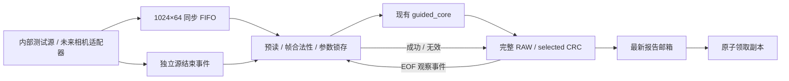

# 同步运行时与完整输出校验

日期：2026-10-27。[融合差异](../../../docs/merge_2026-10-27.md) · [工程入口](../../../README.md) · [规格](../../../docs/spec.md)

本轮在组员已有 `guided_core` 外围增加可独立运行的同步运行时。算法、定点模型、profile 1、旧 QVGA 工程和既有质量报告保持原样；这里的内部源验证不等于真实摄像头、NT35510、全系统时序或 Flash 启动通过。

## 数据与控制链路



核心每边裁 4 像素，VGA 输入 640×480 对应 632×472 输出。CRC 覆盖这 298,304 个有效像素，按行优先每像素一字节，先于任何未来抽取或 ROI 逻辑。两个 CRC 分别对应同坐标原图和选定模式，不包含空拍、标志、坐标或头部。

## 模块与接口

| 文件 | 作用与边界 |
|---|---|
| [video_runtime_pkg.sv](../../../rtl/video_runtime_pkg.sv) | 打包源 token、帧配置、源结束状态与完整报告；运行计数饱和加法 |
| [source_pattern.sv](../../../rtl/source_pattern.sv) | 与软件模型一致的四种内部图案，帧号从 0 起自然回绕，每帧后留实际 L_CORE 空拍 |
| [ingress_fifo.sv](../../../rtl/ingress_fifo.sv) | 默认 1024×64，单时钟、同步 RAM 读，读结果一拍后有效；只复位索引与有效位 |
| [ingress_guard.sv](../../../rtl/ingress_guard.sv) | 两项弹性预读、严格行优先检查、参数 SOF 旁路/锁存、完成确认与恢复 |
| [crc32_byte.sv](../../../rtl/crc32_byte.sv) | 一字节展开 CRC-32/ISO-HDLC，II=1 |
| [core_crc_monitor.sv](../../../rtl/core_crc_monitor.sv) | 完整输出坐标/数量验证、双 CRC、待提交结果、latest 与独立 claimed 副本 |
| [video_runtime.sv](../../../rtl/video_runtime.sv) | 连接入口、现有数值核心与 CRC，暴露状态和输出流；没有物理板级引脚分配 |

源 token 为 64 位：pixel[7:0]、x[17:8]、y[26:18]、SOF27、EOL28、EOF29、frame_id[61:30]、source_error62、保留位63=0。标志须与 valid 同拍，空拍标志必须清零。源结束状态独立传输，不能被塞入可能已满的像素 FIFO。

`source_ready` 仅表示当前可用情况，不是对物理摄像头的反压请求。RAM 之外还有最多两项预读和一项已发出读响应，清空时一并丢弃，不会把旧帧尾接到新帧。高水位记录实际 FIFO RAM 占用，预读上界另按上述有限寄存器计算。FIFO 原语支持满时读写替换；帧 guard 采用更保守的策略，一旦写入观察到 full 即作废当前帧并恢复，不依赖满时替换掩盖溢出。

## 参数、帧边界与异常

WAIT_SOF → RUN → DRAIN，异常或停止等待进入 RECOVER。只接受 (0,0) 且标志合法的首像素；RUN 检查每个坐标、行尾、帧尾和 frame_id。参数在真正向核心接受 SOF 时生效：同沿向数值核心旁路本次合法配置，再保持整帧，避免非阻塞赋值使首像素锁存上一帧参数。

本轮数值配置门禁检查 ε∈{16,64,256,1024}、T≤16、G≤512，以及 RAW/BASE 的 G=0、DENOISE 的 G=256。非法数值请求增加 cfg_error，沿用上一合法配置。source_kind、pattern_id、profile 对应关系与预览布局是调用方描述符责任；物理适配器和本机配置写入器尚未实现，不能据本门禁宣称整个配置前端已完成。

一次只接受一个计算帧。正确输入 EOF 后等待实际 `core_latency_pkg` 的 55/56 拍，并同时确认源 OK 与正确核心输出 EOF/数量。确认可以任意先后到达。正常交接可在旧帧成功沿同时接受下一帧 SOF，防止内部满速源每帧多积压一拍；旧 CRC 提交与下一输入描述符分别保存。

L_CORE 是“输入接受沿到输出 NBA 后可见”的数值延迟；同钟控制器在后续采样沿观察该输出。CRC 报告在成功接受沿后的下一沿发布，采样已经更新的计数器。测试分别检查数值延迟、控制确认沿与报告发布沿，没有把它们混成一个常数。

协议、源错误、输入溢出或算术错误中止当前已接受帧，登记一次 invalid，清流水有效位和 FIFO，丢弃残帧直到新完整 SOF。新帧已排队却等不到上帧状态时，总等待上限为 `max(128,L_CORE+64)`；没有后续帧时为 100 ms。测试以较小 CLK_HZ 缩短等待，保留同一周期公式。成功 EOF 优先于同拍等待超时。STOP 完成当前帧后停止接收后续完整帧，恢复时重新等 SOF。

seen、accepted、completed、invalid、dropped_source、overflow 与 cfg_error 为饱和 32 位计数；物理帧号和报告诊断序号自然回绕。无在途帧且未饱和时验证 `accepted=completed+invalid`、`seen=accepted+dropped_source`。复位开启新会话，计数清零；普通坏帧不会清除最近成功报告。

## CRC 与消费者独立性

CRC 使用反射多项式 0xEDB88320、初值及最终异或 0xFFFFFFFF，标准向量 `123456789` 为 0xCBF43926。SOF 同拍纳入首字节，EOF 同拍先纳入末字节，再锁存最终 CRC。RAW 模式两项 CRC 必须相等。

核心 EOF 仅形成 pending 结果；源 OK 和 guard 成功事件齐备后才发布。坏帧可以输出可见前缀，但不会提交成功报告。latest 只保留最新完整结果；没有消费者时覆盖报告并增加饱和 overwrite_count，计算不等待领取。claimed_report 是独立副本，之后连续发布新报告也不会更改它。

`claim` 与 publication 同沿时领取旧 latest，新结果保持未领取；这种被同时领取的旧结果不计丢失覆盖。`claimed_valid` 是成功领取的一拍脉冲，claimed_report 保持到下一次领取或复位。报告内 accepted/completed/invalid 是提交时快照，不能随运行计数变化。

## 验证证据与复现

正式结果、来源和边界见 [validation.json](validation.json)，实际工具日志归档在本目录 `evidence/`；没有覆盖组员原有 xsim、模型质量或综合证据。独立 CRC 测试见 [crc.md](crc.md)，真实核心恢复见 [recovery.md](recovery.md)。

| 范围 | 实际结果与证据 |
|---|---|
| 完整数值核心运行时 | [24 个 case](evidence/matrix_completion/aggregate.json)，96 个正常帧，其中 32 个 VGA 帧；9,550,944 个 RAW/BASE/selected 三路结果逐点一致，完整 CRC 一致 |
| 矩阵覆盖 | 16×16、17×19、640×480；55/56 拍；四种图案、四种模式，每个 case 完成 4 帧；FIFO 高水位均为 1 |
| 消费者独立性 | [最终小图回归](evidence/final_small/summary.json)共 28 组，含 4 图案×2 延迟×3 领取策略的 24 组真实核心 case；不领取、持续领取、周期领取均保持像素/CRC/完成数一致 |
| 真实核心坏帧恢复 | 4 个尺寸/延迟构建，16 正常帧、12 无效帧，1,304 个正常输出像素逐点及 CRC 通过；[17×19 最终回归](evidence/recovery17/summary.json) |
| 完整 CRC 邮箱 | 113 次发布、9,046 拍；标准向量、首末字节、两种确认顺序、原子领取、无效/复位、饱和与回绕通过 |
| 入口协议/故障 | 55/56 拍各 36 组定向场景；真实 1024 项满溢、896 告警、配置锁存、暂停和恢复通过 |
| 满速 VGA 入口 | [两种延迟各 10 帧](evidence/ingress_vga/simulate.log)，每组 3,072,000 个输入 token；FIFO 峰值 1，9 次同沿交接，无逐帧积压；此项独立验证入口，不能替代数值核心矩阵 |
| 外部逻辑输入包络 | 四个相位，交替覆盖 55/56 拍，每 4 拍一像素；高水位 29≤40，交接 124≤128 拍，不能解释为物理相机吞吐已验证 |
| Python | [新工程 88 项](evidence/python/final_python_after_tool_review_20261027.log)：81 通过、7 项真实 Vivado fixture 明确跳过；旧工程 PC70/脚本16 通过，合计 167 通过、7 跳过，不重复加计定向测试 |
| 旧工程保留 | 旧 Demo 与融合前 b8fcf4a 字节相同，861 项交付哈希通过；模型/profile、组员原数值 RTL 和历史质量证据保留 |
| 旧入口集成 | [最终工具复审](evidence/final_tooling/review_summary.json)：真实复现错误包序编译失败，修复后原小图 A/B 编译/仿真通过；Tcl 前端顺序检查通过，未执行综合 |

原全矩阵在 21 个已完成 case 后经历中断，旧运行器尚无逐项来源字段，也没有留下全局 summary。它们的实际命令、PASS 日志、编译产物及向量归档哈希保留在 [matrix_initial/collection.json](evidence/matrix_initial/collection.json)，没有追补并冒称运行前捕获的源码 SHA。随后只补跑剩余 3 个 VGA case，旧通过项未重跑；补跑清单保留实际来源、向量、包装文件和工具哈希。期间运行器 main 增加检查点导致首轮外层文件不变检查停止，实际 p1 仿真 PASS 仍原样保留并复用，相关经过见[补跑记录](evidence/matrix_completion/summary.json)。运行时 RTL、数值模型和核心 bench 在这段期间未改动。

最终小图与恢复回归使用增强后的运行器，完整来源单独保存。当前版本另在长 case 启动前及每个结果后保存检查点，中断明确写为 interrupted；对应 Python 契约测试通过。大体积可再生 `.hex` 向量与 `.vvp` 编译产物不随源码提交，保留其哈希及生成方法；源文件和实际日志可通过 `python stream_video_enhance/scripts/check_delivery.py` 核对发布字节。

运行命令在仓库根目录执行，输出目录须不存在：

```powershell
python stream_video_enhance/scripts/run_runtime_tests.py --simulator iverilog --iverilog-bin "你的Icarus目录/bin" --output-dir stream_video_enhance/build/regression/runtime_small
python stream_video_enhance/scripts/run_runtime_tests.py --simulator iverilog --iverilog-bin "你的Icarus目录/bin" --suite core --size all --output-dir stream_video_enhance/build/regression/runtime_full
python stream_video_enhance/scripts/run_runtime_tests.py --simulator iverilog --iverilog-bin "你的Icarus目录/bin" --suite core --size 16 --claims 1 2 --output-dir stream_video_enhance/build/regression/runtime_consumers
python stream_video_enhance/scripts/run_runtime_tests.py --simulator iverilog --iverilog-bin "你的Icarus目录/bin" --suite recovery --size 17 --output-dir stream_video_enhance/build/regression/runtime_recovery
```

`runtime_vectors.py` 只调用冻结整数参考模型及 zlib，不运行任何质量搜索。固定矩阵为四种 pattern×四种模式，使用 profile 1 的实际参数；逐像素比较 RAW、BASE、selected、坐标和首尾标志，并比较完整 CRC 与提交字段。运行器同时支持 Vivado；本机没有该工具，本轮新增运行时的行为证据来自 Icarus，不能写成新增 Vivado 时序通过。

物理摄像头 VGA 并发读写、完整 NT35510 显示、快照/UART、按键去抖/配置前端、全系统资源/时序/CDC、真实画质及 Flash 冷启动仍未完成。交接记录的既有局部内部路径通过与 OOC 边界 hold 失败原样保留；没有借新增运行时仿真更改其结论。
